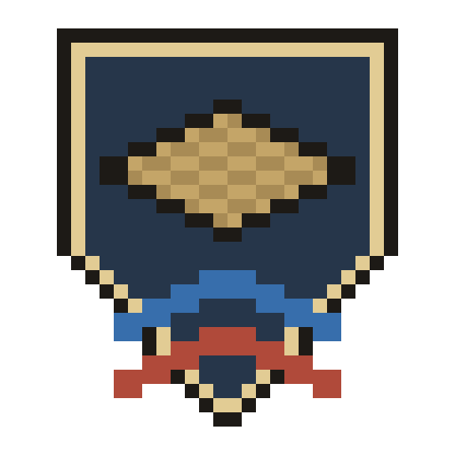
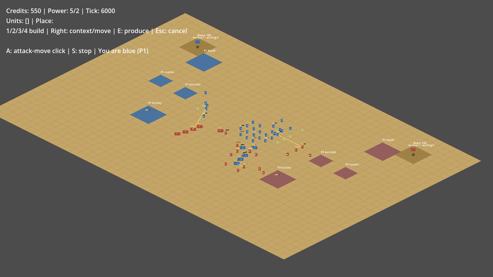

<h1 align="center">Wargrid</h1>

  <b>A free, open-source real-time strategy game in the spirit of Command &amp; Conquer: Generals – Zero Hour.</b> 
  Build a base, secure your supplies and outfight a bot or a friend, in the browser or on the desktop.

  <a href="https://wargrid.pdstuber.dev"><b>Play in the browser</b></a>
  &nbsp;·&nbsp;
  <a href="https://github.com/pdstuber/wargrid/releases">Download for Linux, Windows and macOS</a>

  
  
  

*Bot against bot on the skirmish map after 3:20 of game time (tick 6000). Drawn with the old placeholder shapes; 0.11.0 replaced them with the new geometric look, and a new screenshot follows.*

Wargrid is an isometric RTS written in Godot 4 and typed GDScript. Its design follows Zero Hour (factions, base building, supply economy, combat feel and pacing); the code is Wargrid's own and leaves out the original's known bugs and slow paths. Not affiliated with or endorsed by Electronic Arts, see [License](#license).

## What's in it

- **Three factions:** USA, China and the FRC, each with its own units, buildings and supply collectors.
- **Base building and economy:** builders, power, finite supply piles and production queues.
- **Skirmish against a bot** on three maps: Dry Wells, Broken Crown and Ashfall.
- **Online 1v1** with a match code, no account needed.
- **Sound:** music, combat effects and announcer lines.
- **A geometric 2.5D look** (machines built from a few flat shapes, bright owner colours over muted terrain) is merged on `main` and ships with the next release.

## Play

- **In the browser:** https://wargrid.pdstuber.dev (verified in Safari; Chrome and Firefox untested).
- **Desktop:** Linux, Windows and macOS zips on the [Releases](https://github.com/pdstuber/wargrid/releases) page. Builds are unsigned: on macOS 15 and later open System Settings > Privacy & Security > Open Anyway after the first blocked start (or run `xattr -dr com.apple.quarantine Wargrid.app` once); on Windows, SmartScreen needs More info, Run anyway.
- **Online with a friend:** one player clicks *Create match* and shares the match code; the other enters it and clicks *Join*. The host chooses the map; the other player's game checks it. Both need the same version.
- **From source:** Godot 4.7.2, see [setup and commands](docs/development.md#setup-and-commands).

## Status

Early development; the latest build is on the [Releases](https://github.com/pdstuber/wargrid/releases) page. Playable today: three factions, skirmish against a bot and online 1v1 on Dry Wells, Broken Crown or Ashfall. The long-term target is 3v3 online, friends against bots; scope and milestones are in the [blueprint](docs/blueprint.md).

What is done and what comes next (generated from [packages](docs/packages.md) and [STATUS](docs/STATUS.md)):

<!-- roadmap:begin -->
**10 of 31 parts done**

| | What | State |
| --- | --- | --- |
| ✅ | Move and select units | Done |
| ✅ | Build a base and mine supplies | Done |
| ✅ | Fight with infantry and tanks | Done |
| ✅ | Play online with a friend | Done |
| ✅ | Teams and big maps | Done |
| ✅ | Choose your faction | Done |
| ✅ | Releases and sound | Done |
| ✅ | Tell us what you see | Done |
| ✅ | Laborers that pay | Done |
| ✅ | You clicked, we heard | Done |
| ⏭ | New launcher | Next |
| 📋 | Quick rematch | Planned |
| 📋 | See your selection | Planned |
| 📋 | Build from the dock | Planned |
| 📋 | Units that find their way | Planned |
| 📋 | Three armies | Planned |
| 📋 | Units that make room | Planned |
| 📋 | Supplies you can read | Planned |
| 📋 | Three kinds of base | Planned |
| 📋 | Camera that follows you | Planned |
| 📋 | Smooth motion | Planned |
| 💡 | Order controls | Later |
| 💡 | Smoother big moves | Later |
| 💡 | Minimap and attack alerts | Later |
| 💡 | Crowds that sort themselves | Later |
| 💡 | Fog of war | Later |
| 💡 | Ground batch A | Later |
| 💡 | Tanks, terrain and colours | Later |
| 💡 | Ground batch B | Later |
| 💡 | Bots | Later |
| 💡 | 3v3 online | Later |
<!-- roadmap:end -->

<!-- perf-table:begin -->
Performance against the low-end budget (generated):

**2 of 10 areas over budget**

| Area | Status | Budget used | vs last run | As of |
| --- | --- | --- | --- | --- |
| **Combat, huge battles** | 🔴 Over | ██████████▶ 158% | 🔻 1% better | 2026-11-14 |
| **Background upkeep, huge crowds** | 🔴 Over | ██████████▶ 144% | 🆕 first run | 2026-11-08 |
| Background upkeep, armies on the move | 🟡 Close | █████████░ 98% | 🆕 first run | 2026-11-08 |
| Combat, normal fights | 🟢 OK | ███████░░░ 72% | 🔻 2% better | 2026-11-14 |
| Drawing the screen | 🟢 OK | ███████░░░ 70% | 🔺 9% worse | 2026-11-13 |
| Drawing the screen, big map (Ashfall) | 🟢 OK | ██████░░░░ 67% | 🔻 1% better | 2026-11-13 |
| Combat, normal fights, slowest moments | 🟢 OK | █████░░░░░ 58% | 🔻 1% better | 2026-11-14 |
| Unit movement | 🟢 OK | ████░░░░░░ 40% | 🔻 1% better | 2026-11-14 |
| Unit movement, slowest moments | 🟢 OK | ██░░░░░░░░ 25% | 🔻 2% better | 2026-11-14 |
| Online play overhead | 🟢 OK | █░░░░░░░░░ 11% | 🔺 8% worse | 2026-11-14 |

Percent of the limit for a low-end device, estimated from this Mac (see the ledger for how). 🔺 = used more of the limit than last run. Small changes can be run-to-run noise. As of = when that area was last measured; areas drawn from rendered runs update only at milestone gates.

Details: [performance ledger](docs/reference/performance.md).
<!-- perf-table:end -->

## How it's built

- **Deterministic simulation.** Tick-based and kept apart from rendering and wall-clock time, so builds on different platforms produce identical replay traces (Linux and Windows compared in CI, macOS locally). See the [determinism rules](docs/reference/determinism-rules.md) and the [simulation interface](docs/reference/sim-interface.md).
- **Lockstep online play.** A small Go relay only forwards commands; every client runs the full simulation. The wire protocol is fixed by test vectors and a black-box conformance suite in `protocol/`. See [relay scaling](docs/reference/relay-scaling.md).
- **Tested headless.** More than 700 test cases cover simulation, replays and HUD layout; CI also runs the exported builds and netplay scenarios through a local relay.
- **Performance budgets from a measured target.** Budgets are derived from a Steam Deck running the browser build, and every measurement, passed or exceeded, is recorded in the [performance ledger](docs/reference/performance.md).
- **Checked against the original.** A [parity harness](docs/reference/zero-hour-parity-harness.md) measures the same mechanic in a source build of Zero Hour, so values are compared, not estimated.

Where things live:

- `game/`: the Godot project (simulation, presentation, scenes, tests, map data)
- `relay/`: the Go WebSocket relay
- `protocol/`: wire-protocol test vectors and the black-box conformance suite
- `tools/`: test, benchmark, release and map-conversion scripts
- `web/`: the static web server image for the browser build

Developed with AI coding agents (Claude Code) working from written plans, review gates and recorded evidence: [development notes](docs/development.md), [project rules](AGENTS.md).

## License

Code and the Wargrid logo (`game/art/logo-32.png` and the sizes derived from it): GPL-3.0-or-later, see [LICENSE](LICENSE). The Ashfall, Dry Wells and Broken Crown maps (`game/data/maps/`) are converted from Electronic Arts' GPL-3.0 map sources and keep EA's copyright line and additional terms, see the [map notice](game/data/maps/NOTICE.md). Unit and weapon numbers were researched from EA's GPL source and the retail game's configuration; no EA files, art, audio or text are copied. Wargrid is not affiliated with or endorsed by Electronic Arts; Command & Conquer is a trademark of Electronic Arts Inc. and is named only to describe the inspiration.

Released zips and the web build carry `LICENSE`, the map notice, the audio credits (`game/audio/CREDITS.md`) and Godot's license notices (`GODOT_LICENSES.txt`); the launcher shows the license and the source link, and its Credits button lists the music, voice, map, Godot and Wargrid notices. Wargrid-made audio (generated effects, vocoded announcer lines): GPL-3.0-or-later. Music: CC BY 3.0 / 4.0, credited in [game/audio/CREDITS.md](game/audio/CREDITS.md). Wargrid's own art (the art-direction sheets in `docs/art-direction/` and any later Wargrid-made art): GPL-3.0-or-later.
