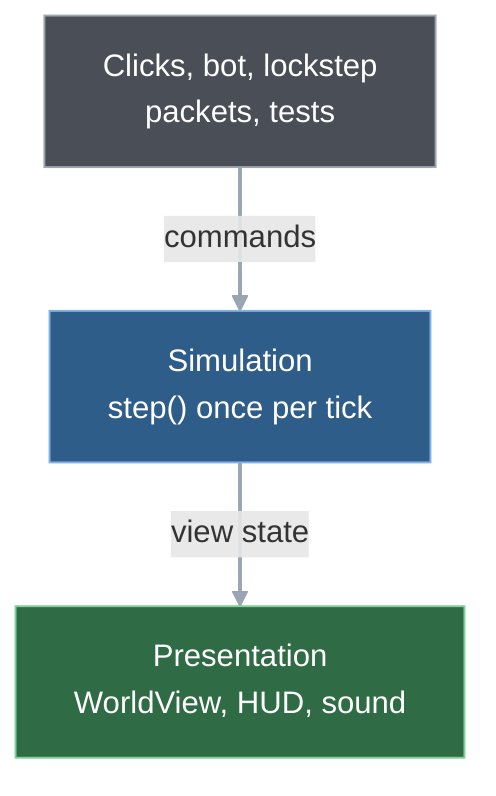
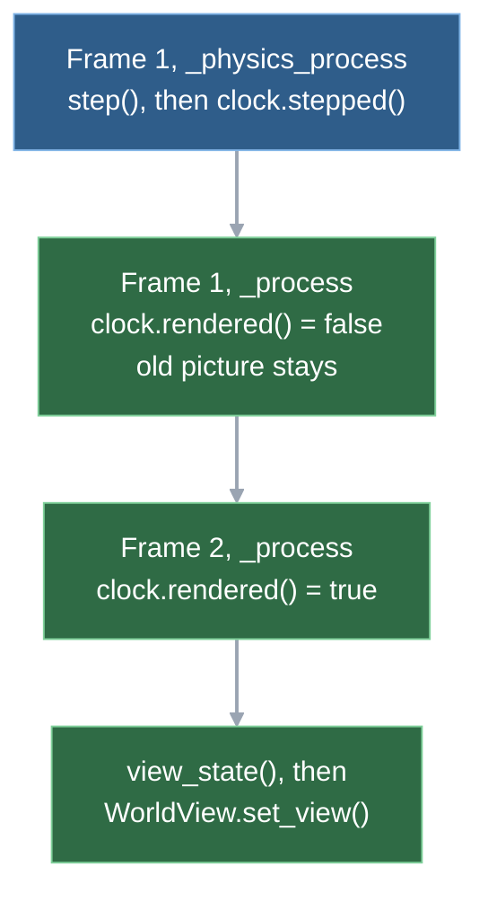
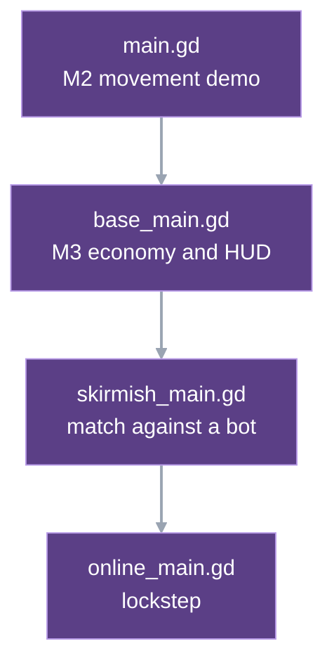

# 1. Big picture and time

Wargrid is two programs in one process. The **simulation** holds every unit, building and credit and advances the whole game in fixed steps of simulated time, 30 per second, with no idea that a screen, a clock or a network exists. The **presentation** draws that state and never decides anything. Thin scene scripts, the **drivers**, sit between the two: they call `step()`, turn clicks into **commands** and pass the new state on. The only things that cross the line are commands going in and state coming out. That one boundary is what lets the same game run headless in tests, replay from a list of commands, and stay identical on every machine in a lockstep match.

## Two halves joined by commands and state

The drivers carry both arrows. The three layers:

1. **Simulation** (`game/scripts/simulation/`). Plain GDScript classes extending `RefCounted`, not `Node`. No scenes, no rendering, no wall-clock time, no network. State lives in dictionaries and arrays inside `Simulation`, and the only clock is its `_tick` counter. The blueprint calls this "authoritative simulation state": sprites show state, they do not own rules ([blueprint §3](../blueprint.md#3-engine-language-tools), "Simulation constraints"). What outside code may call is listed in the [simulation interface](../reference/sim-interface.md).
2. **Presentation** (`game/scripts/presentation/`). Godot nodes that draw, play sound and show the HUD. They hold no reference to the simulation. The driver builds the state with `view_state()` and pushes it in with `WorldView.set_view`. It also asks the view what is under the mouse (`pick_target`, `pick_object`). No presentation script calls `issue_command`. None calls `snapshot()` or `view_state()` either.
3. **Drivers**: the scene scripts (the chain below). They own the `Simulation`, call `step()` on the clock, turn clicks into commands and hand the new state to the presentation. Online they hand commands to the lockstep code in `game/scripts/net/` instead ([chapter 11](11-multiplayer.md)). One call bypasses commands: the movement demo's obstacle key. It calls `replace_blocked_cells`, a terrain edit, from `main._toggle_obstacle`.

The simulation never calls a presentation method. Other callers use `Simulation` with no presentation at all, for example the headless test runner. The runner is `game/tests/run_tests.gd`, a `SceneTree` script. Tests such as `test_replay.gd` call `sim.step()` directly. The benchmarks in `game/benchmarks/` and the headless network client do the same.

The other chapters zoom into one box each; the list is in the [README](README.md).

## One right-click, from mouse to moving unit

Offline skirmish, a unit selected, the player right-clicks open ground. The path through the code:

1. **Input.** The skirmish scene first checks whether the click is a defence order or an attack on an enemy. Neither, so the click passes up to the base scene, which looks for a supply source, another object or a rally point, finds none and passes it up again. The base driver's right-button branch then issues the move, after converting the screen position to a map position (chapter 2).  
   `skirmish_main._unhandled_input (_view.pick_target) → base_main._context_order / _set_rally → main._unhandled_input → main._move(Iso.plane_to_world(...))`
2. **Command.** The driver wraps the target into a move payload, stamps it with the player, a sequence number and the current tick, and hands it to the simulation. It also shows a hint marker and redraws at once, so the click gets feedback before any tick runs. To read the tick and the last sequence it takes a full snapshot; that happens per input event, not per tick.  
   `main._move → main._submit → Simulation.issue_command` (also `_show_hint`, `_refresh`)
3. **Queue.** The simulation validates the command and queues it for its tick. Nothing has moved yet.  
   `Simulation.issue_command → _pending`
4. **Tick.** On the next physics callback the skirmish driver lets the bot issue its commands, then steps the simulation.  
   `main._physics_process → skirmish_main._step_simulation → Skirmish.issue_opponent → Simulation.step`
5. **Inside the step.** The command is due this tick. The simulation gives each unit a destination and queues a path request, answers the request with a route, and starts turning the unit; it begins to roll two ticks later. [Chapter 4](04-the-tick.md) follows these steps function by function. Then the tick counter advances.  
   `Simulation._apply_orders → _service_paths → _assign_route → _advance → Locomotion.step (START_DELAY_TICKS) → _tick += 1`
6. **State out.** The driver notes that the tick advanced and tells the presentation clock. On the next rendered frame it asks the simulation for fresh view state and pushes it to the view and the HUD.  
   `main._physics_process → PresentationClock.stepped … main._process → _present_if_due → _refresh → Simulation.view_state → main._show → WorldView.set_view`
7. **Draw.** The view draws the new state. On this first tick the unit has only turned toward its route; it starts to move two ticks later. On each following rendered frame the view can slide it toward the newest pose (interpolation, below).  
   `WorldView.set_view → WorldView.advance_frame`

Online the same click takes a different middle. The online driver sends the command to lockstep instead of the simulation, which stamps it with a future tick and queues it. It travels to the relay inside a packet and reaches the simulation only when every seat's packet for that tick is in (chapter 11).  
`online_main._submit → Lockstep.submit → finish_tick … Lockstep.advance → Simulation.issue_command`

## Who keeps the time

Wargrid lets Godot keep the time. The project setting `physics/common/physics_ticks_per_second` is 30 (`game/project.godot`). The base driver calls `step()` from `_physics_process`. Godot keeps the leftover time between rendered frames (an accumulator) and runs zero to several fixed physics steps per frame, so offline one physics callback is one **tick** (online it may be none or two; see below). The simulation uses no Godot physics; the setting is only the metronome. A tick is 1/30 s of game time, and its cost budget is in the [performance ledger](../reference/performance.md). The rate of 30 was the blueprint's starting default ([decision log](../blueprint.md#14-decision-log)), and it is also Zero Hour's logic rate, so frame counts in a Zero Hour recording map one-to-one to ticks ([Zero Hour verification](../reference/zero-hour-verification.md)).

`_process` is the other callback: once per **rendered frame**, as fast as the machine allows. It pans the camera and calls `WorldView.advance_frame`. So ticks are steady and rendered frames are not; a frame may carry zero, one or (after a long frame) several ticks. The outcome of a tick depends only on state and commands, never on how many frames were drawn. The rate is baked in twice. First, `locomotion.gd` converts speeds per second into distance per tick with a literal `30.0`. Second, every duration in the rules and data is a tick count: weapon delays, build times, the start delay of a move, the bot's decision interval (`delay_ticks`, `DECISION_TICKS`). Changing the project setting alone would change the speed of the whole game. After the match ends, time stops: `step()` returns at once once the **match** is over, and `_tick` stops counting.

### Why the redraw waits a frame

A rendered frame can carry two expensive things: a tick (`step()`) and a redraw (a fresh `view_state()`, then view and HUD). Both in one frame make that frame long. So the presentation clock (`presentation_clock.gd`) holds the redraw back. `stepped` marks it pending and `rendered` releases it on the next rendered frame. If that frame ran no tick, the two costs landed in different frames (a split). If it ran a tick as well, the machine draws no faster than it ticks and waiting bought nothing, so the clock redraws in the tick's own frame for `RETRY_TICKS` ticks before it tries again. `split_share()` is the share of recent redraws that were split; the F3 overlay prints it. The price is a picture one rendered frame older; the simulation never sees any of this.

### Smooth motion between ticks

A unit jumps a short distance each tick. On the highest graphics quality with the smooth option on, the world view keeps each unit's pose from the previous tick and the current one and draws it a fraction of the way between them (`blend`, `advance_frame`). This is **interpolation**. The fraction comes from wall-clock time since the view received the latest tick and `Engine.physics_ticks_per_second`; the simulation never reads it. On other quality levels units snap to the new tick's position.

### Drivers: one chain, three kinds of game

`main.gd` owns the clock, camera, selection and the simulation, and exposes four hooks:

- `_create_simulation` builds the world.
- `_step_simulation` defines what one tick does.
- `_submit` decides where a command goes.
- `_pauses_sim` says whether the pause menu stops time.

The skirmish driver makes a tick "bot commands, then step". The online driver makes it "poll the network, then ask lockstep whether this tick may run" (`_lockstep.advance`), up to `CATCH_UP_STEPS` per callback. If another seat's packets are late, `advance` says no, the tick does not happen, and rendered frames keep coming. Online play also never pauses time. The launcher (`launcher.gd`) picks the offline or online scene.

## What this design costs

- **State crosses the boundary by copy, every tick.** `view_state()` and `snapshot()` build fresh data on every call, so the presentation can never touch simulation state. That hand-off costs about as much as the simulation: the view state plus sorting and batching for drawing take 0.54 / 0.95 / 1.93 ms mean per tick against a step of 0.70 / 1.07 / 1.98 ms (`skirmish3v3`, team match, `hordes300` stress row; measured, [data layout decision](../reference/data-layout-decision.md), section 2). None of it is in the simulation tick budget ([performance next](../reference/performance-next.md), section 1, point 3). Chapters 5 and 12 follow it up.
- **Godot's physics clock drives the ticks.** Built in and steady, no accumulator code of our own. The price: the rate is a project setting shared with Godot physics, and catch-up is Godot's. Past `max_physics_steps_per_frame` (not set in `game/project.godot`, so Godot's default of 8 applies, see the [Engine class reference](https://docs.godotengine.org/en/stable/classes/class_engine.html#class-engine-property-max-physics-steps-per-frame)) Godot does not skip ticks: the game runs slower than real time. That meets the blueprint's rule that "a long frame must not trigger unbounded catch-up work or silently drop simulation ticks" ([blueprint §11](../blueprint.md#11-performance-multiplayer-and-future-architecture)) offline; online play bounds its own catch-up explicitly.
- **Plain objects, not nodes.** Chosen so the rules are testable without the scene tree ([blueprint §3](../blueprint.md#3-engine-language-tools)); it is also what made the later native-port spike possible. The price: nothing in the simulation can use the scene tree, timers or signals; everything is explicit ticks and explicit calls. Randomness comes from a seeded generator inside the simulation (`next_random`), never from the engine ([determinism rules](../reference/determinism-rules.md)). Tests are held to the public interface by `tools/test_sim_boundary.py`.
- **Work is spread over ticks on purpose.** At most `PATH_REQUESTS_PER_TICK` path requests are answered per tick, so a large move order takes several ticks to get routes; bot decisions run every `DECISION_TICKS`. The blueprint goes further (split rates: movement and firing at the full rate, unit decisions less often, staggered; not built; [blueprint §11](../blueprint.md#11-performance-multiplayer-and-future-architecture), "Performance next").
- **The redraw split is a known shortcut.** The code says it in a comment: when no idle frame comes between two ticks, splitting cannot help at that frame rate, so the clock retries later (`presentation_clock.gd`, `rendered`). In that case the refresh runs in the step's own frame, so that frame is the long one.
- **Interpolation draws one tick behind.** A unit is drawn between its previous and its current tick pose, so the picture trails the simulation by up to one tick on top of the redraw wait. Rules never read the drawn pose. Picking and box selection do, on purpose (`_pick_bounds`, `_drawn_position`): a click hits what is on screen, and the command carries only unit ids. When the view jumps more than one tick between redraws it snaps instead of blending (`_track_poses`). It runs on the highest quality only because of its cost ([data layout decision](../reference/data-layout-decision.md), recommendation 3).

Proposed, not built: running the simulation on a worker thread (a probe passed; no game code does this). Chapter 12 has the status.

## Where in the code

- `game/project.godot` — `physics/common/physics_ticks_per_second` (the tick rate), `run/main_scene` (the launcher).
- `game/scripts/simulation/simulation.gd` — `Simulation`: state fields at the top (`_tick`, `_entities`, `_pending`, `_path_queue`), `issue_command`, `_apply_orders`, `_assign_move`, `_service_paths`, `_assign_route`, `_advance`, `step`, `tick`, `snapshot`, `view_state`.
- `game/scripts/simulation/locomotion.gd` — `step`: how far a unit moves this tick.
- `game/scripts/main.gd` — base driver: `_unhandled_input`, `_move`, `_submit`, `_physics_process` (calls `_step_simulation`), `_process` (`_present_if_due`, camera, `advance_frame`), `_refresh`, `_show`.
- `game/scripts/base_main.gd` — economy HUD and build menu on top of `main.gd`.
- `game/scripts/skirmish_main.gd` — match scene: `_create_simulation` via `Skirmish.create`, `_step_simulation` with `Skirmish.issue_opponent`.
- `game/scripts/online_main.gd` — online scene: `_submit` and `_step_simulation` with `CATCH_UP_STEPS`, `_lockstep.advance`.
- `game/scripts/net/lockstep.gd` — `submit`, `advance`, `finish_tick`.
- `game/scripts/presentation/presentation_clock.gd` — `stepped`, `rendered`, `split_share`, `RETRY_TICKS`.
- `game/scripts/presentation/world_view.gd` — `set_view`, `advance_frame`, `blend`, `_interpolating`.
- `game/scenes/*.tscn` — `launcher.tscn` (main scene, `launcher.gd`); `skirmish.tscn`, `online_skirmish.tscn`, `base.tscn`, `main.tscn` each attach one driver script.
- `game/tests/run_tests.gd` — headless runner that drives the simulation with no presentation.

## Further reading

- [Blueprint §1](../blueprint.md#1-vision-and-intent), [§3](../blueprint.md#3-engine-language-tools) (architecture and simulation constraints), [§6](../blueprint.md#6-core-systems-and-recommended-implementation-order), [§11](../blueprint.md#11-performance-multiplayer-and-future-architecture).
- [Development notes](../development.md#overview): current status, commands, milestone history.
- [Simulation interface](../reference/sim-interface.md): what outside code may call.
- [Determinism rules](../reference/determinism-rules.md): what simulation code must never do.
- [Performance ledger](../reference/performance.md): tick and frame budgets and measurements.
- [Zero Hour verification](../reference/zero-hour-verification.md): where Zero Hour's logic rate was checked.

---
Checked against `2b108ab`. Files: `game/project.godot`, `game/scripts/simulation/simulation.gd`, `game/scripts/simulation/locomotion.gd`, `game/scripts/main.gd`, `game/scripts/base_main.gd`, `game/scripts/skirmish_main.gd`, `game/scripts/online_main.gd`, `game/scripts/presentation/presentation_clock.gd`, `game/scripts/presentation/world_view.gd`, `game/scripts/simulation/skirmish.gd`, `game/scripts/net/lockstep.gd`, `game/scripts/launcher.gd`, `game/tests/run_tests.gd`
