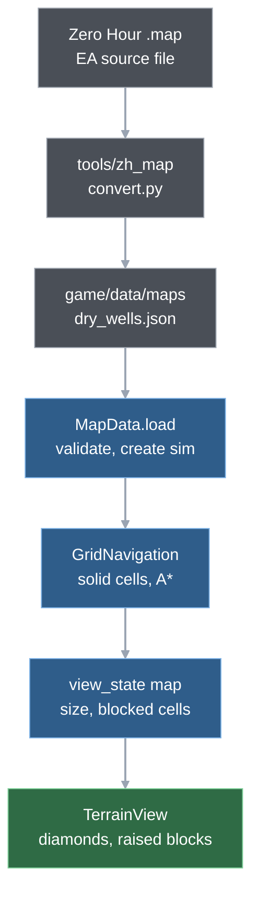
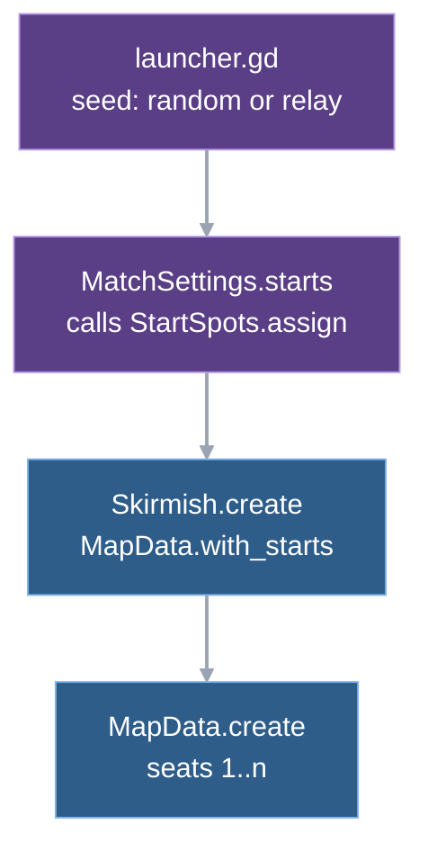

# 2. The world

A Wargrid map is a rectangle of square **cells**. Each cell is open or blocked; ground units, pathfinding, building sites and supply piles all work on that grid, and aircraft fly over it. Drawing turns the same grid into diamonds on screen, and the conversion between the two is two lines of arithmetic. The maps are not hand-drawn: three of the four are converted from Zero Hour map files by a Python tool, and a map is plain data that the simulation loads, validates and never edits.

## From a map file to a diamond on screen



Two stages, split by when they run.

- **Offline, once per map (tool).** `tools/zh_map/convert.py` reads an EA map, folds it onto Wargrid's 25-unit grid, places start spots and supply sources and writes a JSON file under `game/data/maps/`. The JSON is committed; the game never reads an EA file.
- **At match start (game).** `MapData` loads and validates the JSON and builds a `Simulation` from it. A navigation class holds the grid. The view state of each tick includes the map's size and blocked cells, which `TerrainView` draws.

The JSON has six required parts: a name, EA's notice, the size, the rows of cells, the start spots and the supply sources. Converted maps add a `heights` grid that no game code reads (see below). Each start spot has a seat number, a start cell and one building slot per kind of start building.

Four maps ship: `skirmish` (48 × 32, hand-made, 2 starts, the test map), and the converted Dry Wells (81 × 108, 2 starts), Broken Crown (112 × 100, 4) and Ashfall (194 × 187, 8). Sizes and counts are from the JSON files and `game/tests/test_map.gd`.

## Dry Wells, from the source file to the first step of a unit

One map followed through every stage. Re-running the converter on the pinned EA source (revision `3aad8e4`; path in `game/data/maps/NOTICE.md`) reproduces the committed map byte for byte (checked 2026-11-12). The numbers below come from that run and from a one-off headless script at the commit named at the end of this chapter.

**1. The source.** The source map is a compressed chunk file. The converter checks its magic, decompresses it and walks the chunks. The height chunk holds 270 × 340 samples 10 world units apart, a 35-sample border and a playable boundary of 204 × 270 samples that the chunk stores itself (it is not width minus twice the border), so the playable area is 2040 × 2700 units. The tile chunk is version 8, which carries a painted cliff bit per sample. The object chunk holds the start waypoints, supply docks and piles, and the trigger chunk holds 2 water polygons. Format evidence: [M6 map and feel](../reference/m6-map-and-feel.md).

`convert.load → refpack.decode → convert.read_map`

**2. Folding samples into cells.** The converter maps 2.5 × 2.5 samples onto one 25-unit cell, so Dry Wells becomes 81 × 108 cells (2040 / 25 = 81.6, rounded down). Each cell is decided in this order:

- wet (`~`) if the cell centre lies inside a water polygon and the ground there is below the polygon's height;
- else blocked (`#`) if at least half of the cell's area is covered by cliff bits;
- else open (`.`).

The result is 7,202 open, 1,287 cliff and 259 water cells. The converter also stores the mean sample height of each cell, in tenths of a unit, as the `heights` grid.

`convert.resample → convert._wet`

**3. Starts and sources.** Each seat's start waypoint floors to a cell: seat 1 to (40, 23), seat 2 to (40, 84). Around each start the converter scans square rings, 2 to 12 cells out, for a legal site for each of six building slots (power plant, supply center, barracks, factory, command center and defence), keeping a one-cell gap. The supply center slot instead goes to the legal 3 × 3 site closest to the nearest full dock: seat 1's is at (28, 11), 8.3 cells from the dock centre ([more maps](../reference/more-maps.md), "Supply center slot near supplies"). Supplies become 4 docks (4 × 5 cells, 400 boxes) and 12 small piles (1 × 1 cell, 50 boxes, removed when empty). The conversion fails with an error if a start is not open, a slot cannot be placed, no source lies within 20 cells, sources overlap, or one start cannot reach another. Its report for Dry Wells gives 1525.0 units (61 cells) for the route between the starts, against 1524.1 on the source's own 10-unit grid.

`convert.place → convert._supply_site → convert.route_matrix`

The map file's cell rows hold only open, cliff and water characters. Below is seat 1's base: those rows (open and cliff only here) with the start and source entries drawn over them. Columns 18 to 61 are shown; rows 9, 10 and 14 to 18 are left out (open, apart from one or two cliff cells at the left edge of rows 9 and 10). The legend marks are overlay, not file content.

```
    18        28        38        48        58
  0 ######...................................###
  1 #####.....................................##
  2 ####.......................................#
  3 ###..$$$$...................................
  4 ###..$$$$...................................
  5 ###..$$$$...................................
  6 ##...$$$$...................................
  7 ##...$$$$...................................
  8 #...........................................
 11 ##........SSS...............................
 12 #.........SSS...............................
 13 ..........SSS...............................
 19 ..................CCC.......................
 20 ..................CCC.......................
 21 ..................CCC.D.PP..................
 22 ........................PP..................
 23 ......................@.....................
 24 ........................BB..................
 25 ....................FFF.BB..................
 26 ....................FFF.....................
 27 ....................FFF.....................

.  open     #  cliff     $  dock     @  start cell
S  supply center   C  command center   P  power plant
B  barracks   F  factory   D  defence
```

**4. Load.** The loader reads the file and rejects it, returning an empty dictionary and logging an error, unless all of these hold: the required parts exist; the cell rows match the size exactly; every start cell is open; each start carries a slot for every kind of start building, with its footprint open and inside the map; every source's footprint is open. JSON numbers arrive as floats, so cell reads convert them to integers.

`MapData.load → MapData.parse → MapData._valid`

**5. Create.** Every character other than `.` is a blocked cell, so water and cliff are the same to the simulation: 1,546 cells for Dry Wells. The navigation class turns them into solid points of a Godot A* grid (4-neighbour moves, no diagonals) and labels the connected open regions. The loader then adds the players, sets up each seat (start unit and start building) and adds each supply source. With the standard skirmish setup (USA against USA) the builder of seat 1 appears at (40.5, 23.5), the centre of cell (40, 23), and the start command center at slot (36, 19).

`Skirmish.create → MapData.create → Simulation.setup_seat → Simulation.add_supply_source`

The navigation grid is not only terrain. The simulation adds the footprint of every building and every source to the terrain cells. After setup the grid has 1,656 solid cells: 1,546 terrain, 2 × 9 for the two command centers, 4 × 20 for the docks and 12 for the piles (same script). Placing or removing a building changes the grid again.

`Simulation._union_cells → Simulation._replace_union`

**6. A move order.** A move order to (40.5, 35.5) makes the navigation class return a 12-point route: the centres of cells (40, 24) to (40, 35), one waypoint per cell (same script). The tick pipeline that gets the unit moving is [chapter 4](04-the-tick.md); how routes are followed is [chapter 6](06-movement.md).

`Simulation._assign_route → GridNavigation.route`

**7. Onto the screen.** The projection maps a map position to a screen position at zoom 1:

```gdscript
Vector2(32 * (point.x - point.y), 16 * (point.x + point.y))
```

Cell (40, 23) has its four corners at (544, 1008), (576, 1024), (544, 1040) and (512, 1024): a diamond 64 pixels wide and 32 tall, the standard 2:1 isometric tile. The builder at (40.5, 23.5) is drawn at (544, 1024), the diamond's centre. The whole 81 × 108 map is a diamond whose corners land at (0, 0), (2592, 1296), (-3456, 1728) and (-864, 3024), so it spans 6,048 pixels across at zoom 1. The camera takes the same corners as its bounds and starts on the local seat's start cell.

`Iso.world_to_plane`, `main._reset_camera → MapData.start_cell`

The way back is the algebraic inverse. The right-click in step 6 uses it, and so do the picking functions of the world view. A test covers the projection (`game/tests/test_isometric.gd`).

`orders._selection_input → Iso.plane_to_world`, `WorldView.pick_target → Iso.plane_to_world`

## How cells become tiles

`TerrainView` is a child node of `WorldView`, added first, so it sits under the structure and unit layers. It draws two things.

- **Ground.** One flat diamond per cell, each a few percent lighter or darker than the base colour by a hash of its position, pushed to the GPU as one triangle array. The array is cached by map size and ground colour; a palette change rebuilds it, nothing else does. A code comment sizes it at 70 thousand triangles; the arithmetic for Ashfall is 194 × 187 cells × 2 triangles = 72,556, for Dry Wells 17,496. Trail: `TerrainView._draw_ground → TerrainView._build_ground → RenderingServer.canvas_item_add_triangle_array`
- **Blocked cells.** They are sorted by x + y (back to front) and each is drawn as three quads lifted 8 px: left face, right face, top. They come from the view state's blocked cells, which are the navigation snapshot, so building and source footprints get raised blocks too, under the structure layer's drawing. Water cells look like cliffs: no GDScript reads the water character. The test "V9 a new building footprint redraws the terrain" (`game/tests/test_view.gd`) pins the redraw on placement. Trail: `TerrainView._draw_blocked`

The terrain redraws only when the map dictionary changes identity. The navigation snapshot is cached and replaced only when blocked cells change, so ten ticks on one map cost no terrain redraw (test V9, "ten ticks on one map keep the cached terrain"). The ledger measured the effect: on Dry Wells the frame interval was 8 to 9 ms p50 before the terrain moved to a cached node and 0.6 ms after (row "2026-11-07 Dry Wells as play map", with `draw.terrain` about 4 ms per redraw). On the much larger Ashfall the frame interval is 0.84 ms p50 and 2.89 to 3.02 ms p95 against the 3.04 ms budget (measured, row "2026-11-08 perf spike R2", [performance ledger](../reference/performance.md)).

`TerrainView.set_map`, `GridNavigation.snapshot`

## Start spots: which seat stands where

A map with 8 starts does not mean 8 players. A match started from the launcher has seats 1 and 2, offline or online (the 3v3 team match used by tests and benchmarks is built by `debug/team_match.gd`, not by the launcher). Which of the map's start spots they get is decided before the simulation exists.



The launcher calls `MatchSettings.starts(id, seed)`. Offline the seed is `randi()`; online it is the match seed the relay announces in `start`, so every peer computes the same answer.

`StartSpots.assign` follows Zero Hour's rule ([converted maps plan](../superpowers/plans/2026-11-08-converted-maps-playable.md), header, with the EA source lines). Slots are placed in order:

1. Slots with a chosen spot take it first.
2. If nobody chose a spot, the first slot gets a random start (`RandomNumberGenerator` seeded with the match seed).
3. Every later slot whose team already has a computed position gets the free start closest to it.
4. Any other slot gets the free start with the largest summed distance to all taken starts.

Distances are straight lines between start cells; ties go to the lowest index. The launcher passes teams `[1, 2]` and no chosen spots, so today only rules 2 and 4 run: on Dry Wells the seed decides which seat starts in the north.

`launcher._offline_setup → MatchSettings.starts → StartSpots.assign → Skirmish.create → MapData.with_starts` (online, `launcher._start` makes the same calls with the relay's seed)

`MapData.with_starts` copies the chosen starts and renumbers them 1..n, which is why the rest of the code can say "seat 1's slot" without knowing which map start it is. The skirmish test map is exempt: `MatchSettings.starts` returns an empty list for it, so seat N stays on start N and the pinned traces hold.

## Why a grid, and what the conversion costs

**Map plane first, projection last.** The blueprint's "crucial implementation decision" is that simulation coordinates are never isometric pixels: a flat grid for positions, distances and pathfinding, projection only when drawing, and the mouse conversion is its inverse ([blueprint §2](../blueprint.md#2-visual-direction-geometric-25d)). That is why `Iso` has two functions, why the simulation has no notion of height, and why tests and replays need no renderer. The price is that a drawn object can be lifted above its ground point. Units are picked by their drawn bounds (an aircraft's box sits 30 px above its ground point) and buildings by their ground footprint only, so a click on a tall building's roof above its footprint misses it. `pick_target` skips aircraft altogether.

**25 units per cell is inferred.** Zero Hour paths on a 10-unit grid. Comparing Wargrid's rifle and tank ranges (4 and 6 cells) with Zero Hour's implies 25 units per cell, "inferred from the range ratio, not documented anywhere else" ([Zero Hour verification](../reference/zero-hour-verification.md), "Level 0 result"). Every speed and range derived from Zero Hour data inherits that scale.

**Elevation only decides passability, today.** Heights are folded into the cliff bit and then dropped. The converter writes a heights grid, but no GDScript reads it (a search over the scripts, tests and benchmarks folders finds none; `docs/questions/next-m75-art-world.md` says the same). The M6 decision that elevation affects passability only ([blueprint M6](../blueprint.md#m6--teams-and-a-full-scale-map)) is superseded for direct fire: line of sight over terrain is planned for ground batch A ([blueprint §7](../blueprint.md#7-milestones-and-exit-criteria), "Ground batch A"). It is not designed and not built. A raised-terrain look is an open art question, also not built.

**The resampling is lossy in known ways.** Zero Hour's one-cell cliff dilation is not copied ([M6 design](../superpowers/specs/2026-11-05-m6-teams-full-map-design.md), "Resampling"). A ramp narrower than a cell can vanish, so the converter refuses to write a map where one start cannot reach another and prints the narrowest corridor between neighbouring starts. Dry Wells' corridor clearance is 10, Broken Crown's 13 to 15 ([more maps](../reference/more-maps.md), "Converter report"). Two things the converter does not do:

- **It measures routes the game cannot walk.** The converter's route check is an 8-neighbour Dijkstra (diagonal steps cost 1.414, corner cutting forbidden), while the game's grid sets `DIAGONAL_MODE_NEVER`. The ratios in the converter report therefore compare 8-connected lengths; a diagonal route is longer in game. On Dry Wells the lane between the starts is straight, so it makes no difference there (the route above is 61 cells, 61 steps).
- **Water is tested at the cell centre.** The M6 design says a cell is blocked when "at least half of its area is cliff or water"; the code applies the half-area rule to cliff bits only and samples water at the centre point. The M6 design describes water by area; the code samples the cell centre.

**What is not on the map.** Trees, rock clusters, bridges, roads, tech buildings and ambient sound objects of the source are dropped ([M6 map and feel](../reference/m6-map-and-feel.md), "Terrain passability"); one tech building type is skipped because Wargrid has no tech buildings. The same note records a fidelity gap: whether rock clusters and civilian buildings block routes in Zero Hour was not checked. So the converted maps may be more open than the originals where rocks or buildings blocked a route, and less connected wherever a dropped bridge carried one (speculation: neither was measured).

**Grid limits.** The navigation class asserts a grid no larger than 256 × 256; the largest map is 194 × 187. GDScript runs asserts only in debug builds and the editor ([Godot reference](https://docs.godotengine.org/en/stable/classes/class_%40gdscript.html#class-gdscript-method-assert)), and releases are built with `--export-release` (`tools/export_build.sh`), so a released build does not enforce the limit; the headless test runs, which use the engine binary directly, do. There is a 196 × 196 synthetic layout (`large_196`) in the ledger's benchmark rows, so the size at which the grid itself becomes the problem was not found (speculation: the connected-region labelling and the A* grid's memory grow with area; no row isolates them).

**The loader trusts more than it checks.** It checks shape, open start cells, open slots and open sources. It does not check that seat numbers are unique, that starts can reach each other or that the heights grid matches the cells; the converter guarantees those, a hand-edited file would not be caught. Online, the host's map is identified by id and the SHA-256 of its file text with carriage returns removed (`MatchSettings.map_hash`); a joiner whose copy differs refuses the match. Chapter 11 follows the exchange. Builds that changed a map file cannot play each other online (noted in [more maps](../reference/more-maps.md), "Small piles").

**Start-spot caveats, from the notes.** A spot chosen by a player is not recorded as its team's position, as in Zero Hour, so a teammate is placed far away; whether to keep that is open for M9 ([more maps](../reference/more-maps.md), "Converted maps playable"). The draw uses Godot's `RandomNumberGenerator` (PCG32) and is exempt from the simulation's randomness rule because it runs at setup ([determinism rules](../reference/determinism-rules.md)). The test pin `SS6` (Ashfall, seeds 0 to 15) was derived on macOS and holds on Linux and Windows: the test runs in the CI suite on both, green on the main branch (`b5cc483`, 2026-11-12).

## Where in the code

- `game/scripts/simulation/map_data.gd` — `load`, `parse`, `_valid` (shape and open-cell checks), `_cell` (float pair to integer cell), `create` (builds the `Simulation` from a map), `blocked_cells`, `slot`, `start_cell`, `with_starts`.
- `game/scripts/simulation/start_spots.gd` — `assign`, `_farthest`, `_closest`.
- `game/scripts/match_settings.gd` — `PLAY_MAPS`, `starts`, `map_hash`, `refusal`; `TEST_MAP`.
- `game/scripts/simulation/skirmish.gd` — `create` (`map_path`, `starts`), `MAP_PATH` (`skirmish.json`, the test default).
- `game/scripts/simulation/grid_navigation.gd` — `AStarGrid2D` wrapper: `_init` (size assert, `DIAGONAL_MODE_NEVER`), `route`, `is_walkable`, `component_at`, `snapshot`, `replace_blocked_cells`.
- `game/scripts/simulation/simulation.gd` — `_union_cells` (terrain plus buildings plus sources), `_replace_union` (also called from `construction.gd`), `_assign_route`, `setup_seat`, `add_supply_source`, `view_state` (`map`).
- `game/scripts/simulation/definitions/definitions.gd` — `SOURCE_FOOTPRINT` (4 × 5), `source_footprint`, the `slot` key on building kinds.
- `game/scripts/presentation/isometric.gd` — `world_to_plane`, `plane_to_world`.
- `game/scripts/presentation/terrain_view.gd` — `set_map`, `_draw_ground`, `_build_ground` (cached in `_ground`), `_draw_blocked`, `CLIFF_HEIGHT`.
- `game/scripts/match/match_screen.gd` — `_reset_camera` (bounds from projected corners, start on the local seat). `game/scripts/match/orders.gd` — `handle`, `_selection_input`.
- `game/scripts/presentation/world_view.gd` — `pick_target`, `pick_source`, `pick_object` (`_pick_bounds` for units), the `TerrainView` child set up in `_init`.
- `game/scripts/launcher.gd` — `_offline_setup`, `_start` (compute the start spots).
- `tools/zh_map/convert.py` — `load`, `read_map`, `resample` (with `_wet`), `place` (with `_supply_site`), `route_matrix`, `route_widths`, `convert`, `write_json`; `refpack.py` decoder; `test_zh_map.py`.
- `game/data/maps/*.json`, `game/data/maps/NOTICE.md` — map data and EA's notice; the JSON `notice` field points to it.
- Tests: `game/tests/test_map.gd`, `test_start_spots.gd`, `test_isometric.gd`, `test_navigation.gd`, `test_view.gd` (V9, W2).

## Further reading

- [More maps](../reference/more-maps.md) — Dry Wells and Broken Crown, small piles, supply center slot, converted maps playable, the bot sweep on all maps.
- [M6 map and feel](../reference/m6-map-and-feel.md) — EA map format and passability evidence.
- [Converted maps verification](../reference/converted-maps-verification.md) — check rows and the `SS6` derivation.
- [Small supply piles design](../superpowers/specs/2026-11-08-small-supply-piles-design.md) — per-source footprint, `delete_when_empty`, the Zero Hour evidence table.
- [M6 design](../superpowers/specs/2026-11-05-m6-teams-full-map-design.md) — resampling and data-file decisions.
- [Blueprint §2](../blueprint.md#2-visual-direction-geometric-25d) — the map-plane rule; [Zero Hour verification](../reference/zero-hour-verification.md) — the 25-unit scale.
- Next: [3. Entities](03-entities.md) puts units and buildings on this grid; [6. Movement](06-movement.md) walks routes over it.

---
Checked against `60b6674`. Files: `game/scripts/simulation/map_data.gd`, `game/scripts/simulation/start_spots.gd`, `game/scripts/simulation/grid_navigation.gd`, `game/scripts/simulation/simulation.gd`, `game/scripts/simulation/skirmish.gd`, `game/scripts/simulation/definitions/definitions.gd`, `game/scripts/presentation/isometric.gd`, `game/scripts/presentation/terrain_view.gd`, `game/scripts/presentation/world_view.gd`, `game/scripts/match_settings.gd`, `game/scripts/launcher.gd`, `game/scripts/match/match_screen.gd`, `game/scripts/match/orders.gd`, `tools/zh_map/convert.py`, `tools/zh_map/refpack.py`, `game/data/maps/NOTICE.md`, `game/data/maps/dry_wells.json`
