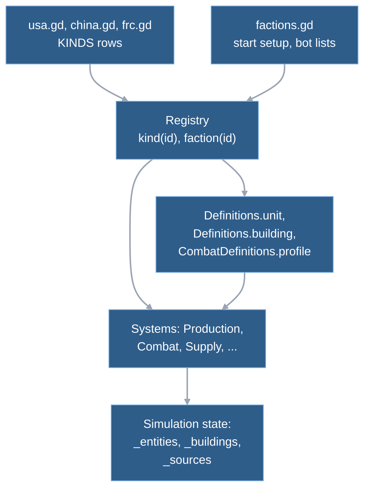
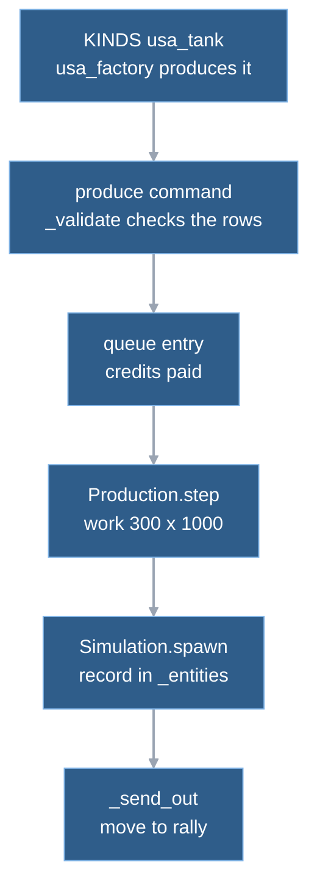

# 3. Entities and definitions

Every unit and building in a match is a plain dictionary inside the simulation. Everything that makes a tank a tank (cost, build time, speed, hit points, weapon) sits in a separate, read-only table of **definitions**. The three factions are three sets of rows in that table plus a small faction table. The simulation code has no "if faction is X" branch: it asks a row what it can do and acts on the answer. So a new unit that uses existing abilities is a data row, not a code change. This chapter has two halves: what is stored per entity at run time, and what is looked up from definitions.

## Rows in one registry, state in three dictionaries

Definitions are constants, loaded once and never changed while a match runs. The only writer is a test-only helper. The systems of [chapter 4](04-the-tick.md) change the state every tick.

Run-time storage lives inside `Simulation`:

- Units are in one dictionary of id to record. The name predates buildings; it holds units only. Trail: `Simulation._entities`.
- Buildings are in a second dictionary of the same shape with a different record layout. Trail: `Simulation._buildings`.
- Supply sources and players have their own dictionaries; a player record holds credits, controller, team and faction. Trail: `Simulation._sources`, `Simulation._players`.
- Units, buildings and sources draw ids from one counter, so an id names exactly one object. Ids are never reused and only grow, so id order is creation order (ordering rules: [determinism rules](../reference/determinism-rules.md)). Trail: `Simulation._next_entity_id`. Production queue entries have their own counter.

A kind is a unit if its row has a `class` key (vehicle, infantry or air) and a building otherwise. That one test splits the table in `Registry.units` and `Registry.buildings`, and it is how the bot tells a building from a unit.

## One tank, from its definition row to a unit on the map

A USA player has a completed Vehicle Factory and 900 credits, and orders a Battle Tank.

**1. The definition.** The USA file holds one dictionary for the tank, on a single line: name, class vehicle, cost 900, 300 build ticks (ten seconds at 30 ticks per second), the treads locomotor with its speed and turn limits, hit points, an armor class, a weapon name, a body radius and a vision range. Armor and weapon are names, not values. The damage, range, reload and armor percentages live in a table shared by all factions. The factory row lists what it may build and which finished building must exist first.

`definitions/usa.gd KINDS["usa_tank"] → definitions/shared.gd WEAPONS["cannon"]`

**2. The lookup.** Code asks the registry for a row by kind id: test kinds first, then USA, China and FRC; an unknown id gives an empty dictionary. Most callers read the row through three small cached views instead of the raw row.

`Registry.kind → Definitions.unit / Definitions.building / CombatDefinitions.profile`

- The unit view has cost, build ticks, the movement keys, whether the kind flies, and which building produces it.
- The building view has cost, build ticks, power, footprint, prerequisite and the first entry of the produces list.
- The combat profile has hit points, armor and weapon name; a second call turns the weapon name into the weapon table.

**3. The command.** The player's produce command names the building and the unit kind. The validation checks it against definitions: the building is owned and finished, the unit kind exists, the building's row lists it, a finished building of the prerequisite kind exists, the queue holds fewer than nine entries, and credits cover the cost. The same checks run again when the command comes due at its tick (chapter 4).

`Simulation.issue_command → Simulation._validate`

**4. The queue.** The cost is subtracted at once and an entry with its own id, the kind, the paid cost and zero work goes to the end of the building's queue. Cancelling pays the cost back.

`Production.enqueue`

**5. The work.** Each tick the head entry gains the owner's work rate. The entry needs `ticks * 1000` work, and full power adds 1000 per tick, so the tank takes 300 ticks. The rate is 1000 while power supply covers demand, and otherwise the supply-to-demand ratio clamped to between 500 and 800. Power comes from the finished buildings of the owner. The factory draws 1 point, so a USA player whose power plants are gone builds at exactly half speed (ratio 0, clamped up to 500). Any shortage costs at least a fifth, because the rate drops from 1000 to at most 800 as soon as demand exceeds supply. FRC buildings all draw 0, so the FRC always works at 1000.

`Production.step → Definitions.work_rate`

**6. The unit appears.** At full work the game walks the cells around the factory and spawns the unit on the first free walkable one. If no exit cell is free, the entry stays at full work and the spawn is tried again every tick.

`Production.spawn_unit → Simulation.spawn`

The spawn builds this record:

| field | value at birth |
|---|---|
| `id`, `owner`, `kind` | next id, the player, `"usa_tank"` |
| `position`, `heading` | `[x, y]` float pair, `[1.0, 0.0]` |
| `hp`, `max_hp` | both from the profile's `max_hp` |
| `status`, `order`, `destination`, `route` | `"idle"`, `null`, `null`, `[]` |
| `speed`, `move_after` | `0.0`, `0` (see `START_DELAY_TICKS` in chapter 4) |
| `combat` | `mode: "guard"`, no target, `next_fire_tick: 0`; `null` for an unarmed kind |
| `construction_id`, `collection` | `null`; `collection` is a record only if the row has `collects` |

Optional keys are added later, and their presence is state: `container_id` while the unit sits in a transport, `hole_id` on a rebuild-hole worker. The tank has no horde rule, no weapon tiers and no ramping weapon, so those parts are left out of its record.

**7. Out of the door.** The new unit gets a move to the building's rally point, through the same move assignment a player's move order uses. The tank is now `path_pending`, and chapter 4's move trace applies from step 8 on. A collector made by a depot skips the rally point and starts hauling on its own (chapter 7).

`Production._send_out → Simulation._assign_move`

## Factions are rows plus capabilities

The same flow with a different faction is the same code with different rows. The table shows how far the data goes (values from the three files). FRC is the Free Resistance Coalition, Wargrid's own name for the faction based on Zero Hour's GLA ([blueprint §7, M7](../blueprint.md#7-milestones-and-exit-criteria)).

| | USA | China | FRC |
|---|---|---|---|
| start | `usa_command_center`, `usa_builder` | `china_command_center`, `china_builder` | `frc_command_center`, `frc_builder` |
| power plant | `power: 5` | `power: 10` | none; its buildings have `power: 0` |
| supply hauler | `usa_collector`, class `air` | `china_collector`, a truck | `frc_builder` has `collects` itself |
| infantry | `usa_rifle_infantry` | `china_rifle_infantry` with `quantity: 2` and `horde` | `frc_rifle_infantry` with `salvage: "money"` |
| vehicle extras | `usa_light_vehicle` has `contains` (passengers fire) | `china_light_vehicle` has `horde`; `china_tank`'s weapon has `ramp` | `weapon_tiers`, `salvage: "weapon"`, `contains` on the pickup (passengers do not fire) |
| defence | `usa_defence`, `powered: true` | `china_defence`, `powered: true` | `frc_defence` is a shared tunnel (`contains` with `shared`); buildings have `rebuild_hole` |

Each difference is a key the code already reads:

- **No power plant for the FRC.** Its builder's `builds` list has none, and the placement check rejects any kind the builder does not list. Its buildings draw no power.
- **A truck, a helicopter or a worker hauls supply.** Supply code asks only whether the kind has `collects`. A kind with class `air` is also registered as flying: spawning skips the walkability checks for it, and production spawns it at the building centre.
- **Two militia per order.** Production reads `quantity` and spawns that many, or none if too few exits are free.
- **Horde, salvage, weapon tiers, containers, rebuild holes.** Each is a key that one system reads (table in the appendix).

The faction table (`factions.gd`) holds only what is not a property of one kind. That is the display name, the start building and unit, the bot's build order and unit choice per producer, and its collectors per depot. Choosing a faction stores it on the player, spawns the start unit and puts the start building on the map's start slot for that building's `slot` key. Trail: `Simulation.setup_seat`. The launcher lists factions by iterating the table. Inside `simulation/`, only the definition files and the faction table name a faction or its kinds, apart from one default kind in the registry. Outside it, the `rg` hits for faction names are the debug workloads, the team-match and lab-fight scripts and the economy demo scene, which pick factions or kinds for their setups. The last hit is the shape table in `presentation/shapes.gd` (below).

Two properties follow that surprise a first reader.

- **A kind carries no faction field.** The `usa_` prefix is a naming convention. What keeps a USA player from building a Medium Tank is the data: no USA builder has it in `builds`, and no USA building has it in `produces`. `Simulation.spawn` itself accepts any kind for any owner, which tests and workloads use (`debug/combat_workload.gd` puts USA and China units in one match). That is true for the rules. The presentation does read the name: `Shapes.role` picks a shape from the id's suffix (builder, collector, rocket infantry, the building names), from the faction prefix for defences and from an explicit table for tanks. It falls back to a default shape by class. A new weapon also needs a row in `sound_cues.gd` ([chapter 5](05-presentation.md)). So a new row plays correctly at once and looks generic until those tables know it.
- **A new capability still needs code.** A new unit that uses existing keys is one row (the design promise: [blueprint §14](../blueprint.md#14-decision-log), "Faction model"). A new behaviour, such as the point-defence laser or deploy-to-fire that ground batch A lists, needs a new key and a system that reads it. That work is in proposed gates, not approved and not built ([blueprint §7](../blueprint.md#7-milestones-and-exit-criteria)). One hidden coupling shows the limit today: production switches supply collection on for whatever air kind it spawns, so the code assumes every air kind is a supply hauler. A produced aircraft without `collects` would fail there (read from the code, not run). Trail: `Production.spawn_air`. The working side is in `tests/test_factions.gd`. Its `test_capability_rules` adds one test kind that builds and another that collects supply, and checks that the simulation honours them with no code change.

## What outside code may call

Everything described above is private to `game/scripts/simulation/`. The rest of the game and the tests use the interface in [sim-interface.md](../reference/sim-interface.md). Its sections follow a match in order: set up, send commands, advance, read state.

- **Set up** before tick 0: two creators build a world (`MapData.create`, `Skirmish.create`). Players, units and supply sources are added next, and `start_match` begins the game.
- **Commands in:** `issue_command`. After setup it is the only way to change the game.
- **Advance:** `step` runs one tick; `tick` and `match_over` read the clock and the result.
- **State out:** a full copy from `snapshot()` (entities sorted, for hashing, tests and UI that needs everything) and a lighter one from `view_state()`, which drawing, HUD and sound read each tick. The units in `view_state()` are columnar `ViewRows`, one packed array per field, built from the unit dictionaries on each call.
- **Events and queries:** `combat_events` and `command_results` hold the last tick's events; `preview_build` checks a placement, and `team_of` and `map_data` answer the other read-only questions.

Anything with a leading underscore is not interface. Two things are open to everyone by design: the definitions, which are static data (the presentation reads them directly, for example in `world_view.gd`), and the records inside a snapshot, which are copies.

How the boundary is held:

- Presentation gets copies, so it cannot write simulation state ([chapter 1](01-big-picture.md)).
- `tools/test_sim_boundary.py` fails any test file outside its allowlist that reads a private member of the simulation. It covers `game/tests` only, not other callers. The allowlist has 30 files, so most existing tests still reach into the unit and building dictionaries. The rule is to migrate them only when touched ([simulation interface](../reference/sim-interface.md#rule-for-tests-user-2026-11-09)).
- Known leaks outside tests, listed in the interface note: the two debug workloads and the headless network client read or write privates.

## Trade-offs and limits

**One dictionary per entity is easy to extend and slow to copy.** Every field is a string key, so a record can gain a field without a schema change, and presence can mean state (a unit in a transport, a rebuild-hole worker, a building's combat record). The costs: `snapshot()` copies every record (only the route is shared, read-only), and `view_state` converts the dictionaries to columns on every call. That hand-off was measured (chapter 1 gives the numbers). Packed arrays for the per-unit state are **proposed, not built**. The [data layout decision](../reference/data-layout-decision.md) (status "proposed, not approved") recommends moving system by system, only inside the milestone that rewrites that system, with movement first. The only column storage in the code today is the output side, `ViewRows`. The decision note counts 20 test files that read the unit dictionary (measured, `rg -l`), and the boundary test keeps that number from growing.

**Three read paths for one row.** The registry gives the raw row, and the economy and combat definitions give cached subsets. A comment in `definitions.gd` says the subsets "keep today's economy and combat dictionary shapes". They are a leftover from before the M7 split into one file per faction, kept so callers did not change. The cost is a second lookup layer. A key that a system needs from the raw row but that the subset lists do not carry is silently absent from the subset, and the building view exposes only the first entry of its produces list.

**No load-time check of the table.** `Registry.kind` takes the first match (test kinds, USA, China, FRC), and an unknown id returns an empty row. So a mistyped kind in a produces or builds list is an empty row at run time. An id defined in two faction files is silently shadowed by the first, and `Registry.units` lists it twice. No test or loader checks the table for consistency. The tests iterate all units and buildings for single properties, for example the cached radius against its formula in `test_combat.gd`. An unknown kind mostly fails quietly. `Simulation.spawn` returns -1, the produce validation answers "Producer cannot build that unit", the placement check answers "Invalid builder or building kind", and a typo in a building's spawn-on-complete list just spawns nothing.

**Number types are chosen for the digest.** In definitions, durations are tick counts (build, delay and load ticks), and hit points and damage are integers in thousandths. The tank's `max_hp` is 480000, and the HUD prints it divided by 1000 (`skirmish_main._selected_summary`). Speeds stay floats, in cells per second, and `Locomotion.step` converts them per tick. In state, a position is a pair of floats rather than a `Vector2`, because the [determinism rules](../reference/determinism-rules.md) ("Snapshot values") keep `Vector2` out of anything the digest hashes.

**The capability keys are an unwritten schema.** No file lists which keys exist, what they mean, or which are required. The design left "the exact capability field shapes" open ([M7 factions design](../superpowers/specs/2026-11-06-m7-factions-design.md)), and use set the shapes. The appendix below is the first list. The same design says each kind "has its faction"; in the code it does not (see above). Zero Hour handles it like Wargrid: faction by data and module composition, with logic branching on side only for AI build lists and similar ([M7 faction evidence](../reference/m7-factions.md#how-the-reference-games-model-factions)).

**Shortcuts recorded in the code** that touch entities: a comment on `Simulation._spawn_on_complete` says the free unit a finished building spawns is lost if every exit cell is occupied ("upgrade if a playtest shows it").

## Where in the code

- `game/scripts/simulation/definitions/usa.gd`, `china.gd`, `frc.gd` — `KINDS`: one dictionary per kind (USA 12, China 12, FRC 13 rows at the checked commit).
- `game/scripts/simulation/definitions/shared.gd` — `ARMOR`, `WEAPONS`, horde and salvage constants shared by all factions.
- `game/scripts/simulation/definitions/factions.gd` — `FACTIONS`, `DEFAULT_FACTION`, `DEFAULT_SKIRMISH`.
- `game/scripts/simulation/definitions/definitions.gd` — `Registry`: `kind`, `faction`, `units`, `buildings`, `unit_view`, `building_view`, `profile_view`, `air_kinds`, `collects`, `is_builder`, `can_rally`, `add_test_kind`.
- `game/scripts/simulation/economy_definitions.gd` — `unit`, `building`, `work_rate`.
- `game/scripts/simulation/combat_definitions.gd` — `profile`, `weapon`, `radius`, `vision`, `armor_percent`, `initial_combat`.
- `game/scripts/simulation/simulation.gd` — `_entities`, `_buildings`, `_sources`, `_players`, `_next_entity_id`; `spawn`, `setup_seat`, `_validate` (produce branch), `_player_snapshots`, `_entity_copy`, `snapshot`, `view_state`.
- `game/scripts/simulation/production.gd` — `enqueue`, `step`, `spawn_unit`, `spawn_air`, `_send_out`.
- `game/scripts/simulation/construction.gd` — `place` (the building record), `preview` (`builds` and `prerequisite` checks).
- `game/scripts/simulation/view_rows.gd` — `ViewRows`, the columnar unit view.
- `tools/test_sim_boundary.py` — `ALLOWLIST` of tests that still read private state.
- `game/tests/test_factions.gd` — `test_capability_rules` and the per-faction start and prerequisite cases.

## Reference appendix: capability keys and who reads them

Checked by `rg` over `game/scripts/simulation` at the commit below; the presentation reads a few for drawing and menus.

| key (on the row) | meaning | read by |
|---|---|---|
| `class` | `vehicle`, `infantry`, `air`; absent on buildings | `definitions.gd`, `horde.gd`, `containers.gd`, `salvage.gd`, `combat.gd`, `skirmish.gd` |
| `builds` | structures a builder may place | `construction.gd`, `Registry.is_builder` |
| `produces` | units a building may train | `_validate`, `Registry.can_rally`, `skirmish.gd` |
| `prerequisite` | completed building kind needed first | `_has_prerequisite` |
| `power`, `powered` | power supplied or drawn; a defence that needs power | `_player_snapshots`, `combat.gd` |
| `footprint`, `slot` | cells a building covers; its start slot on the map | `construction.gd`, `map_data.gd` |
| `counts_for_victory` | a seat survives while it owns one | `_survives` |
| `receives_supply`, `collects` | depot; a hauler with capacity and cycle times | `supply_collection.gd`, `production.gd` |
| `spawns_on_complete` | units a finished building adds | `_spawn_on_complete` |
| `quantity` | units per production order | `production.gd` |
| `contains` | transport or tunnel: slots, who fits, shared network | `containers.gd` |
| `horde` | bonus rule: count, radius, match by kind or class | `horde.gd`, `spawn` |
| `salvage`, `weapon_tiers` | what a salvager takes from a wreck; weapon upgrade steps | `salvage.gd`, `combat.gd` |
| `rebuild_hole`, `hole` | rubble left behind; the rubble's worker and timers | `rebuild_holes.gd` |
| `weapon`, `armor`, `max_hp`, `radius`, `vision` | combat profile | `combat_definitions.gd` and `combat.gd` |

## Further reading

- [Simulation interface](../reference/sim-interface.md): the full list of what outside code may call, with line references.
- [M7 faction evidence](../reference/m7-factions.md) and [design](../superpowers/specs/2026-11-06-m7-factions-design.md): why capability data, the roster, the Zero Hour comparison.
- [Blueprint §8](../blueprint.md#8-data-driven-mechanics) (data-driven mechanics, a proposed `game/data/` layout that the code does not use: definitions are GDScript constants) and [§14](../blueprint.md#14-decision-log) (faction model).
- [Data layout decision](../reference/data-layout-decision.md): the proposal for packed arrays.
- [Determinism rules](../reference/determinism-rules.md): which types may sit in state.
- Next: [4. The tick](04-the-tick.md) shows what mutates these records; [7. Economy](07-economy.md) opens production, construction and supply.

---
Checked against `2b108ab`. Files: `game/scripts/simulation/simulation.gd`, `game/scripts/simulation/definitions/definitions.gd`, `game/scripts/simulation/definitions/factions.gd`, `game/scripts/simulation/definitions/shared.gd`, `game/scripts/simulation/definitions/usa.gd`, `game/scripts/simulation/definitions/china.gd`, `game/scripts/simulation/definitions/frc.gd`, `game/scripts/simulation/economy_definitions.gd`, `game/scripts/simulation/combat_definitions.gd`, `game/scripts/simulation/production.gd`, `game/scripts/simulation/construction.gd`, `game/scripts/simulation/view_rows.gd`, `game/scripts/simulation/skirmish.gd`, `game/scripts/simulation/map_data.gd`, `tools/test_sim_boundary.py`, `game/tests/test_factions.gd`
