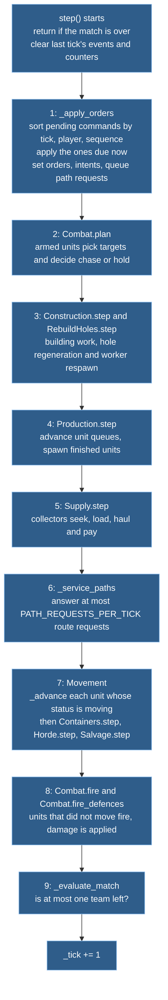
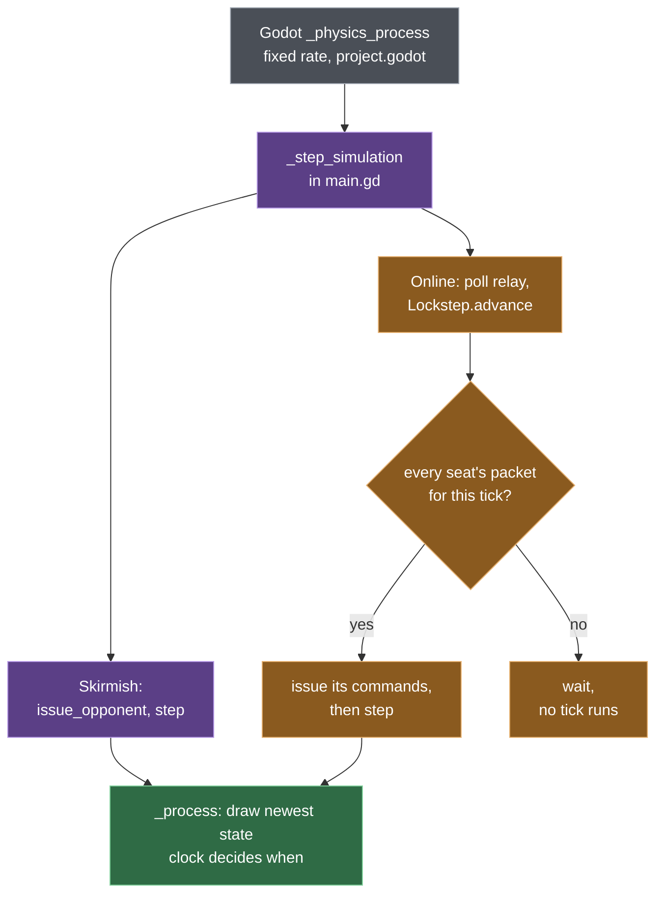

# 4. The tick

Once a match runs, everything that changes the game happens inside one function, `Simulation.step()`, in a fixed order, and the only way to ask for a change is a **command**: a small dictionary naming a player, a tick and an action. That narrow door is what makes lockstep multiplayer, replays and desync checks possible, and it keeps `simulation.gd` readable: `step` is about seventy lines of calls to systems that each own one area.

## The pipeline in one picture

A tick is one fixed step of game time; the simulation has no other clock. `step` does the following, top to bottom, every tick:

Orders go in first, so everything after them sees this tick's decisions. Combat is split around movement: `Combat.plan` decides who chases what before units move, and `Combat.fire` shoots after they moved, so range is checked on final positions. The systems (`Combat`, `Production`, `Construction`, ...) are not objects with their own state. They are `static func`s that take the simulation and read and write `sim._entities` and `sim._buildings`; `simulation.gd` owns the data and decides the order. There is no event bus and no scheduler.

Who calls `step` is outside the simulation:

Offline, every physics callback runs one `step`, after the bot has issued its commands. Online, a tick runs only when every seat's packet for it has arrived (every seat sends exactly one per tick, empty or not; chapter 11), so the slowest peer paces everybody. Drawing happens separately in `_process` and reads `snapshot()` or `view_state()`; chapter 5.

## One move order, followed through the code

A player selects a tank and right-clicks. Say `tick()` is N at that moment, and the tank stands still.

**Before the tick (offline).**
1. `main.gd` `_move` builds `{"type":"move","entity_ids":[...],"target":[x,y]}` and calls `_submit`.
2. `_submit` adds `tick` (the current one), `player` (the local seat) and the next `sequence`, and calls `Simulation.issue_command`.
3. `issue_command` runs `_validate`: required fields, `tick` not in the past, `sequence` higher than the player's last, at least one named unit exists and none belongs to another player, the target is inside the map and walkable. A rejection returns `{ok:false, error}` and the HUD shows it. An accepted command is copied into a normalised form (`_payload_fields` lists the fields per type) and appended to `_pending`.

Online, step 2 differs: `online_main.gd` `_submit` calls `Lockstep.submit`, which stamps the tick of the next packet to be sent (one more than the **input delay** ahead of the current tick) and queues the command; chapter 11.

**Tick N, phase 1: `_apply_orders`.**
4. `_pending` is sorted with `_command_before` (tick, player, sequence) and commands for other ticks are kept for later.
5. The due command is validated again with `_validate(command, true)`: the world may have changed since step 3.
6. The command goes into `final[id]` for each unit it names. If two due commands name the same unit, the later one in sort order wins.
7. For those units, `_detach_task` drops any build or other task, `destination` is cleared and the id is erased from `_path_queue`.
8. `_assign_move` calls `Allocation.assign` (`destination_allocation.gd`), which gives each ground unit its own destination cell around the target. Each unit gets status `path_pending` and its id is appended to `_path_queue`. If no cell is reachable, the unit's status becomes `blocked` instead. Armed units also get the intent `move` through `_set_intent`.

**Tick N, phases 2 to 5.** Nothing here changes the order. `Combat.plan` leaves a `move` intent alone while the unit is `moving` or `path_pending`.

**Tick N, phase 6: `_service_paths`.**
9. Up to `PATH_REQUESTS_PER_TICK` ids (8, see below) are popped from the front of `_path_queue`. For our tank, `_assign_route` asks `grid_navigation.gd` `route`, a wrapper around Godot's `AStarGrid2D`, for a path from its position to its destination and stores the waypoints. The status becomes `moving`, or `blocked` if there is no route.
10. Because the tank was standing (speed 0), `_assign_route` sets `move_after = _tick + START_DELAY_TICKS`.

**Tick N, phase 7: the advance loop.**
11. The loop reaches the tank because its status is `moving`, and calls `_advance`, which calls `Locomotion.step`. That turns the heading toward the first waypoint, but returns distance 0 while `tick < move_after`. So on ticks N and N+1 the tank only turns.
12. On tick N + `START_DELAY_TICKS` at the earliest, `Locomotion.step` accelerates the unit and returns a distance. `_advance` walks it along the route, consumes waypoints it reaches and writes `unit.position`. This is the first tick where the tank's position changes. A unit that was already rolling when the order arrived skips the delay.

**Tick N, phases 8 and 9.** A tank whose position changed is in `moved`, so `Combat.fire` skips it. `_tick` becomes N+1. Presentation's next `view_state()` shows the new position.

Order a group of 150 and steps 9 to 12 stagger: unit number p in the queue (counting from 1, queue otherwise empty) gets its route on tick N + (p-1)/8, integer division, because only 8 requests are answered per tick. The others show `path_pending` and stand still.

**The same click on an enemy.** An attack order uses the phases the move skipped. Phase 1 stops the unit and sets the intent `attack` (`_stop_unit`, `_set_intent`). Phase 2: `Combat.plan` calls `_pursue`; out of range, `_approach` picks a firing cell (`_firing_cell`), sets `path_pending` and appends the unit to `_path_queue`. Phases 6 and 7 route and move it like any move order. Once it is in range, `_pursue` stops it in phase 2, it does not move in phase 7, and phase 8 fires (`Combat.fire` checks `_in_range` and `next_fire_tick`). On every tick its position changed, phase 8 skipped it.

## Rules the order enforces

**Commands are checked twice.** The first check (`issue_command`) gives offline players instant feedback. The second (the due check in `_apply_orders`) protects against what changed in between: a command sorted earlier in the same tick spent the credits or took the build site, or the command was issued for a later tick. Online, both run at the stamped tick, inside `Lockstep.advance` and `step`, so a rejection reaches the player an input delay late (`Lockstep.rejections`). Consequence read from the code: when two players' due commands conflict (the same build site, say), commands are applied in (tick, player, sequence) order and `Lockstep.advance` feeds them in seat order, so the lower seat number wins every time. Every due command except `move` appends a row to `command_results()` (accepted or rejected) that the HUD and sound read.

**Immediate and unit-directed commands.** Produce, cancel, set rally, unload, choose faction and defence attack take effect inside the `_apply_orders` loop. Move, attack-move, attack, gather, stop, enter and the builder part of build and resume-build are collected per unit and applied after the loop, so the "last command wins" rule can run first (build places its foundation inside the loop).

**Sorted ids everywhere.** `step` builds a sorted unit id list once and the unit systems loop over it; the building systems sort their own ids. Results never depend on dictionary iteration order. This is one of the [determinism rules](../reference/determinism-rules.md); chapter 10 shows how they are checked.

**Removals inside a tick.** Phase 3 can remove a unit (a rebuild-hole worker) before the unit loops run, so `step` refilters `ids` and `armed` right after it (`_units_removed`). Later phases that can meet a removed id check `_entities.has(id)` themselves.

**Moving and shooting exclude each other.** Phase 8 skips every armed unit recorded as moved in phase 7 (passengers excepted). It is a rule of the pipeline, not of one weapon.

**Match end.** `_evaluate_match` runs while the match is `ongoing`; when at most one team still owns a building that counts for victory, the status becomes `won` or `draw` and every later `step` returns at once.

## Where the tick is capped, and where it is not

The one global cap is `PATH_REQUESTS_PER_TICK` (8), a constant in `simulation.gd`. A big move order queues one request per unit; each tick answers the first few from the FIFO `_path_queue`. The rest keep `path_pending` and stand still (the movement demo's status line counts them as pending; the match HUD does not show them). The cap bounds how many searches a tick runs, not how long they take. On a large map eight long routes are expensive: in the 2026-11-08 team match the worst tick took 7.3 to 7.4 ms against a 0.6 ms mean, 6.2 to 6.3 ms of it in `step.service_paths` (measured, [T1b](../reference/perf-spike-verification.md#t1b-team-match-zones)). The ledger's worst-tick watch item puts that tick at 34 ms native on the Steam Deck, longer than one tick ([performance ledger](../reference/performance.md)). A budget in expanded nodes instead of whole requests is recorded in T1b as an open question; not built. The other cost is that a group starts in waves, and a queue built by one event drains over many ticks: [the M4 scenario envelope](../reference/m4-scenario-envelope.md) measured 19 ticks with a peak of 150 pending units when 150 moving units were re-routed after an obstacle was removed.

Zero Hour also queues path requests and works them off under a per-frame budget, counted in searched cells. Wargrid counts whole requests, which is why its path cost per tick is not bounded, and neither the value nor the timing is derived from Zero Hour ([M2 plan](../superpowers/plans/2026-11-01-m2-groups.md), "Reference findings and follow-up"). The current movement design is slated for change (chapter 6).

Other work is spread by timers in each system rather than by a global cap: bots decide only every `DECISION_TICKS` ticks, horde levels are recomputed on a per-unit timer (`horde_tick`), idle defences scan every `DEFENCE_SCAN_TICKS`, and units without a target rescan on `Combat.REPATH_TICKS`, staggered by id. Expensive thinking is rare, but only the unit rescan is staggered on purpose. Horde timers start at a random offset (`Horde.first_check`), and all bot seats decide on the same tick: `opponent.decide` peaked at 3.5 ms with six seats (measured, [T1b](../reference/perf-spike-verification.md#t1b-team-match-zones)), and staggering the seats is an open question there.

The path cap covers only the route search. The destination allocation in step 8 runs synchronously inside `_apply_orders` on the tick the command is applied, so the tick that applies a big order pays for the whole allocation, uncapped. What that costs today is not measured for a large group: the [M4 envelope](../reference/m4-scenario-envelope.md) rows (2.2 to 6.3 ms per call) date from 2026-11-03, before `assign` was rewritten to expand rings instead of sorting the whole map component. The one row since is the 2026-11-08 team match: `allocation.assign` peaks at 0.15 ms while `step.apply_orders` peaks at 5.7 ms (measured, [T1b](../reference/perf-spike-verification.md#t1b-team-match-zones)). Command ticks do carry an uncapped cost; that run does not pin it on allocation. The ledger's budgets and the per-phase profile zones (`step.apply_orders`, `step.service_paths`, ...) live in the [performance ledger](../reference/performance.md).

## Engineering depth: what holds this together and where it strains

**Why one ordered function.** `step` is hand-written order rather than a scheduler or independent systems. That is easy to read and gives a stable order, which determinism needs. The cost is shared mutable state: a new system must be placed in the right slot, and the removal refilter above is the kind of patch that grows. `Combat.fire` collects all shots of a tick, then applies damage, then removes the dead, so two units can kill each other in one tick and id order gives no first-shot advantage; `Combat.fire_defences` runs after it, so a defence destroyed by units this tick never fires (detail in chapter 8). One consequence of the order: a chase that `Combat.plan` decides is appended to `_path_queue` and, if the queue is short, routed in phase 6 of the same tick.

**The tick rate is a literal.** `Locomotion.step` divides speeds and accelerations by `30.0`. The blueprint ([section 11](../blueprint.md#11-performance-multiplayer-and-future-architecture)) keeps movement and firing at 30 per second and lists split rates, with unit decisions running less often, as "not built". Adding them means changing the pipeline, not a setting.

**The slowest peer sets the pace, and catch-up is rationed.** `Lockstep.advance` returns false while any seat's packet for the tick is missing, so no peer runs ahead of the slowest machine or connection, and a seat that leaves ends the match (`ended_left`). When late packets arrive in a burst, `online_main.gd` `_step_simulation` may run up to `CATCH_UP_STEPS` ticks per physics callback, each paid from a credit that grows by one per callback and is capped at `MAX_CATCH_UP_CREDIT`. The credit exists because the first online match ran at about 57 ticks per second, nearly double speed, before it bounded the catch-up ([m5-online](../reference/m5-online.md)). `MAX_QUEUED_TICKS` guards the other side: a peer with 300 packets queued ends the match as a protocol error ("peer too far ahead"); a legitimate peer queues about twice the input delay.

**Linear work every tick, measured small.** `step` rebuilds and sorts the id list of all units each tick: zone `step.ids`, about 2 % of `step` (0.013 to 0.039 ms mean on three scenarios; measured, [data layout decision](../reference/data-layout-decision.md), section 2). `_path_queue` is a plain `Array` used as a FIFO, and both ends are linear: `pop_front` in `_service_paths` and `erase(id)` in `_apply_orders`, `_stop_unit` and `remove_object` shift the rest of the array (Godot's [Array reference](https://docs.godotengine.org/en/stable/classes/class_array.html) says both "may have a noticeable performance cost, especially on larger arrays"). Re-ordering k units while q wait costs about k times q element moves. No profile zone isolates the queue, so its share is not measured (speculation: irrelevant below a few hundred pending units). The copy that does show in profiles is `snapshot()`: bots take one per decision tick (`Skirmish.issue_opponents`), online play one per hash tick (`Lockstep.wants_snapshot`).

**Documented shortcuts.** The systems carry `shortcut:` comments with their own limits, for example `combat.gd` scanning every object per defence scan "if the defences layout still shows in the ledger", and `destination_allocation.gd` re-sorting its pool per ring. They belong to chapters 6 and 8. Nothing inside `step` caps a system's time; the ledger's budgets are checked by benchmarks from outside.

## Where in the code

- `game/scripts/simulation/simulation.gd` — `step` (the pipeline), `issue_command`, `_validate`, `_payload_fields`, `_apply_orders`, `_command_before`, `_assign_move`, `_service_paths`, `_assign_route`, `_advance`, `_evaluate_match`; constants `PATH_REQUESTS_PER_TICK`, `START_DELAY_TICKS`; queues `_pending`, `_path_queue`.
- `game/scripts/simulation/destination_allocation.gd` — `assign`: one destination cell per unit.
- `game/scripts/simulation/grid_navigation.gd` — `route`: the A* behind `_assign_route`.
- `game/scripts/simulation/locomotion.gd` — `step`: heading, speed and distance per tick; honours `move_after`.
- `game/scripts/main.gd` — `_move` (builds the move payload), `_submit` (offline stamping), `_physics_process`, `_step_simulation`, `_process`.
- `game/scripts/base_main.gd`, `game/scripts/skirmish_main.gd` — input to payload; `skirmish_main.gd` `_step_simulation` (bot, then step).
- `game/scripts/online_main.gd` — `_submit` (to lockstep), `_step_simulation` (catch-up loop), `CATCH_UP_STEPS`, `MAX_CATCH_UP_CREDIT`.
- `game/scripts/net/lockstep.gd` — `submit`, `advance` (feed packet commands, then `step`), `finish_tick`, `MAX_QUEUED_TICKS`.
- `game/scripts/net/seat_sim.gd` — wrapper whose `issue_command` goes through lockstep, so bot and script code can drive a networked seat.
- `game/scripts/simulation/combat.gd`, `construction.gd`, `production.gd`, `supply_collection.gd`, `containers.gd`, `horde.gd`, `salvage.gd`, `rebuild_holes.gd` — the per-phase `static func step`, `plan` and `fire`.
- `game/scripts/debug/profiler.gd` — the zone timers used in `step`.

## Further reading

- [Simulation interface](../reference/sim-interface.md) — the command fields, what `step`, `snapshot` and `view_state` promise, what is not interface.
- [Determinism rules](../reference/determinism-rules.md) — what code inside the tick may and may not do.
- [Movement](../reference/movement.md) — grid navigation and route rules behind phases 1, 6 and 7.
- [M4 scenario envelope](../reference/m4-scenario-envelope.md) — measured path-queue wait; its allocation rows predate the ring rewrite.
- [Performance ledger](../reference/performance.md) — per-tick budget and measurements.
- [M5 online](../reference/m5-online.md) — the pacing fix for lockstep catch-up.
- Next: [5. Presentation](05-presentation.md) reads the state this chapter produces; [6. Movement](06-movement.md) opens phases 1, 6 and 7.

---
Checked against `582725f`. Files: `game/scripts/simulation/simulation.gd`, `game/scripts/main.gd`, `game/scripts/base_main.gd`, `game/scripts/skirmish_main.gd`, `game/scripts/online_main.gd`, `game/scripts/net/lockstep.gd`, `game/scripts/net/seat_sim.gd`, `game/scripts/simulation/combat.gd`, `game/scripts/simulation/locomotion.gd`, `game/scripts/simulation/destination_allocation.gd`, `game/scripts/simulation/grid_navigation.gd`, `game/scripts/simulation/construction.gd`, `game/scripts/simulation/production.gd`, `game/scripts/simulation/containers.gd`, `game/scripts/simulation/horde.gd`, `game/scripts/simulation/salvage.gd`, `game/scripts/simulation/rebuild_holes.gd`, `game/scripts/simulation/skirmish.gd`, `game/scripts/simulation/supply_collection.gd`, `game/scripts/debug/profiler.gd`
