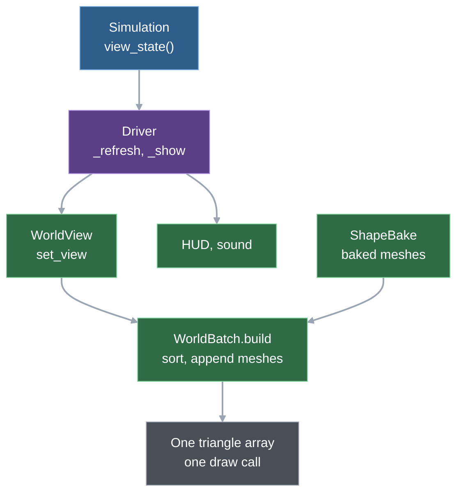
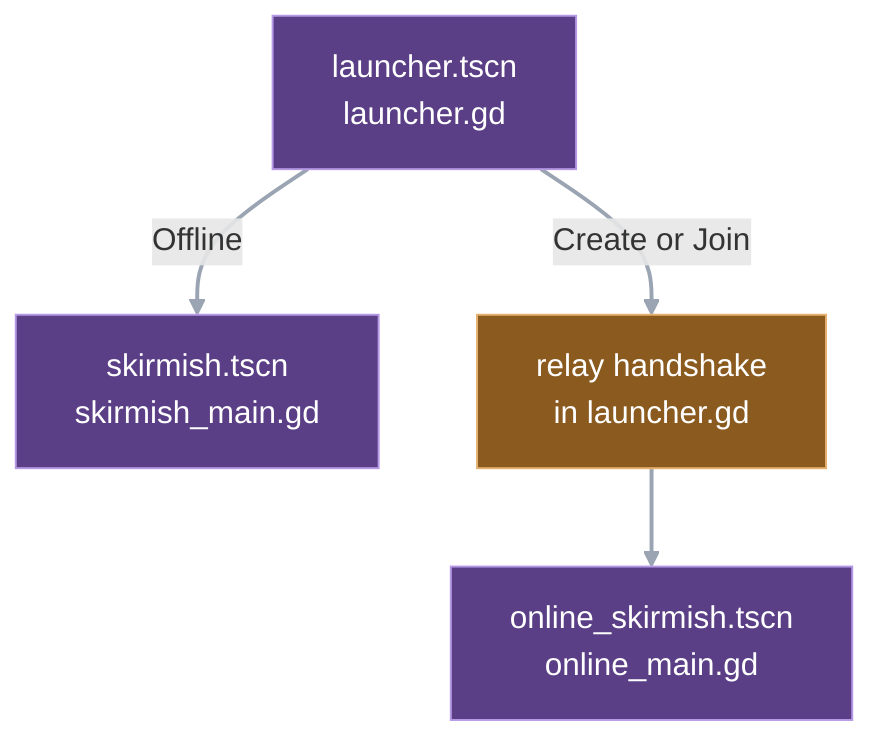
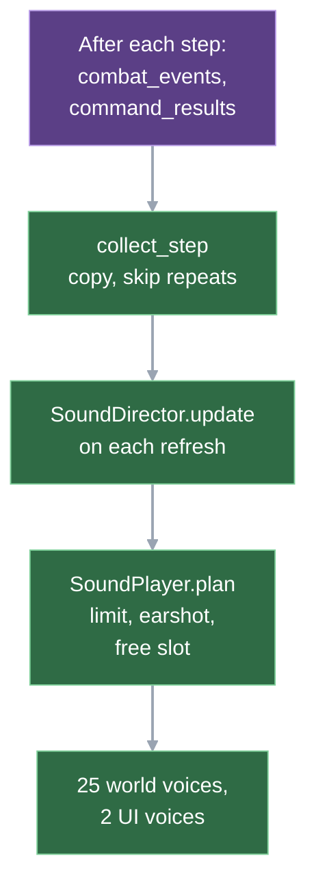

# 5. Presentation

Every refresh, the presentation turns the simulation's state into one packed list of coloured triangles and a handful of sound requests. It owns no rule. A unit's silhouette is geometry baked once per heading and then copied into one big array that the GPU draws in a single call. Chapter 1 explains who calls the refresh and when; this chapter follows what the refresh does with the state.

## From view state to one draw call

The parts, all in `game/scripts/presentation/` unless noted:

- **View rows** (`simulation/view_rows.gd`). The unit half of the state the simulation hands over: one row per unit, stored column by column in packed arrays.
- **WorldView** (`world_view.gd`). One node that receives the state, keeps a per-unit item between ticks, answers picking questions and draws overlays such as health bars, selection marks, focus boxes, hints and labels. Three child layers draw behind those overlays: terrain, building footprints and bodies.
- **WorldBatch** (`world_batch.gd`). Sorts the items into draw order and appends each one's baked mesh to a points array and a colours array.
- **Shapes and ShapeBake** (`shapes.gd`, `shape_bake.gd`). The first is the data table: per role, a list of parts made of boxes and cylinders. The second projects a part at one heading into a flat triangle list and caches it.
- **VisualDirector** (`visual_director.gd`). Turns shot and death events into short effects (muzzle flash, hit, dash, fade) and keeps turret aim angles.
- **Sound** (the `sound_*.gd` files, the announcer and the music player): a short section below.

The presentation holds no `Simulation` reference. It does import static simulation code: the definitions, `ViewRows`, and one pure function, `Combat.masked`, which picking uses to skip a building whose rebuild worker is present. No file in the presentation folder asks the simulation for anything: a search for the three entry points (issue a command, take a snapshot, take the view state) finds no call.

## One tank, from view row to triangles

A USA tank is on the map. This is its path through one refresh on the highest graphics quality.

1. **State.** The simulation keeps the tank as a dictionary with position, heading, hit points, owner and combat state. Once per refresh it collects all units in id order and writes each into one row of the column arrays. The tank's kind becomes an index into a string table that is rebuilt on every call and holds `"usa_tank"`; booleans such as "is attacking" become bits in a flag byte.
   `Simulation.view_state → _view_rows → ViewRows.from_units`
2. **Hand-off.** The driver takes the view state, drops dead units from the selection and gives state and selection to the world view. In the skirmish driver the same step then updates the HUD and sound.
   `base_main._refresh → main._show → WorldView.set_view`
3. **Depth order.** The view sorts the rows from the top of the screen to the bottom. The key is x + y, because screen height in the isometric projection is 16 × (x + y) (chapter 2), and ids break ties. Every row is keyed as ground here; only the batch sort in step 7 puts aircraft in their own layer, so picking order treats an aircraft as if it stood on the ground.
   `WorldBatch.depth_order`
4. **Item.** Each unit has a small dictionary, its item, that survives from tick to tick: one merge pass over the rows and the old items finds or creates it. A new item learns what never changes: the shape role (`tank_usa`, from an explicit table), the ground layer and a shadow radius of 6. Every tick it is rewritten with the anchor point, the heading angle (an arc-tangent of the row's heading pair), hit points, target and horde flag.
   `WorldView._rebuild_items → WorldBatch.write_unit_item`
5. **Pose.** With smooth movement on, the view keeps the previous tick's anchor and heading, so the tank can slide between ticks (see interpolation below).
   `WorldView._track_poses`
6. **Effects and turret.** The visual director consumes the shot and death events collected since the last refresh. If the tank has a target, its turret angle turns toward it by at most 0.15 radians per call; that angle lives only in the director.
   `VisualDirector.update → _aim`
7. **Batch.** The view then rebuilds the whole batch. It sorts all items (units, buildings, supply piles) and walks them twice: first every shadow quad (High only) and horde ring, then every body, then the effects. So no shadow or ring covers a body, and effects sit on top of everything. For the tank, the heading becomes one of 64 buckets (the angle as a fraction of a full turn, times 64, rounded and wrapped), the turret angle becomes another, and the batch asks for the merged mesh of that pair.
   `WorldView._rebuild_batch → WorldBatch.build → _append_body → _body`
8. **Baked mesh.** On first use, each part of the shape is baked. A USA tank has two: a body (a hull box and two track boxes, turning with the hull) and a turret (a dome box and one barrel box, turning with the turret angle). Baking rotates each box's corners by the bucket angle, projects them onto the screen plane, lifts them by their height (one height unit is 3.5 px) and emits a top face plus only the side faces that turn toward the viewer. Every vertex carries a colour slot, such as roof or machinery, not a colour. At one checked heading bucket the two meshes add up to 30 triangles, 18 + 12 (one-off headless script at the commit named at the end of this chapter, Godot 4.7.2; the count changes a little with heading because the visible faces do).
   `ShapeBake.mesh → _bake`, parts from `Shapes._append_tank`
9. **Copy and colour.** The merged mesh is copied into the batch through a translation-only transform. The tank is moved to its screen position but never rotated at draw time, because the rotation is already in the bucket. Colours come from looking up each vertex's slot in the owner's palette; that list is cached per mesh and owner, which is why the bake never needs to know the owner.
   `WorldBatch._append_body → _mesh_colors → Palette.owner_colors`
10. **Draw.** The view asks its body layer to redraw. The layer's draw callback hands the arrays to the rendering server as one triangle array without indices (`canvas_item_add_triangle_array`): one command for all units and buildings. Later triangles paint over earlier ones, which is how the depth sort becomes occlusion.
    `WorldView._rebuild_batch → BodyLayer._draw → WorldView.draw_bodies → WorldBatch.submit`

Health bars, selection diamonds, focus boxes and the rest are not in that array. They are plain rectangle and line calls in the view's own draw callback, on top of the bodies.

## How rows become triangles, layer by layer

### View rows: columns instead of dictionaries

The rows object holds one packed array per field: id, owner, kind, hit points, target, position, heading, order target, status, combat mode and tier, collection phase, and the flag byte. Three per-call string tables name the kinds, combat modes and collection phases. Row i is one unit, rows are in id order, and a binary search finds a unit's row by id. The fill is one flat loop over local column variables; a comment in `view_rows.gd` records that a helper-per-field version cost three times as much. The flag byte carries the booleans: horde, contained, hole, attacking, ordered, waiting for a source, collecting. The column list is in the [simulation interface](../reference/sim-interface.md); this chapter does not copy it.

Two rules follow from the [view rows design](../superpowers/specs/2026-11-12-view-rows-design.md):

- **Table indices are only valid with their own rows object.** A kind index points into that call's table, and the next tick may number the same string differently. The sound director keeps the previous tick's rows, so it compares strings.
- **A new per-tick field becomes a column**, not a per-unit dictionary again.

Why it exists: before it, every refresh took a full snapshot and copied each unit into dictionaries. The hand-off sum (view state plus sort plus batch preparation) fell from 0.863 to 0.537 ms per tick on `skirmish3v3`, 1.413 to 0.951 on the team match and 2.963 to 1.927 on `hordes300`, against a 0.91 ms plumbing budget: `skirmish3v3` passes, the team match is exceeded by 0.04 ms, and `hordes300` (stress row) and the movement layouts are exceeded (measured, [performance ledger](../reference/performance.md), row "2026-11-11 perf-next stop gate, headless hand-off sum"). Filling the rows is now the smaller part: 0.154 / 0.260 / 0.442 ms against 0.383 / 0.690 / 1.484 ms for sort and batch preparation ([data layout decision](../reference/data-layout-decision.md), section 2).

### Items persist, the batch does not

The unit items are kept across ticks, so a steady-state tick allocates no item dictionary per unit; the per-tick keys are simply rewritten. The batch has no such memory: every build clears the point and colour arrays and refills them from the items, sorting every item and appending every mesh. There is no dirty tracking. A new tick, a selection change (the driver refreshes, so a click costs a fresh view state and a full `set_view`), an interpolation step, and a zoom, quality or Neon change all end in a rebuild. Picking itself reads rows and cached extents and rebuilds nothing. This is cheap per tick and expensive per frame; see interpolation below.

### Depth order and its limits

The sort key packs layer, depth and id into one integer (2 + 22 + 20 bits), and the build step puts the item's index in 16 more bits below. One integer sort therefore gives an order that is total, stable by id and carries the index back. There are two layers, ground and air; air units are drawn 30 px up, after all ground objects.

Two limits are guarded by asserts: fewer than 65,536 items in a batch, and ids below 2^20. Asserts run in debug builds and tests only (the [Godot `assert` reference](https://docs.godotengine.org/en/stable/classes/class_%40gdscript.html#class-gdscript-method-assert); releases are exported with `--export-release`, see `tools/export_build.sh`). Past a limit a released build would mis-sort silently (speculation about the symptom). Neither limit is near: the largest ledger row has a few hundred items.

A unit's whole body gets one depth, its anchor. A long building can in principle be drawn over a unit standing beside its far end, the single-anchor risk the integration note names ([art Godot integration](../reference/art-godot-integration.md), section 2). Whether that shows in play is not recorded.

### Baking: shapes as data, triangles as cache

Each shape role is a list of parts. A part has an angle source (hull heading, turret angle or fixed), a list of primitives (a box or cylinder with offset, size and colour slot) and an optional pivot. FRC's tank turret turns around a point off the hull axis, so the bake rotates the pivot by the hull heading and the primitives by the turret heading.

The role of a kind comes from its id and definition: tank kinds by an explicit table, buildings by name suffix (defences by faction prefix, rubble by footprint width), units by class and then by suffix (builder, collector, rocket infantry). A building with an unknown suffix gets `default_building`; a new vehicle gets the generic light-vehicle shape. This is one place where the faction-prefix naming of kinds is load-bearing ([chapter 3](03-entities.md)).

Baking is lazy and cached in a static dictionary that counts its misses; the art lab design said baking would happen at load, but the code bakes on first use. The batch merges a role's parts for one heading pair into a cached body (points, per-vertex lifts and slots). That body cache is cleared wholesale at 4096 entries. The flush drops the merged bodies and their colour arrays, which are re-merged from the bake cache on demand: no re-bake, no error. The bake cache itself has no cap. Whether a real match reaches either limit is not measured.

Details worth knowing:

- **Colour slots, not colours.** There are eight slots, resolved per owner when the colours are looked up. Eight owners, the Neon palette and a future ally/enemy option therefore need no re-bake. Vertical faces and machinery are neutral; roofs, the soldier torso and a few stripes take the owner hue ([art direction](../art-direction/ART_DIRECTION.md), sections 3 and 7).
- **Variant.** A small integer selects a different part list for the same role: the damage stage of a building (0, 1 or 2, at 70 % and 35 % of hit points, integer maths) or a supply pile's stack level and footprint.
- **Rise.** A building under construction scales its vertex lifts by its progress, so it grows out of the ground.
- **Detail.** Low is always detail 0; High is 0 below zoom 1, 1 at zoom 1 and 2 at zoom 2 or more. Detail changes only the cylinder segment count (4, 6 or 8) and the generic vehicle's extra box. A tank is all boxes, so it bakes identical triangles at the three details (same script) but under three cache keys.
- **Picking reads the bake.** A unit's pick box is the bounding box of its role's baked mesh over all 64 buckets at detail 1, so a click on any drawn pixel picks it. A small margin stands in for sweeping every hull-by-turret pose, which would take 4096 bakes; the code's `shortcut:` comment puts the measured overshoot under 2 px. Infantry get a fixed 36 px wide box instead.

### Layers and what redraws when

The three child layers are drawn behind the view's own overlays, in this order: terrain, building and supply-pile footprints, bodies. The terrain redraws when the navigation snapshot's identity or the palette changes (chapter 2). The structure layer redraws only when a key built from each building's and source's id, owner, kind, origin, completion and selection changes. Building bodies are not in that cached layer: they are in the batch with the units, which is what lets a unit pass behind a tall building. The structure layer draws the flat footprint tint and the selection outline only.

### Interpolation: where the per-frame cost comes from

[Chapter 1](01-big-picture.md#smooth-motion-between-ticks) describes when interpolation runs and what it blends. The mechanism is this. After each new tick the view lists the items whose pose (position and heading) changed since the previous tick. On every rendered frame it computes alpha, the wall-clock time since the tick times the tick rate, clamped to 1, then moves those items between their two poses and rebuilds the batch. That is a full sort and re-append of every item, every rendered frame, while anything is moving. Alpha stays at 1 during a lockstep stall, so nothing is rebuilt when nothing changes. Turret angles are not interpolated; they move at tick rate.

Cost, measured: with interpolation on, CPU per rendered frame is 0.82 to 1.14 ms (p50) against 0.04 to 0.05 ms with it off, on the rendered benchmark's 300-unit layouts (ledger row "2026-11-11 perf-next stop gate, rendered, interpolation on"). At 60 frames per second that is 1.6 to 2.3 ms per tick, and at 120 Hz it doubles ([data layout decision](../reference/data-layout-decision.md), section 7). In that row the frame interval p95 is 3.4 to 4.5 ms (3.8 to 5.7 before the view rows change) against the 3.04 ms frame budget: exceeded on every layout on both trees (report-only row). The gated benchmark rows therefore run with interpolation off, the benchmark's default.

`WorldView._track_poses → advance_frame → blend → _rebuild_batch`

### Effects and turrets

Shot and death events carry no positions. The visual director takes positions from the items of the current refresh, and from the previous one for a unit that just died; an effect for an unknown id is skipped. It copies the events after every simulation step, rejects a tick it already saw and keeps at most 8 steps of history, counting overflow in `dropped`. It consumes them once per refresh. Effects are a muzzle quad (4 ticks), a hit quad (6), a dash from attacker to target (6) and a fade where a unit died (60), with at most 256 live. They join the same triangle array as quads. The simulation never learns about them.

### Quality, settings and the overlay

Quality (Low or High), Neon colours, smooth movement and the destination marks are stored in `user://settings.cfg`, the file the audio settings also use. Low draws no shadows and never interpolates. The Esc menu toggles each setting and emits a signal that `main.gd` wires to the view. On the first run with no stored quality, `skirmish_main.gd` samples 120 frames of CPU time (tick, redraw and draw) after skipping 60, and picks Low when the p95 is over 8.3 ms. The code marks this a `shortcut:`: it measures a nearly empty map at match start, so it catches only very slow machines. F3 toggles the performance overlay (frame and step time, counts, split share).

## Art direction, as built

The [art direction](../art-direction/ART_DIRECTION.md) was written before the code and is treated as proposals, open to change. The code now has geometric 2.5D bodies from boxes and cylinders with an owner-coloured top and neutral sides, 64 headings where the art direction shows eight, selection as a ground diamond, sand ground with cliffs as a low step, damage stages, construction rise, and muzzle, hit, dash and fade effects. It does not have recoil, factory or generator animation, signature and shake effects, or any fog. Fog and the signature and shake variants exist only in the lab overlays. The two reference notes ([art Godot integration](../reference/art-godot-integration.md), [art perf levers](../reference/art-perf-levers.md)) are pre-implementation research; where they and the code differ, the code wins.

One triangle array instead of one polygon per face comes from the perf-levers note. In Godot's Compatibility renderer every polygon draw is its own GL draw call, while the triangle-array command is one polygon command and so one draw for the whole array (Godot 4.7.2-stable, `rasterizer_canvas_gles3.cpp`, in its item-command recording: "Polygon's can't be batched, so always create a new batch"; re-read 2026-11-12). The result, measured on the rendered benchmark, is 3 to 4 draw calls on the open, dense and horde layouts and 23 on Ashfall, against ceilings of 50 (60 on Ashfall) that `movement_benchmark.gd` asserts (ledger row "2026-11-11 perf-next stop gate, rendered, interpolation off").

### The A/B lab

The lab scene runs a scripted, repeatable fight on a real simulation, built from public calls: mirrored blocks of all 17 listed kinds, builds, a gather order, an attack-move at tick 240 and a wave at tick 600. Keys switch a question's variant (Tab), quality (Q), zoom (Z) and opponent colour (O). The variants go through the same hooks the game uses, such as the biome, ground colour and Neon setters. Lab-only extras (wrecks, signature rings, a fog mask, camera shake) are drawn by two overlay nodes placed around the bodies layer. The lab feeds the view a snapshot, which `set_state` converts to rows; that is why that path still exists.

The defaults (sand ground `#A88E5C`, Neon as an opt-in palette, a wide infantry pick box, the dash effect, interpolation) were chosen in the lab and are recorded in the [art lab verification](../reference/art-lab-verification.md); five questions remain open. The lab is self-contained: no game code refers to it.

`art_lab.advance → _show → AbVariants.apply, WorldView.set_state`

## App shell, scenes, HUD and input

- **Scenes.** The main scene is the launcher. The skirmish and online scenes share one node layout: a world view, a camera and a HUD layer with a status label, a selection box, a production panel, a result label and Restart. The base and main scenes are the older economy and movement demos at the start of the driver chain (chapter 1); the benchmark and the lab reuse the world view.
- **Launcher.** Sections: a Map row, then Play offline (You, Bot, Start), Play online (You, Create, Join, code) and Settings; each play section has its own "You" faction selector, and the two do not sync, with Credits and the legal line at the foot; the relay URL sits under a fold named Advanced, closed by default. For an offline game it writes the choice into static variables on `skirmish_main.gd` (factions, map, starts, match seed) and changes scene. For online play it opens the relay connection, sends a hello message (the host's carries the map settings), builds the lockstep object on the start message, instantiates the online scene, calls its `setup` and makes it the current scene (chapter 11 has the protocol). Headless flags redirect to `net_headless.tscn`.
- **Match settings.** Map path, map hash and start spots for a match; [chapter 2](02-world.md#start-spots-which-seat-stands-where) explains them, chapter 11 the exchange.
- **HUD.** There is no HUD script. Each driver overrides `_refresh_hud`: the base driver writes unit counts, credits, power and the build menu, the skirmish driver adds the selected and inspected unit lines and the result text, and the online driver adds the lockstep notice (waiting, disconnected, desync report path). Unit lines come from a small snapshot-shaped dictionary rebuilt from one row. HUD changes get a headless layout test ([AGENTS.md](../../AGENTS.md)).
- **Input.** The input handlers chain from the skirmish driver to the base driver to `main.gd`, each handling its own modes and calling `super`. The mouse position goes through the view's canvas conversion, which undoes the camera, and the pick functions work on that plane point. Selection lives in the driver and is passed to the view on every refresh. The skirmish driver pans with the built-in arrow actions where `main.gd` uses its own camera actions, and A and S are orders there. Esc first clears pending state, then opens the pause menu; offline that menu pauses the simulation, online it does not.
- **Playtest helper.** An optional overlay for play sessions: a checklist from a focus card, a marker key (N) that saves the tick, camera, selection and a small screenshot with a note, and a review form when the match ends; the focus questions are agreement scores, `1 strongly disagree … 5 strongly agree`, shown under the score rows. It is presentation only. The skirmish driver adds the overlay to the HUD and the online driver inherits it. The overlay never touches the simulation: it reads the driver through two callables, one for the current context (tick, camera, selection, over, menu) and one for the match record saved at the end, and it notices orders as the driver submits them. Offline play wraps the simulation in a `CommandRecorder` that keeps every accepted command; every order the offline driver issues goes through it, the AI opponent's included. Online play records the lockstep command log instead. The overlay is on by default only for versions ending in `-dev`, or when the launcher or pause menu switch says so. Offline, an open marker dialog or form counts as an open menu, so the match pauses; online it cannot. Sessions are saved as JSON and replayed by tools ([chapter 13](13-testing-and-tooling.md#playtest-session-tools), [chapter 10](10-determinism-and-replays.md)).

## Sound: events in, requests out

Sound is presentation only: nothing in the simulation or a trace depends on it. The simulation clears its event arrays on every step, so the driver hands the events to the director after each one (online catch-up may run two steps per physics callback). The director keeps a history of at most 120 steps and ignores a tick it has seen.
`skirmish_main._step_simulation → _collect_sound → SoundPlayer.collect_step → SoundDirector.collect_step`

On each refresh the HUD update calls the sound player, which asks the director for requests. A shot event becomes a cue chosen from the attacker's weapon, by weapon id first and then by damage type; there is no catch-all, so a new weapon needs a row. A rifle burst plays once per burst, splash weapons add an impact at the target, and a death becomes an infantry, vehicle or building cue (vehicle deaths get random pitch within 5 %). State changes come from comparing this refresh with the last: an own building appearing plays a click cue, and low power, construction complete and a finished unit queue announcer lines. Events for ids already gone are looked up in the previous rows.
`skirmish_main._refresh_hud → SoundPlayer.update → SoundDirector.update`

Most requests are dropped by design:

- **Effects.** The player splits requests into world and UI. A static, tested function gives a request a voice only if it is within 1145 px of the camera centre, its cue is under its limit and a voice is free. Nothing queues; a request that loses is gone. There are 25 world voices (attenuation 0.5, fitted to Zero Hour's falloff: [sound spike note](../reference/sound-spike.md), "Godot attenuation") and 2 UI voices.
- **Announcer.** Lines for the local player only, one at a time, highest priority first. A line waits at most 150 ticks, and the alarm lines have cooldowns (900 ticks for base-under-attack and structure-lost, 3600 for low power), so a long fight does not repeat itself.
- **Unit voices.** An accepted order gets a short spoken line. `unit_voice.gd` takes each unit's role from the definitions (a kind that builds or collects is a `worker`, else `infantry` or `vehicle`) and maps the command type to a line: `move`, `enter` and `unload` say the move line, `attack` and `attack_move` the attack line, `gather`, `build` and `resume_build` the work line, and `stop`, `set_rally` and the production commands stay silent. The speaker is the first own unit in the order whose role has that line, and the file is one of two variants for role and line. `SoundDirector.order_voice` makes that choice and skips it while the previous line is still playing (not queued, not cut); `SoundPlayer.order` plays it on its own `Voice`-bus player, separate from the announcer. The drivers call it from `_submit`: the skirmish driver only after the simulation accepted the order, the online driver for every order it sends. Variant choice uses the director's own generator, so nothing here touches the simulation.
- **Music.** One music player per scene: the launcher loops one track, a match plays the five tracks in an order shuffled once per match (`MusicPlayer.shuffled`, presentation randomness) with 25 s gaps; Restart keeps the running playlist. It never reacts to the game.
- **Volume.** Sliders in the launcher and the Esc menu write the music, effects and voice bus volumes. Master mute (key M) is never saved, so a muted session cannot leave the next start silent.

The random pitch uses a generator that seeds itself, which is fine because nothing here feeds back. Headless runs skip `play()` for the announcer voice and the music, because Godot reports their queued playback as a leak at exit; pooled effect voices play in every mode.

## Trade-offs and limits

- **A tick's pixels are a pure function of the view state and the settings.** The batch rebuild is stateless apart from caches (bakes, bodies, colours), which is why quality, zoom and Neon changes just trigger a rebuild. The price is that nothing is incremental.
- **Per-frame cost is the open problem.** Interpolation rebuilds the batch each frame (measured above). The [data layout decision](../reference/data-layout-decision.md), section 7, proposes building the array once per tick and moving the vertex ranges of moving items per frame, or a shader or MultiMesh variant, and estimates 1.5 to 2 ms per tick saved at 60 Hz. Proposed, not built; the batch's golden test would change by design. The Auto quality pick may also switch smoothing off exactly on slow machines (same note, inferred).
- **Items are still dictionaries.** The batch build and the pose tracking read dictionary keys. Reading rows directly in the batch was measured at 0.07 to 0.20 ms per tick at most and folded into the interpolation item above rather than done alone.
- **Hard limits are asserts.** See "Depth order and its limits": 65,536 items per batch, 2^20 ids; the 4096-body cache is a flush, not a failure.
- **Match settings are static variables.** The launcher hands settings to the next scene through statics on `skirmish_main.gd`. Simple, and the scene depends on the launcher having run first.
- **The caches are global.** Bakes, bodies and colours are static variables shared by every batch and shape user, so there is one cache per process and nothing to invalidate per scene.
- **Zero Hour comparison.** The world voice pool, the per-cue limits and the "no ducking" rule follow Zero Hour as recorded in the [sound spike note](../reference/sound-spike.md) ("read in memory, not re-verified"); the two-voice UI pool and the mix levels are Wargrid's own.

## Where in the code

- `game/scripts/simulation/view_rows.gd` — `ViewRows`: columns, flags, `from_units`, `index_of`. `game/scripts/simulation/simulation.gd`: `view_state`, `_view_rows`.
- `game/scripts/presentation/world_view.gd` — `set_view`, `set_state`, `_rebuild_items`, `_track_poses`, `blend`, `advance_frame`, `_rebuild_batch`, `pick_*`, overlays in `_draw`, `draw_bodies`, `draw_structures`.
- `game/scripts/presentation/world_batch.gd` — `write_unit_item`, `structure_items`, `sort_key`, `depth_order`, `build`, `_append_body`, `_body`, `_mesh_colors`, `submit`, `pick_extent`, `top_lift`.
- `game/scripts/presentation/shapes.gd`, `shape_bake.gd` — roles, parts, `HEADING_BUCKETS`, `Bake.mesh`, `bucket`, `Z_SCALE`.
- `game/scripts/presentation/palette.gd`, `graphics_settings.gd`, `pause_menu.gd`, `perf_overlay.gd`, `ui_style.gd` — colours, settings, Esc menu, F3 overlay, HUD theme.
- `game/scripts/presentation/visual_director.gd` — `collect_step`, `update`, `turret_angles`, `effects`.
- `game/scripts/presentation/body_layer.gd`, `structure_layer.gd`, `terrain_view.gd`, `isometric.gd` — child layers and projection (chapter 2).
- `game/scripts/presentation/presentation_clock.gd` — when a refresh runs (chapter 1).
- `game/scripts/presentation/sound_player.gd`, `sound_director.gd`, `sound_cues.gd`, `announcer.gd`, `unit_voice.gd`, `music_player.gd`, `audio_settings.gd`, `volume_sliders.gd` — sound; `credits.gd` — launcher credits text.
- `game/scripts/main.gd`, `base_main.gd`, `skirmish_main.gd`, `online_main.gd` — the driver chain, input, HUD (`_refresh`, `_show`, `_refresh_hud`, `_unhandled_input`, `_unit_record`). `game/scripts/launcher.gd`, `game/scripts/match_settings.gd` — app shell and match set-up. `game/scenes/*.tscn`.
- `game/scripts/playtest/` — `playtest_overlay.gd` (`setup`, `open_marker`, `end_match`, `observe_command`), `command_recorder.gd`, `playtest_session.gd`, `playtest_settings.gd` (`enabled`, `build_id`), `focus_cards.gd`, `focus_card_view.gd`, `session_form.gd`, `marker_capture.gd`; driver hooks `playtest_context`, `playtest_match`, `_add_playtest`, `_recording` and `_issue` in `skirmish_main.gd` (`_issue` is defined in `main.gd`); `online_main.gd` overrides `playtest_context` and `playtest_match`.
- `game/scripts/lab/` and `game/scenes/art_lab.tscn` — the A/B lab (`art_lab.gd`, `ab_variants.gd`, `ab_overlay.gd`, `lab_fight.gd`).
- `game/audio/` — effects, voice lines, music, `CREDITS.md`.
- Tests: `game/tests/test_view.gd`, `test_view_rows.gd`, `test_world_batch.gd`, `test_shapes.gd`, `test_shape_audit.gd`, `test_visual.gd`, `test_sound.gd`, `test_announcer.gd`, `test_graphics_settings.gd`, `test_pause_menu.gd`, `test_skirmish_scene.gd`, `test_art_lab.gd`, `test_playtest.gd`, `test_playtest_overlay.gd`, `test_playtest_replay.gd`.

## Further reading

- [Art direction](../art-direction/ART_DIRECTION.md), [art Godot integration](../reference/art-godot-integration.md) and [art perf levers](../reference/art-perf-levers.md): proposals and research from before the build.
- [Art lab design](../superpowers/specs/2026-11-10-art-lab-design.md) and [art lab verification](../reference/art-lab-verification.md): the look, its measurements and the A/B answers.
- [View rows design](../superpowers/specs/2026-11-12-view-rows-design.md) and [data layout decision](../reference/data-layout-decision.md): the hand-off format and what comes next.
- [Sound spike design](../superpowers/specs/2026-11-08-sound-spike-design.md) and [sound spike note](../reference/sound-spike.md): cue table, mix, licences, attenuation.
- [Performance ledger](../reference/performance.md): budgets and the rendered and headless rows quoted above.
- Previous: [4. The tick](04-the-tick.md). Chapter 2 covers the projection and terrain; chapter 11 the online start.

---
Checked against `e9d79b4`. Files: `game/scripts/simulation/view_rows.gd`, `game/scripts/simulation/simulation.gd`, `game/scripts/presentation/world_view.gd`, `game/scripts/presentation/world_batch.gd`, `game/scripts/presentation/shapes.gd`, `game/scripts/presentation/shape_bake.gd`, `game/scripts/presentation/palette.gd`, `game/scripts/presentation/graphics_settings.gd`, `game/scripts/presentation/visual_director.gd`, `game/scripts/presentation/body_layer.gd`, `game/scripts/presentation/structure_layer.gd`, `game/scripts/presentation/terrain_view.gd`, `game/scripts/presentation/pause_menu.gd`, `game/scripts/presentation/perf_overlay.gd`, `game/scripts/presentation/sound_player.gd`, `game/scripts/presentation/sound_director.gd`, `game/scripts/presentation/sound_cues.gd`, `game/scripts/presentation/announcer.gd`, `game/scripts/presentation/music_player.gd`, `game/scripts/presentation/audio_settings.gd`, `game/scripts/presentation/volume_sliders.gd`, `game/scripts/main.gd`, `game/scripts/base_main.gd`, `game/scripts/skirmish_main.gd`, `game/scripts/online_main.gd`, `game/scripts/launcher.gd`, `game/scripts/match_settings.gd`, `game/scripts/lab/art_lab.gd`, `game/scripts/lab/ab_variants.gd`, `game/scripts/lab/ab_overlay.gd`, `game/scripts/lab/lab_fight.gd`, `game/scenes/*.tscn`, `game/default_bus_layout.tres`, `game/scripts/playtest/playtest_overlay.gd`, `game/scripts/playtest/command_recorder.gd`, `game/scripts/playtest/playtest_session.gd`, `game/scripts/playtest/playtest_settings.gd`, `game/scripts/playtest/marker_capture.gd`, `game/scripts/playtest/focus_cards.gd`, `game/scripts/playtest/focus_card_view.gd`, `game/scripts/playtest/session_form.gd`
