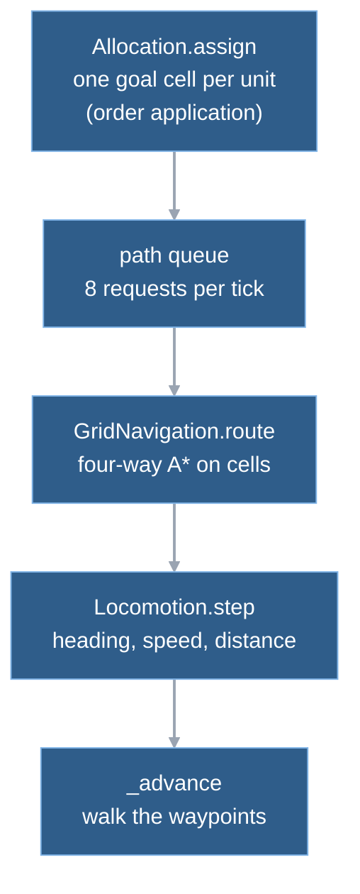

# 6. Movement

Three small scripts turn "send these tanks over there" into positions that change every tick: a grid pathfinder, a locomotion step that models heading and speed, and a destination allocator that gives each unit of a group its own end cell. The design is simple on purpose: units are points, the grid is four-way, nothing collides. **The movement and pathing milestone, planned and not started, rewrites this** (rectangle navmesh, size classes, any-angle paths; proposed, not built, see the end), so this chapter spends its words on the ideas and their known limits, not on every branch.

Unit avoidance, units going around each other, exists only on the branch `spike-avoidance` and is not part of this chapter; chapter 12 covers it as proposed work.

## Four steps from a click to motion

A move order passes through four steps. The first and last run inside the order's own tick; the middle two are spread over ticks by the path queue ([chapter 4](04-the-tick.md) has the pipeline).

- **Grid navigation** (`grid_navigation.gd`) wraps Godot's `AStarGrid2D` over the map's cells ([chapter 2](02-world.md)). It also labels connected regions of open cells (**components**), so "can this unit reach that cell at all" is an array lookup.
- **Locomotion** (`locomotion.gd`) is a static function that, per tick, turns the unit's heading, updates its speed and returns the distance it may travel. It knows nothing about the grid.
- **Destination allocation** (`destination_allocation.gd`) picks, for every ground unit of an order, a distinct goal cell near the clicked point. It needs only navigation's components and a list of cells to avoid.
- `simulation.gd` glues them: one function allocates and queues, one routes, one walks (names in "Where in the code").

## Six tanks, one click

A one-off headless script at the commit named at the end of this chapter: an open 40 by 20 map, six `usa_tank` standing in a column at x = 3.5 (y = 4.5, 6.5, ..., 14.5), one move command for all six to (30.5, 8.5), issued for tick 0.

1. The command is validated, due, and applied in phase 1. All six ids are collected into one group; air units would be split off here and given a straight one-waypoint route, ground units go on.  
   `_apply_orders → _assign_move`
2. The simulation lists the cells the group may not use: every cell holding a non-group unit, and every cell any unit already heads for.  
   `_assign_move → _unavailable_cells`
3. The allocator walks the units in id order. Each takes the nearest still-free cell to the target, nearest first, ties broken by row then column. The target cell itself is first in line, then its four neighbours, then the diagonals.  
   `Allocation.assign → _add_ring, _before`
4. So tank 1 gets the clicked point exactly, tank 2 the cell above it, tank 3 the left, tank 4 the right, tank 5 below, tank 6 the upper left diagonal. Ids decide, not where the tank stands: tank 6 starts lowest on the map and gets an upper-left slot.
5. Each tank gets status `path_pending` and joins the queue. Six requests fit under the cap of eight, so all six are routed in phase 6 of the same tick.  
   `_assign_move → _path_queue; _service_paths → _assign_route`
6. The route is a list of cell centres from the tank's cell to the goal, ending on the exact goal point. The routes here are 31, 28, 26, 30, 30 and 33 waypoints long: Manhattan distance, since diagonal moves are off.  
   `_assign_route → GridNavigation.route → AStarGrid2D.get_id_path`
7. Tanks 1 to 3 already face east and start rolling on tick 2, the two-tick start delay after standing still. Tanks 4 to 6 face east too, but their first waypoint is straight up, a 90 degree turn. A tank stops completely while it points more than 45 degrees off, so they turn for eight ticks (6 degrees each) and begin rolling on tick 8.  
   `Locomotion.step → heading_factor, turn`
8. From then on a tank rolls at 1.2 cells per second, 0.04 cells per tick, except at its one corner: a 90 degree turn stops it for 8 ticks and costs about 12 in all (arithmetic from the heading factor and the 6 degree step). The six arrive on ticks 651, 713, 773, 773, 788 and 848.  
   `_advance → Locomotion.step; unit.status = "arrived"`

| tank | goal cell | route waypoints | first moves | arrives |
|---|---|---|---|---|
| 1 | (30.5, 8.5), the exact click | 31 | tick 2 | 788 |
| 2 | (30.5, 7.5) | 28 | tick 2 | 713 |
| 3 | (29.5, 8.5) | 26 | tick 2 | 651 |
| 4 | (31.5, 8.5) | 30 | tick 8 | 773 |
| 5 | (30.5, 9.5) | 30 | tick 8 | 773 |
| 6 | (29.5, 7.5) | 33 | tick 8 | 848 |

The group arrives spread over about 200 ticks (6.6 s). The causes are visible in the table: slots assigned by id, not by distance; four-way routes, here an L with one corner, instead of a straight line; and a stand-still turn at the start or at the corner. The first leg differs between tanks because many four-way routes have equal length. Godot's search prefers, among equal estimates, the cell farther from the start (`SortPoints` in Godot 4.7.2's `core/math/a_star_grid_2d.h`), so it tends to run one leg out before it turns. Which of two equally good cells comes first is heap order, which Godot does not document. Tank 4's route runs along row 8.5 and, around tick 723 (arithmetic from the table), straight through tank 3, which has been parked on its goal since tick 651. Nothing checks for collisions.

## How each piece works

**Grid navigation.** `AStarGrid2D` is configured with square cells, the Manhattan heuristic, no diagonals and no jumping. Blocked cells are solid points. `route` returns cell centres, drops the start point if the unit already stands on it, and appends the exact target. The grid has no unit size: a route is valid for a point. It is built at match start and updated when the blocked cells change. A change takes the cheap path only when it is a rectangle that cannot split the open area, or a rectangle removed beside a single component; otherwise every component is relabelled. The map size is capped at 256 cells per side by an assert in the constructor.

**Locomotion.** Every ground kind carries a speed, an acceleration, a braking rate and a locomotor type (legs, treads or wheels) in its definition row ([chapter 3](03-entities.md)). Per tick:

- The unit turns toward its first waypoint by at most a fixed angle (the definition stores the cosine and sine of that step; for a tank they work out to 6 degrees per tick). Wheels turn in proportion to their speed, so a standing wheeled vehicle cannot pivot.
- The allowed speed is scaled down by the angle left to turn (`heading_factor`): treads and legs lose all speed at 45 degrees off; wheels keep a minimum turn speed.
- Speed rises by `accel / 30` per tick and may not exceed what brakes can stop within the remaining route (`sqrt(2 * brake * remaining)`). So braking is planned only for the end of the route. A corner is handled by the heading factor instead: the speed is cut in one tick, with no brake ramp, and treads and legs stop dead at a 90 degree corner.
- The returned distance goes to the advance step, which consumes it along the waypoints and ends the order when the route is empty.

Every per-second rate is divided by a literal 30, the tick rate ([chapter 4](04-the-tick.md)). The simulation uses no trigonometry (libm differs per platform): turn steps are precomputed literals and `angle_between` is a polynomial arctangent ([determinism rules](../reference/determinism-rules.md), Maths; [M6 verification](../reference/m6-verification.md): worst error 0.000095 degrees against `atan2`).

**Allocation.** A ring search around the target cell: ring r holds the cells at Chebyshev distance r; a cell is released from the pool only once no cell in an unexamined ring can be nearer, so the cost follows the group size, not the map size. Only cells in the target's component are candidates, so an unreachable target yields no goal and the unit becomes `blocked` instead of a failed search. A cell holding another group member is skipped, so a new slot never sits under a unit that has not yet left. A test pins the number of cells examined (`AL2` in `test_allocation.gd`).

## Trade-offs and limits

**Points on a four-way grid.** The first movement milestone chose this for a single vehicle, and the [movement](../reference/movement.md) note still labels it provisional: four-way zigzag routes, no footprint clearance. Its list of gaps was "no unit collision, dynamic blockers or group destination allocation"; allocation has since been added. A tank's `radius` in its definition does not enter navigation. A tank will route through a one-cell gap because the point fits.

**Units overlap in transit by design.** Temporary overlap during travel with distinct reserved goals was chosen ([group movement](../reference/group-movement.md)), so units never deadlock at a choke; the cost is that a group looks like a stream of overlapping sprites, and at the end it relies on goals being distinct. Units going around each other is a stated requirement; the avoidance branch explores it ([design answers](../reference/design-answers-2026-11-08.md#unit-avoidance-behaviour)).

**Blocked is final until the next command.** A unit with no route, no reachable goal or a goal cut off by a new obstacle becomes `blocked`, loses its order and stays put. A plain move order has no retry timer; collectors and combat chases bring their own (chapters 7 and 8). Whenever the blocked cells change (a building placed or destroyed, a source removed, terrain replaced), the simulation empties the path queue and re-queues every moving unit; the M4 scenario envelope measured 19 ticks to drain it with 150 units pending at the peak ([M4 envelope](../reference/m4-scenario-envelope.md)).

**Two costs are bursty, and neither is bounded by work done.**

- *Route search* is capped by request count, not by search work. In the 2026-11-08 team match the worst tick spent 6.2 to 6.3 ms of its 7.3 to 7.4 ms in the path service, a burst of at most eight searches on the Ashfall grid (times measured, the burst is the note's inference, [team-match profile](../reference/perf-spike-verification.md#t1b-team-match-zones)).
- *Allocation* is uncapped and runs inside order application. Since the ring rewrite it peaks at 0.15 ms in that match (measured, same profile); the 2 to 6 ms per call in the [M4 envelope](../reference/m4-scenario-envelope.md) predate the rewrite. Besides orders, a new unit leaving its factory for the rally point ([chapter 7](07-economy.md)) and a retaliating unit walking home ([chapter 8](08-combat.md)) call it once each. A halted attack-move unit resumes without it.

Two smaller limits are written in the code. A `shortcut:` comment in `destination_allocation.gd` says the pool is re-sorted per ring, "fine while pools stay small", with a merge as the upgrade. Locomotion measures the remaining route every tick, but stops walking the waypoints once the braking cap can no longer bind.

**Compared with Zero Hour.** Zero Hour also gives each unit of a group its own adjusted goal and queues path requests, but under a per-frame budget of searched cells, with eight-neighbour search and path optimisation; Wargrid counts whole requests, allocates canonical cells and routes four-way. The group note holds the source links; no formation or spacing parity is claimed ([group movement](../reference/group-movement.md), [movement gaps](../reference/zero-hour-movement-gaps.md)). M6 aligned the wheeled turning of the builder (`usa_builder`) with a retail parity trace ([M6 verification](../reference/m6-verification.md)); the blueprint asks for the same check on each new unit.

**What comes next (proposed, not built).** The movement and pathing milestone is provisionally decided as: a rectangle navmesh (the finer grid stays as the reference), three size classes, body-safe straightening, individual routes first, 8 routes per tick kept and measured, a 2 by 2 pathing grid per map cell and the 256-cell cap raised ([design answers](../reference/design-answers-2026-11-08.md#movement-and-pathing-user-2026-11-10)). Priority there: units not getting stuck and good performance, both ahead of exact Zero Hour parity. Its timing spike lives on the branch `spike-pathing`. Locomotion's weight (per-kind turn rates, rolling wheel turns) is meant to stay.

## Where in the code

- `game/scripts/simulation/grid_navigation.gd` — `route`, `is_walkable`, `component_at`, `replace_blocked_cells`, `blocks_locally`, `_single_neighbor_label`; wraps `AStarGrid2D`.
- `game/scripts/simulation/locomotion.gd` — `step`, `turn`, `heading_factor`, `angle_between`, `_wheel_turn`, `_route_length_until`.
- `game/scripts/simulation/destination_allocation.gd` — `assign`, `_add_ring`, `_settled`, `_before`; `last_cells_examined`.
- `game/scripts/simulation/simulation.gd` — `_assign_move`, `_unavailable_cells`, `_service_paths`, `_assign_route`, `_advance`, `_replace_union`; constants `PATH_REQUESTS_PER_TICK`, `START_DELAY_TICKS`.
- `game/tests/test_allocation.gd`, `test_groups.gd`, `test_locomotion.gd`, `test_movement.gd`, `test_navigation.gd`, `test_navigation_incremental.gd` — behaviour tests per piece.

## Further reading

- [Movement](../reference/movement.md) and [group movement](../reference/group-movement.md) — M1 and M2 rules; status labels there are `UNVERIFIED_REFERENCE`.
- [Zero Hour movement gaps](../reference/zero-hour-movement-gaps.md) — source-supported differences and what a parity measurement would need.
- [M2 groups plan](../superpowers/plans/2026-11-01-m2-groups.md) — the allocation and queue contract.
- [Performance ledger](../reference/performance.md) and [M4 scenario envelope](../reference/m4-scenario-envelope.md) — path queue and allocation costs.
- Previous: [5. Presentation](05-presentation.md). Next: [7. Economy](07-economy.md).

---
Checked against `2b108ab`. Files: `game/scripts/simulation/grid_navigation.gd`, `game/scripts/simulation/locomotion.gd`, `game/scripts/simulation/destination_allocation.gd`, `game/scripts/simulation/simulation.gd`, `game/scripts/simulation/definitions/usa.gd`, `game/tests/test_allocation.gd`
