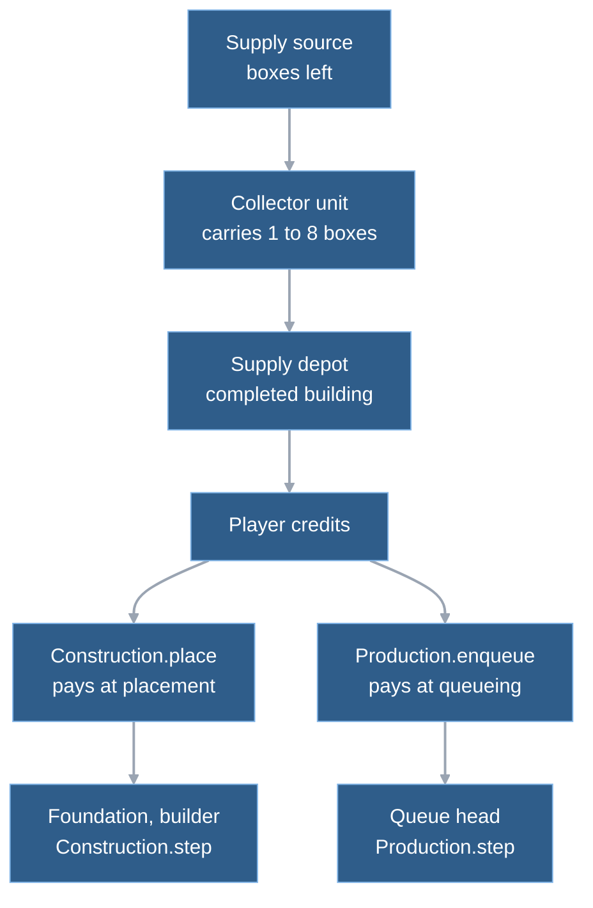
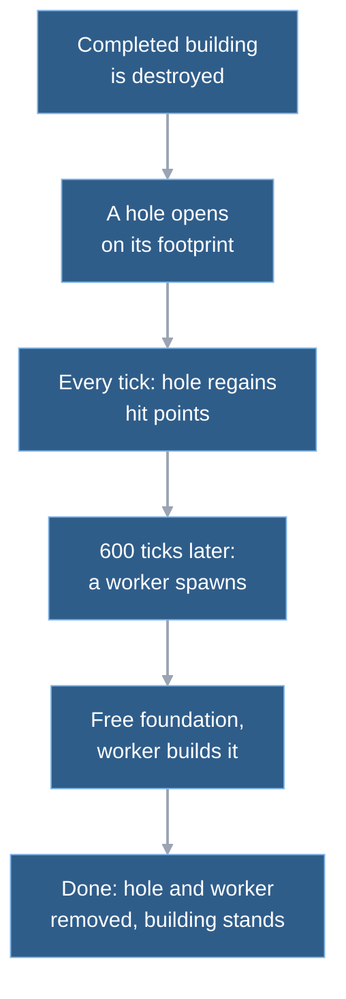

# 7. Economy and building

Money enters mainly when a collector unloads boxes at a depot (a supply center: any building whose row has `receives_supply`), and leaves when a building is placed or a unit queued. Everything else in this chapter exists to make those moments deterministic when several trucks, builders and factories compete for the same pile, the same footprint cells and the same exit cells. Most of it is a state machine per collector and an integer accumulator per build job. The shape follows Zero Hour's economy, and the supply loop was measured against Zero Hour (a source build, through the parity harness).

## Money in, money out

After setup, seven lines in the simulation change a player's credits. Unloading at a depot (`supply_collection.gd`) and picking up a salvage crate (`salvage.gd`) add. Placing a building and queueing a unit subtract the full price. Cancelling a foundation, cancelling a queue entry, and losing a building with units still queued refund the price stored on the record, not the current price. The bots keep their own copy of the balance for planning only (chapter 9).

The economy systems are the usual static functions that take the simulation (chapter 4), and they run in a fixed slot of `step`:

- Phase 3: `Construction.step`, then `RebuildHoles.step`.
- Phase 4: `Production.step`.
- Phase 5: `Supply.step`.
- Phase 7, after units moved: `Salvage.step`.

Work at a low power level is the one cross-cutting input. Before phase 3, `step` computes one work rate per player (`economy_definitions.gd` `work_rate`) from the power supplied and demanded by that player's completed buildings. Full power is 1000. A shortfall clamps the rate between 500 and 800 per thousand. Both construction and production add that rate to their progress each tick instead of 1000, so a brownout slows work down and never stops it.

## One truck, from idle to a tank

Take a China supply truck (`china_collector`: 4 boxes per load, 75 credits a box, 38 ticks to load a box, 37 to unload) with a completed depot and a pile on the map. The numbers come from the row; the cycle time below comes from a test that measures it.

**Getting started.**

1. When the depot finishes, the simulation spawns its free truck on a free cell around the depot. Because the truck carries supplies and the producing building receives them, it is switched on straight away, with phase `seeking`, instead of walking to a rally point. A truck trained later takes the same path.  
   `Construction.step → _spawn_on_complete → Production.spawn_unit → _send_out`

**Phase 5, each tick: seek.**

2. The truck's turn comes in `Supply.step`. Phase `seeking` waits for its `retry_tick`, then picks a target. Empty, it takes its preferred pile (set by a right-click gather) if that still has boxes, otherwise the nearest pile with boxes left by squared distance, ties broken by lower id. Loaded, it takes the nearest completed depot of its owner.  
   `Supply.step → _seek → choose_target → nearest`
3. For a ground collector the seek also claims a dock cell: the closest free cell of the one-cell ring around the target (corners included) that lies in the same walkable region as the truck. If there is none, the truck goes `idle` and retries 30 ticks later.  
   `_seek → _claim_dock → _ring`
4. The truck's goal is the dock cell's centre, shifted a quarter cell toward the target so a pile and a depot sharing a cell still get different standing points. Its phase becomes `flying_source` (the name is shared with helicopters, which really fly), and it joins the normal path queue.  
   `_seek → _arrival; sim._path_queue.append`

**Phases 6 and 7: travel.** Routing and movement are the ordinary pipeline from [chapter 4](04-the-tick.md); the collector is an ordinary unit with a move order the supply system wrote. If the route comes back `blocked`, the truck lets go of the dock and retries 30 ticks later.

**Phase 5, later ticks: dock, load, haul, unload.**

5. Each tick the supply step checks whether the truck stands exactly on its arrival point. When it does, the truck first stands a 5-tick lead (`lead_source`) that does not lock the pile. Then it is admitted: if the pile has no active collector and nobody who arrived earlier is waiting, the truck becomes the pile's `active_collector_id` and starts loading. Otherwise it waits and stores the tick its lead ended, so ground waiters are served in that order.  
   `Supply.step → _admit → _ahead`
6. Loading counts down 37 ticks per box and moves one box from pile to cargo each time. After the fourth box the truck waits one more 37-tick delay, then releases the pile: the 185-tick lock plus the 5-tick lead is 190 ticks standing still. The next tick it seeks again, this time with cargo, so it chooses a depot. (Laborer: lead 38, then 46. Chinook: lead 18, then 369.)  
   `Supply.step → _load_box → release`
7. The same admit logic runs at the depot (lead, then lock). Lead and lock for the depot: truck 0 + 37, Laborer 6 + 39, Chinook 60 + 153. When the truck's 37 ticks end, all cargo is paid at once: 4 boxes at 75 is 300 credits.  
   `Supply.step: credits += cargo * box_value`
8. The truck releases the depot and seeks the pile again on the next tick. One cycle ends.

How long a cycle takes depends on the distance. The pinned case is a depot and a pile 12.5 cells apart, centre to centre:

| | Ticks per cycle | Of which at the docks |
|---|---|---|
| Wargrid | about 647 (derived: 300 credits per trip at 834.6 credits per minute) | 227 (190 pile, 37 depot; lock 222: 185 pile, 37 depot) |
| Zero Hour | 650 (measured) | 238 (188 pile, 50 depot) |

The Wargrid rate is measured by `test_supply_parity.gd` ([economy verification archive](../reference/m7-verification-archive-economy.md); layout and constants in [rework plan](../reference/m7-economy-rework-plan.md)), the Zero Hour phases are in the [measured supply cycle](../reference/m7-supply-parity-measured.md). The 420 ticks left on Wargrid's side are driving, plus a few ticks per leg for the seek, the path queue and the start delay.

**Credits become a tank.** A China Rotary Gun Tank costs 800, so one truck needs about three trips, roughly 1940 ticks or 65 seconds, to pay for one. Say the player has 800 credits and a completed vehicle factory.

9. The player clicks the tank in the factory's menu. The driver submits a `produce` command (chapter 4). Validation checks that the building is the player's and completed, that the kind is in its `produces` list, that the factory's own prerequisite exists (a completed depot), that fewer than 9 entries are queued and that the player can pay.  
   `Simulation._validate → "produce"`
10. In phase 1 of the tick, `enqueue` subtracts 800 and appends an entry with `paid_cost` 800 and zero work.  
    `_apply_orders → Production.enqueue`
11. Each tick in phase 4, the factory adds the player's work rate to the entry at the head of the queue. The tank needs 300 ticks times 1000, so 300 ticks at full power.  
    `Production.step`
12. When the work is complete, `spawn_unit` places the tank on a free cell of the factory's perimeter. `_send_out` then orders it toward the factory's rally point (or the nearest reachable cell if the rally is on another island), and the entry leaves the queue. If every exit is occupied, spawning fails, the entry stays at the head with full work and the next tick retries.  
    `Production.step → spawn_unit → _send_out → rally_target`

## How a collector works

A collector's `collection` record carries a phase and a few numbers; the supply step reads it once per tick per unit.

| Phase | Meaning | Leaves when |
|---|---|---|
| `seeking`, `idle` | no target; `idle` is a seek that found nothing, or a switched-off collector | `retry_tick` reached, then `_seek` |
| `flying_source`, `flying_depot` | moving to the arrival point of a pile or depot | position equals the arrival point, then `_admit` |
| `lead_source`, `lead_depot` | arrived, standing before the lock window; does not hold the dock | timer ends, then `_admit` |
| `waiting_source`, `waiting_depot` | arrived, another collector holds the dock | released by `_admit` on a later tick |
| `loading`, `unloading` | holds the dock, counting `remaining_ticks` | timer ends |

**One collector per lock window, per source and per depot.** `active_collector_id` on the target is the lock; the lead before it is not exclusive. The queue among waiters is in `_ahead`: helicopters first (lowest id first), then ground units in the order they began waiting, then ground arrivals by id. When two leads end on the same tick the lower id wins, also over a Chinook. The comment in the code gives the aim: no truck starves.

**Release is the single exit.** `release` clears the target, the dock and the timer, and clears `active_collector_id` if this unit held it. It runs after a finished load or unload, when a route is blocked, when the pile or depot is removed, and when a player gives the unit any other order. That last case also switches the loop off until the next `gather`. Cargo survives all of these except the unit's own death.  
`Supply.step, object_removed, Simulation._detach_task → Supply.release`

**Only some kinds collect.** The row key `collects` (boxes, load ticks, unload ticks, box value, and `lock`: lead and box or work ticks per target) turns a unit into a collector. Helicopters skip the dock-cell and path steps: they fly straight to the target centre. A `gather` command sets the preferred pile and starts the loop. `_validate` rejects a `gather` on an empty pile only for collectors that carry nothing.

**Small piles vanish.** A source the map flags `delete_when_empty` is removed in the tick that takes its last box, through the normal `remove_object`, so the navigation grid is rebuilt and waiting collectors are released. Unflagged sources stay on the map empty. (Why the map has both: [world chapter](02-world.md) and the [small piles design](../superpowers/specs/2026-11-08-small-supply-piles-design.md).)

## Building: pay first, work later

A building goes from command to usable in four stages.

**Preview.** `Construction.preview` is the one legality check. Three callers use it: the placement ghost, the check when a command is issued and the placement on the due tick, so the three cannot disagree.  
`base_main → Simulation.preview_build; Simulation._validate; Construction.place`  
The checks, in order:

- the builder exists, belongs to the player and its row lists the kind in `builds`;
- the prerequisite building is completed (an unfinished foundation does not count);
- the player has the credits;
- the footprint (`footprint_error`): every cell walkable, no ground unit or unit destination on it, at least `BUILD_EDGE_MARGIN` cells from the map edge, and clear of supply sources by the row's `supply_clearance`;
- a navigation grid with the footprint blocked still lets the builder reach a perimeter cell (`approach`). The grid is only rebuilt for the preview when the footprint could cut a route (`blocks_locally`), and `place` reuses that grid.

**Place.** In phase 1, `place` subtracts the full cost and adds an unfinished building record with zero work and the price it was charged. Then the blocked cells are rebuilt. The foundation exists, and blocks cells, before any builder arrives. A foundation has no combat state until it completes, and `Production.step` skips it until then.

**Work.** `_attach_builder` sends the builder to the approach cell. `Construction.step` adds the player's work rate only while the builder stands exactly on that cell and has arrived. The target is the kind's build ticks times 1000. One builder per foundation: a second `resume_build` replaces the first. Re-ordering the builder drops the job but keeps the foundation and its progress; `resume_build` sends a builder back.

**Complete.** The building gets its combat state, the builder is freed, and `spawns_on_complete` units appear (the free collector at a depot). `cancel_build` of an unfinished foundation refunds `paid_cost` in full, whatever progress it had.

Work is an integer accumulator rather than elapsed time over total duration, so a power change affects only the future. That departs from Zero Hour deliberately: it computes progress as elapsed over the current duration, so a rate change retroactively moves progress ([M3 economy](../reference/m3-economy.md), "Construction, production and power rules"). Wargrid also refunds the stored price, which closes the exploit of cancelling after a price change.

### Rebuild holes

For kinds that define `rebuild_hole`, a destroyed completed building leaves rubble instead of nothing. That includes a seat's last building: the hole counts for victory, so an FRC seat is only out once its holes are destroyed too (`test_rebuild_holes.gd`, RH3). The one exception is a building that does not count for victory, the Tunnel Hub, when its owner has no counting building left (RH2). Today only the FRC rows define it. The hole is itself a building record (kinds `frc_hole_1` to `frc_hole_3`, by footprint size) with a `rebuild` sub-record, so it sits in the same table and counts for victory.

The rebuild reuses the ordinary construction path. The foundation is free, and the normal construction step builds it at the original building's build time and the player's work rate.  
`RebuildHoles._spawn_worker → Construction.place_rebuild; Construction.step`  
Four details differ from a normal build. On completion `site_completed` removes both the worker and the hole, and the free unit is not spawned a second time. If the worker dies, the hole waits another 600 ticks and the half-built foundation stays; if the hole or the foundation is destroyed, the worker goes with it. A normal builder cannot take over a foundation that a worker is currently building ("Foundation is being rebuilt"). Hole regeneration is 83 hit-point units per tick against a maximum of 500000, about 0.5 percent per second.

### Salvage crates

A vehicle killed by an enemy unit whose row has `salvage` leaves a crate on its cell, when the combat step removes the dead. `Combat.fire` calls `Salvage.on_death` for each dead object. The crate lasts 900 to 1050 ticks (random, from the simulation's own generator). `Salvage.step` runs after movement and gives the crate to the lowest-id salvager of any owner whose body touches it. A weapon salvager takes its next weapon tier first; a money salvager, or one with every tier, gets 25 to 75 credits. The scan is crates times salvagers each tick and is skipped when there are no crates; the code carries a `shortcut:` comment to grid it if the layout shows in the ledger.

## Zero Hour: what matched, how it was proved

The economy has the most Zero Hour measurement behind it. The method had three steps:

1. **Read the source and the retail INI** for box value, capacities, delays, speeds, costs, the dock rule and placement rules ([M3 economy](../reference/m3-economy.md), [M7 economy parity](../reference/m7-economy-parity.md)).
2. **Measure Zero Hour headless** with the parity harness (a source build): credits per minute for each collector type at up to three depot-to-pile distances, and for two and four collectors ([measured supply cycle](../reference/m7-supply-parity-measured.md)). Spreads between runs were mostly under 2 percent.
3. **Fit the free parameters** (load and unload ticks, with the pile hold folded in) and pin the result as a test, `test_supply_parity.gd`, within 5 percent of the measured rate per row ([rework plan](../reference/m7-economy-rework-plan.md)). Before the fit Wargrid was 7 to 86 percent faster than the game on single-collector rows, and up to 90 percent with two collectors (measured, [measured supply cycle](../reference/m7-supply-parity-measured.md)); after it, the single-collector rows are within 2 percent and the two-collector rows within 1.6 percent (measured, [economy verification archive](../reference/m7-verification-archive-economy.md)).

A later measurement shows where this fit is weakest. The [faction income comparison](../reference/faction-income-parity.md) plays whole openings (depot order, free collector, trained collectors, 600 s) in Zero Hour and in Wargrid. In net at 600 s, USA and China match within 3 percent, but their rows already sit on Wargrid's per-pile cap, so a larger opening would fall short. The FRC openings at the close depot fall 25 to 46 percent short.

Adopted (c1, user 2026-11-12 night): the pile and the depot are locked only for the lock window, the lead before it overlaps other collectors, as Zero Hour's dock grants do. Rebuilt on `c1-dock-rebuild`, not merged; rows in the [c1 dock rebuild verification](../reference/c1-dock-rebuild-verification.md). Measured close-depot steady rates (credits per minute): frc5 2085 (Zero Hour 2085), frc7 2550 (Zero Hour 2850), reported not judged. The experiment behind the choice: [dock-hold experiment](../reference/dock-hold-experiment.md).

What Wargrid takes over directly:

| Rule | Zero Hour (evidence) | Wargrid |
|---|---|---|
| Only the lock window is exclusive | `DockUpdate`, [rework plan](../reference/m7-economy-rework-plan.md) | `active_collector_id` |
| Last box costs one more delay | `AIDock`, [M3 economy](../reference/m3-economy.md) | loading waits once more with a full load |
| Pay everything at once at the depot | `SupplyCenterDockUpdate`, [M3 economy](../reference/m3-economy.md) | `unload` pays `cargo * box_value` |
| Cost charged at queueing or placing, refund in full | `ProductionUpdate`, `GameLogicDispatch`, [M3 economy](../reference/m3-economy.md) | `paid_cost` on the record |
| Queue of 9, head works, a blocked exit keeps the head | same note | `queue.size() >= 9`; `Production.step` |
| Low power slows, never stops | `Player`, `ThingTemplate`, same note | `work_rate` clamp 500 to 800 |
| Rebuild holes: worker after a delay, slow regeneration | [factions note](../reference/m7-factions.md) | `RebuildHoles`, 600 ticks, 83 per tick |
| Salvage crate lifetime and amounts | [factions note](../reference/m7-factions.md) | `SALVAGE_CRATE` in `definitions/shared.gd` |
| Depot keeps a gap to a pile | [placement rules](../reference/m7-placement-rules.md) rule 1 | `supply_clearance` 1, rounded up |

Where Wargrid differs, and what the notes say about it:

- **Search radius.** Zero Hour collectors do not start toward a pile beyond a scan distance. Wargrid searches the whole map. Deferred, not built ([rework plan](../reference/m7-economy-rework-plan.md)).
- **Clearance timeout.** Zero Hour's clearance timeout for a waiting collector is not modelled, so waiters never look for another pile ([rework plan](../reference/m7-economy-rework-plan.md), residual risks).
- **Four helicopters.** Four helicopters at one depot produce 10.6 percent less than the game (3116 measured versus 2787); the row is reported, not gated, with a suspected harness artefact ([rework plan](../reference/m7-economy-rework-plan.md)).
- **Placement.** The edge margin is 1 cell, rounded down from Zero Hour's (kept to keep maps playable, a choice recorded in [placement rules](../reference/m7-placement-rules.md), rule 2). Factory exit lanes are not implemented. Wargrid is stricter than the game about ground units standing on a footprint: it refuses where Zero Hour pushes them aside.
- **Salvage rules.** Zero Hour requires the owner to have a faction science, shows the crate to that player only and sometimes gives a veterancy level instead of money; Wargrid has no sciences, no fog and no veterancy, so any hostile salvager qualifies and the level branch became money ([factions note](../reference/m7-factions.md), comment in `salvage.gd`).
- **Geometry.** Footprints are cell-snapped boxes and Wargrid's buildings are smaller than the game's (placement rules, "Scale caveat"). Helicopters fly straight with no ropes or altitude.

## Trade-offs and limits

**The loop polls instead of reacting.** A collector with no target retries every 30 ticks; one that just finished retries after one tick. Events could wake it, but a poll needs no cleanup when a pile or depot dies in some other system, and `release` is the only place that has to be right. The price is whole-table scans: target choice loops all buildings or sources, and dock claiming and admission loop all entities, per call.  
`Supply.choose_target, _claim_dock, _admit`  
 The measured share is small: `step.supply` took 2, 10 and 2 percent of `step` on three scenarios (mean 0.016, 0.112, 0.043 ms; measured, [data layout decision](../reference/data-layout-decision.md), section 2), and the ledger has no budget row for it alone. No `shortcut:` comment marks these scans. Speculation: a few dozen collectors per match stay cheap; hundreds would show.

**Exact float equality means arrival.** A collector is "at the dock" when its position equals the arrival point exactly. That works because `_advance` writes the waypoint itself when a move reaches it. A unit that stops short (blocked, or displaced) is not treated as arrived; the blocked check and the retry cover the blocked case.

**Production exits are the known hot spot.** In the M6 follow-up a building with a blocked exit retried every perimeter cell every tick and `step.production` dominated; `Simulation.occupied_cells()` is now built once per production step and shared (p95 0.776 to 0.119 ms; measured, [M6 verification](../reference/m6-verification.md)). A blocked head still retries every tick.

**Gaps the code admits.** The free unit of a finished building gets one spawn attempt: if every exit cell is occupied, it is lost (a `shortcut:` comment says upgrade if a playtest shows it).  
`Simulation._spawn_on_complete → Production.spawn_unit`  
 Air units never block on an exit. Multi-unit batches need as many free exit cells as the batch size or nothing spawns.

**Why pay at placement.** Taking the whole price at the moment of placing means no "reserved credits" ledger and no case where a half-built building is waiting on money. The cost is that credits are locked in a foundation nobody may ever finish; cancel refunds in full to compensate. A queue behaves the same way. This is also what Zero Hour does ([M3 economy](../reference/m3-economy.md)).

**Determinism.** The building systems sort their ids, the supply step receives the sorted unit ids, and the scans over unordered tables end in a tie-break (squared distance then id; arrival tick then id) or only ask a yes/no question. Salvage amounts and lifetimes use the simulation's own generator (`next_random`), consumed in tick order. The pins that moved when the economy was re-fitted are listed in the [economy verification archive](../reference/m7-verification-archive-economy.md).

## Where in the code

- `game/scripts/simulation/supply_collection.gd` — `step` (the phases), `choose_target`, `nearest`, `_seek`, `_claim_dock`, `_ring`, `_arrival` (`DOCK_SHIFT`), `_admit`, `_ahead`, `release`, `object_removed`.
- `game/scripts/simulation/construction.gd` — `preview`, `footprint_error`, `_near_source`, `approach`, `perimeter`, `place`, `place_rebuild`, `resume`, `cancel`, `step`.
- `game/scripts/simulation/production.gd` — `enqueue`, `cancel`, `refund_all`, `step`, `spawn_unit`, `free_exits`, `_send_out`, `rally_target`, `default_rally`, `spawn_air`.
- `game/scripts/simulation/rebuild_holes.gd` — `step`, `building_removed`, `unit_removed`, `site_completed`, `being_rebuilt`.
- `game/scripts/simulation/salvage.gd` — `on_death`, `step`, `collect`.
- `game/scripts/simulation/economy_definitions.gd` — `work_rate`, thin views of the registry.
- `game/scripts/simulation/simulation.gd` — the `_validate` branches for build, produce and gather, `_apply_orders` (placement, enqueue), `_attach_builder`, `_detach_task`, `_player_snapshots` (power and `work_rate`), `_spawn_on_complete`, `add_supply_source`, `remove_object`.
- `game/scripts/simulation/definitions/definitions.gd` and `game/scripts/simulation/definitions/shared.gd` — `BUILD_EDGE_MARGIN`, `SOURCE_FOOTPRINT`, `SALVAGE_CRATE`; row keys `collects`, `receives_supply`, `supply_clearance`, `spawns_on_complete`, `rebuild_hole`, `hole`, `salvage`.
- `game/tests/test_supply_parity.gd` — the Zero Hour rate targets; `game/tests/test_supply.gd`, `test_rebuild_holes.gd` — behaviour cases.

## Further reading

- [M3 economy](../reference/m3-economy.md) — source-read rules behind the first slice (a dated research note: some M3 departures, such as leaving at capacity and a single 200-box source, were later replaced).
- [M7 economy parity](../reference/m7-economy-parity.md), [measured supply cycle](../reference/m7-supply-parity-measured.md), [rework plan](../reference/m7-economy-rework-plan.md), [economy verification archive](../reference/m7-verification-archive-economy.md) — how the rates were measured and fitted.
- [M7 placement rules](../reference/m7-placement-rules.md) — placement rules, one by one.
- [M7 factions](../reference/m7-factions.md) — hole and salvage evidence.
- [Zero Hour parity harness](../reference/zero-hour-parity-harness.md) — how the real game is driven.
- [Faction income parity](../reference/faction-income-parity.md) — whole-opening income per faction against Zero Hour, the per-pile cap, the decision list.
- Previous: [6. Movement](06-movement.md) moves the collectors; next: [8. Combat](08-combat.md) ends buildings and units that leave holes and crates.

---
Checked against `e9d79b4`. Files: `game/scripts/simulation/supply_collection.gd`, `game/scripts/simulation/construction.gd`, `game/scripts/simulation/production.gd`, `game/scripts/simulation/rebuild_holes.gd`, `game/scripts/simulation/salvage.gd`, `game/scripts/simulation/economy_definitions.gd`, `game/scripts/simulation/simulation.gd`, `game/scripts/simulation/combat.gd`, `game/scripts/simulation/definitions/definitions.gd`, `game/scripts/simulation/definitions/shared.gd`, `game/scripts/simulation/definitions/china.gd`, `game/scripts/simulation/definitions/usa.gd`, `game/scripts/simulation/definitions/frc.gd`, `game/tests/test_supply_parity.gd`, `docs/reference/faction-income-parity.md`
