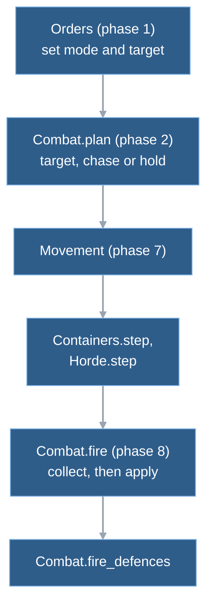
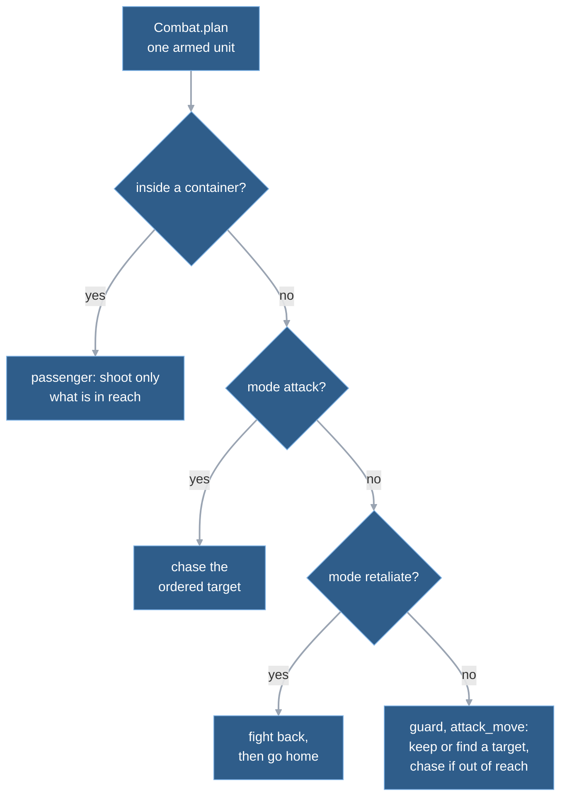

# 8. Combat

A battle is hundreds of units that each have to decide, every tick, whom to shoot, whether to chase and when the weapon is ready, and every machine in an online match must reach the same answer. Wargrid keeps that affordable and deterministic with three habits: units look for targets on a staggered timer, not every tick; every shot of a tick is computed before any damage is applied; and a unit that moved this tick does not fire. Combat is two static functions on either side of movement, plus three small rules systems (rate bonuses, containers, defences) that hang off the same tick.

## Combat sits on both sides of movement

[Chapter 4](04-the-tick.md) shows where combat sits in the tick. This is the part that matters here:

`plan` decides, before anything moves, who is chasing what. After movement, passengers follow their container and horde levels are updated. `fire` then shoots, so range is tested on final positions, and `fire_defences` lets buildings with a weapon do the same. The state is one `combat` dictionary per armed unit, built by `initial_combat`, which holds:

- the **mode** (chapter 4 calls it the intent): guard, move, attack-move, attack or retaliate;
- the current target id, the tick the weapon is next ready and the rounds left in the clip;
- timers for the next scan and for retaliation and, for kinds that need them, a weapon tier, ramp counters or a horde level.

An unarmed kind has no `combat` dictionary. `step` builds the sorted list of armed ids once per tick and hands it to the three combat-related calls.

## One tank shoots another, tick by tick

Take two Battle Tanks. Player 1's tank A stands idle in `guard` mode and belongs to a human seat. Player 2's tank B is driving to a spot well inside A's reach, so its mode is `move` until it arrives: while it drives it ignores A, and `fire` skips it because it has no target. Let T be the first tick on which A's scan runs after B's edge is within weapon reach; B is still driving on tick T.

**Before T.** B's movement brings it within reach. A has not noticed, because A scans on a timer.

1. Each time A's scan finds nothing, it schedules the next scan for the next tick where tick plus unit id divides by 8. So B can be inside reach for up to seven ticks before A looks. The period is `REPATH_TICKS`; the ledger notes it matches the retail idle-scan check.  
   `Combat.plan → _nearest; combat.repath_tick`

**Tick T, phase 2: acquire.**

2. A's scan runs. A's owner is human and A is not re-targeting, so the search radius is the weapon reach, tested edge to edge. For the tank's cannon that is a centre distance of about 7.3 cells: range 6.0 minus a 0.1 slack, plus the two radii of about 0.72 (arithmetic from the definitions). The search reads only the buckets of an 8-cell grid that cover the window, and picks the nearest hostile, the lowest id on a tie.  
   `Combat.plan → _grid → _nearest`
3. B is in reach, so there is nothing to do: no chase, no path request. A's `target_id` is now B.  
   `Combat.plan → _engage → _in_range`

**Tick T, phase 7.** A is idle, so nothing moves it and it does not appear in the `moved` list.

**Tick T, phase 8: fire.**

4. `fire` visits A. A did not move, it has a target, its weapon is ready, and the target is a valid one (hostile, ground, not inside a container) and in reach. So A shoots on the same tick it saw B: there is no aim or wind-up time (see "Turrets" below).  
   `Combat.fire → valid_target, _in_range`
5. The damage is the weapon's damage times the target's armour percent for that damage type. The cannon does 60,000 milli-HP of armour-piercing damage, which a tank takes at 100 percent: 60 of its 480 HP. The shot is recorded as an event, and the damage goes into a pending table, not onto the target yet.  
   `Combat._hit → CombatDefinitions.armor_percent`
6. The cannon has a splash radius of 0.2, so the splash code also looks for victims at the impact point. Normally there are none besides B; a friendly unit standing there would be hit too.  
   `Combat._splash → splash_victims`
7. The reload sets the next fire tick to T + 60: the cannon has no clip, only a 60-tick delay.  
   `Combat._reload → bonus_delay`
8. After all units have been visited, the pending damage is applied: B drops to 420 HP. The shot event stays readable through `combat_events` until the next `step` clears it.  
   `Combat.fire: hit.hp = maxi(0, hit.hp - damage[id])`

**After the tick.** The driver hands the events and the new state to presentation. This is the only place a turret turns, and nothing in the simulation waits for it.

9. The visual director adds a muzzle flash at A and a hit flash at B. It also steps A's drawn turret toward B by at most 0.15 rad per refresh that brings a new tick, so a half turn takes at least 21 ticks, about a third of the reload (arithmetic from `TURRET_RATE`). The shot has already happened by then.  
   `skirmish_main → VisualDirector.collect_step; WorldView → VisualDirector.update → _aim`

**Ticks T+1 to T+59.** `plan` keeps A's target: it is still valid and still in reach, so there is no rescan. `fire` skips A because the tick is before the weapon is ready again.

**Ticks T+60, T+120, ... T+420.** A fires again every 60 ticks. Had B only driven past, it would be through A's reach in at most 367 ticks, with at most seven hits and 60 HP or more left (arithmetic: a 14.7-cell chord at 0.04 cells a tick). Here B's move ends inside the reach. On arrival `plan` flips B to guard, B scans, finds A and fires back on its own 60-tick cycle. B's first shot comes after T, because B was still moving on tick T. So at A's eighth shot, at T + 420, B has fired at most seven: B drops to 0 and A keeps at least 60 HP.

10. `fire` sees that B's pending damage reaches its HP, finds the killing shot and passes its shooter to the salvage rule. It then records a death event and removes B.  
    `Combat.fire → _killers; Salvage.on_death; Simulation.remove_object`
11. Removal clears the target of every unit that aimed at B and makes it scan again on its next `plan`, so A looks for a new target on tick T + 421.  
    `Simulation.remove_object → Combat.object_removed`

If B and A had spotted each other on the same tick, both would have lost 60 HP per volley and both died on the eighth, in the same `fire` call. Damage is applied after every shot is collected, so id order gives no first-shot advantage.

If B had been out of reach at step 3, A would not have chased: a human-owned guard only ever sees what is already in reach. A chase starts in other cases: an explicit attack order, a retaliating unit, a bot-owned unit (its scan is wider, below), and a human unit that lost its target while attack-moving. The chaser picks a free cell inside its weapon's reach of the target and queues a path request, and phases 6 and 7 move it there. The path-queue cap from chapter 4 applies. Once the target is in reach, `plan` halts the chase.  
`Combat._engage → _approach → _firing_cell`

## Who decides what, per mode

`plan` visits every armed unit in id order. The branch it takes depends on the unit:

`Combat.plan → _plan_passenger, _pursue, _plan_retaliate, _engage`

A unit on a plain move order takes no part: it neither looks for targets nor shoots until it stops, and then `plan` flips it back to guard (unless it is walking to a container). `attack` is the only fighting mode that never scans. It follows the ordered target until the target is gone, then drops back to guard. The rest of this section covers the other three.

**Guard and attack-move** run the same loop: keep the target or rescan, then stand or chase.

- *Keep or drop.* A target is kept while it is hostile. A human-owned unit that stands also drops a target that left its weapon reach.
- *Rescan*, at most once per cadence tick. A human-owned unit scans its weapon reach only, so an idle human guard never chases. A bot-owned unit scans its vision times a guard modifier, which is wider. A human unit that lost its target while attack-moving gets one wide scan too. "Bot-owned" means the player's `controller` is `ai` (README appendix). Both modifiers are constants named after the retail guard settings.
- *Chase.* With a target out of reach, the unit drives to a firing cell. An attack-moving unit first stores its original destination.
- *Resume.* When the target dies or comes into reach, the unit halts and gets that destination back. It is routed again without a new destination allocation (the second fix under "Trade-offs and limits").

`Combat._engage, _halt; Simulation._chases`

**Retaliate.** After a volley, each shot is checked: if the victim's owner is not a bot and the attacker is within 8 cells of the victim, that owner's idle guards near the victim switch to `retaliate`. They remember where they stood as `goal` and take the attacker as target for up to 300 ticks. Leashes on the distance from home and from home to the attacker send them back. Bots skip this rule; their reach comes from the larger scan above.  
`Combat.fire → _retaliate_trigger → _join_retaliation; _plan_retaliate → _go_home`

**Passengers.** A unit inside a container never chases. It loses its target if the container forbids shooting, and otherwise keeps a hostile target in reach or rescans on the same cadence with the weapon reach as radius.  
`Combat._plan_passenger`

## Reach, reload and the damage rules

**Range is edge to edge.** The gap is the distance between the two centres minus both radii; a building uses its footprint centre and half the footprint diagonal as radius. A shot is possible when the gap is at most the weapon range minus `RANGE_SLACK`, so units fire a little inside their stated range. The measured values are in the [M6 verification](../reference/m6-verification.md).  
`Combat.edge_gap, _reach, _in_range`

**Reload is a cooldown in ticks.** With no clip, the next shot comes one delay after the last. With a clip, each shot uses a round and the next comes after the short delay; when the clip empties it refills and the long reload runs from the last shot. The rifle's clip of three with delays 4, 4 and 22 gives a 30-tick cycle (`test_rifle_cycle_30`, [M6 verification](../reference/m6-verification.md)).  
`Combat._reload`

**Weapon data is shared.** One table holds every weapon and one the armour matrix, both in `definitions/shared.gd`; a unit definition only names them (chapter 3). A kind with `weapon_tiers` fires the weapon of its current tier, which the salvage rule raises (chapter 7). Health and damage are integers in thousandths of an HP, so a rifle shot at a tank is 1.25 HP, not 1 ([M4 combat reference](../reference/m4-combat.md)).  
`Combat.weapon_of; CombatDefinitions.armor_percent`

**Damage is instant.** A shot has no travel time: it is an event with attacker, target and amount, and the damage lands the same tick. There are no projectiles and no line-of-sight test in `combat.gd`. Splash adds to the same pending table. It reaches every ground object near the impact whose side the weapon affects, and for cannons that includes the shooter's own side. The victims come from a cell index of live positions, built once per fire pass at the first splash shot (`fire_defences` builds its own, because deaths in `fire` can release passengers and open rebuild holes before it runs); the victim test itself is the plain distance check, and victims are sorted by id. Against infantry the impact point is moved by a random scatter drawn from the simulation's own generator, and a wider blast applies.  
`Combat._hit, _splash → _splash_index, splash_victims`

**One volley, then removal.** `fire` first goes over all units in id order and appends their shots. Only then does it find the dead (pending damage at least equal to HP), credit each kill to the first shot that reaches the HP, apply the damage, trigger retaliation and remove the dead in id order. That order is why trades are fair and why a removal cannot disturb the loop.

**Defences use the same weapons.** `fire_defences` runs after `fire`, over completed buildings that have a weapon, in id order. A defence without a valid target scans every object, at most once per `DEFENCE_SCAN_TICKS` (8) ticks. It keeps its target while that stays valid and in reach, and accepts a `defence_attack` command from its owner. A powered defence does not fire while its owner's power balance is negative. A defence destroyed by units this tick never fires, because `fire` removed it first.  
`Combat.fire_defences → _defence_pick, _is_dark`

## Rate bonuses: the rotary-gun ramp and the horde

Two mechanisms change a unit's fire rate. Both work by scaling the delay between shots in one function, `bonus_delay`.

**Ramp.** A rotary weapon (the Rotary Gun Tank and the Rotary Gun Tower) counts consecutive shots at one target and speeds up in two steps. The counters live in the unit's `combat` dictionary.  
`Combat._ramp_after_shot`

**The horde.** China's Militia and Anti-Tank Trooper (matching on class) and its Medium Tank (matching on exact kind) carry a `horde` rule: a count, a radius and the match.

- `Horde.step` runs in phase 7, after movement, and re-checks each member on its own timer: every 30 ticks for infantry, 31 for the rest. The first check is a random 1 to 30 or 31 ticks after spawn, drawn from the simulation's generator, so the checks do not all land on one tick.
- A check counts allied units of the right match within the rule radius, edge to edge, using a coarse grid built once on a tick where some member is due. Count minus one of them gives level 2.
- A unit with fewer neighbours, but touching a level-2 neighbour, gets level 1.
- Both levels give the same bonus: the delay is multiplied by 100/150 (`HORDE_RATE_PERCENT`) and floored, so a 30-tick delay becomes 20.
- When a unit enters or leaves the horde, a pending delay restarts from the current tick at the new rate. That mirrors Zero Hour ([M7 factions](../reference/m7-factions.md), horde and rate-of-fire entries, with source citations).

The presentation draws a ring under horde members from a flag in the view rows (chapter 5).  
`Horde.step → _level → _set_level → Combat.restart_wait`

Were a kind to have both a ramp and a horde, only the horde would count; a `shortcut:` comment on `bonus_delay` says so. No kind in the definitions has both.

## Containers: units inside units

A **container** is a unit or building with a `contains` rule in its definition (the code calls the host the carrier). Three kinds have one: the USA Scout Car and the FRC Armed Pickup (5 infantry slots each), and the FRC Tunnel Hub, a building whose 10 slots are shared across all of that player's hubs. The rule says who may enter, how many, whether passengers shoot and what a destroyed carrier does to them.

1. An `enter` command is validated against owner, class and free slots (minus promises from other walkers). Each walker then gets a destination at the host (a vehicle) or on a cell beside it (a hub), an `enter` order and a path request.  
   `Simulation._validate → Containers.enter_error; _apply_orders → Containers.head_for`
2. Each tick, right after the advance loop, every carrier's position is copied to its passengers, and each walker checks its gap to the host. Within half a cell the unit boards.  
   `Containers.step → _walk → _board`
3. Boarding sets `container_id` on the unit, status `contained` and speed 0, and inserts its id into the sorted passenger list (the player's shared tunnel list for hubs).  
   `Containers._board`
4. From then on the unit is out of play. A command that names only passengers is rejected ("Unit is inside a transport"), and in a group command the passengers are skipped. Nothing can target them, the scan grid and splash skip them, and the horde ignores them.  
   `Simulation._commandable; Combat.valid_target`
5. A passenger may fire if the rule allows it. Its position is the carrier's, the moved list leaves out contained units, and so `fire` treats a passenger as a unit that stood still. Scout Car passengers therefore fire while the car drives. When one shoots, retaliation targets its carrier.  
   `Combat._plan_passenger; Combat.fire`
6. `unload` puts each passenger, in id order, on the nearest free walkable cell within four cells of the host and sets it to guard.  
   `Containers.unload → _exit_all → _free_cell`

When a carrier dies, each passenger first takes the rule's share of its max HP as damage (all of it for the Scout Car, which kills them; 10 percent for the pickup), and the survivors are placed around the wreck. When a player's last Tunnel Hub dies, every occupant dies with it; when another hub survives, the occupants move into it. Inside the network, occupants heal every tick.  
`Containers.object_removed → _release; building_removed → _relocate, _bury; Containers._heal`

## Turrets: drawn, not simulated

The simulation has no turret. Combat never reads a unit's facing (`combat.gd` has no use of `heading`), and hull turning runs only for moving units. A tank that stops fires on the same tick if its weapon is ready. The turret you see turning belongs to `VisualDirector._aim`, which follows the target in the view rows at a fixed `TURRET_RATE`.

That is a stand-in. The [design answers](../reference/design-answers-2026-11-08.md#turret-aiming-user-2026-11-10-impact-note) decide that a tank's turret must point at its target before it fires, at a rate per kind, as part of a planned ground-combat milestone (ground batch A). It is **decided, not built**. The [impact note](../reference/turret-aiming.md) lists what it would change:

- one more condition in `Combat.fire` and `fire_defences`;
- a turret vector in the `combat` dictionary, which the snapshot and the state hash would pick up;
- a re-pin of every trace that depends on first-shot timing;
- turreted units firing while they drive once the turret is aligned, decided with the same answers; units without a turret still stop to fire.

## Trade-offs and limits

**Why plan before and fire after.** Checking range after movement keeps an engaged unit from shooting a target that already left, and "moved units do not fire" keeps the rules simple. The price is no firing on the move today. That changes with the turret rule: turreted units will fire while driving (decided, not built; same design answers, from a reading of the Zero Hour source).

**Target search moved to a staggered grid.** The first combat spike rescanned every enemy per unit per tick and measured 12.5 to 15.3 ms p95 for 150 against 150 ([performance ledger](../reference/performance.md), "Known M4 combat cost risks"). Two fixes followed: rescans every few ticks, staggered by id, and halted attack-move units resuming without a new allocation. A grid of 8-cell buckets came next.

A profile of 2026-11-11 on the Mac mini ([data layout decision](../reference/data-layout-decision.md), section 2; measured with the profile tool) gives `step.combat_plan` as 0.370 ms mean on the 210-unit 3v3, 0.403 on the team match and 0.796 on hordes300, which is 53, 38 and 40 percent of `step`. Building the grid is about 9 percent of `step`; the nearest-target search is 1 to 7 percent. `step.combat_fire` is 0.173, 0.130 and 0.136 ms. Whether that fits the target device is the question of chapter 12. The M4.1 stress layouts `open` and `dense` exceed the ledger's p95 budget (1.67 ms then, 1.82 ms now); they are report-only rows with pinned ceilings.

**Big splash fights used to hitch; they no longer do.** Fights are bursty. The ledger records a peak of 11.2 to 11.4 ms at tick 420 in the `contact` layout, 10.2 ms of it in `step.combat_fire`, because that layout fires synchronised volleys every 60 ticks (report-only). Most of that was splash victims: with the cell index the headless benchmark's contact worst tick is 3.6 ms and `combat_fire` is 2.7 ms at its worst in the profile ([performance ledger](../reference/performance.md#history)). The verification file puts the time in damage and death handling over all armed units, and the 2026-11-05 spike found allocation calls from retaliation inside the same zone ([perf spike verification](../reference/perf-spike-verification.md), [performance spike](../reference/performance-spike.md)). The split between the two is not profiled on the current tree. One candidate from reading the code: every removal runs `Combat.object_removed` over all units (speculation).

**Documented shortcuts.** Three `shortcut:` comments in `combat.gd` mark known limits: the defence scan looks at every object; retaliation joiners are found by scanning idle guards per shot; and horde beats ramp. The first two name the ledger result that would trigger a fix. The [M4 scenario envelope](../reference/m4-scenario-envelope.md) measured 6.0 to 6.3 ms per allocation call on a 64x64 map before the allocation was rewritten to expand rings; that cost is why a resuming unit skips allocation.

**Humans and bots scan differently.** A bot's army wakes up and chases from further away than a human's idle units react. The constants cite the retail guard settings, but the rule is not symmetric, so keep it in mind when reading bot results (chapter 9).

**The horde check has no profile zone of its own.** It runs inside `step.advance`, next to movement and containers, which is 48 percent of `step` on hordes300 (0.951 ms; same table). Its grid is built only on ticks where a member is due.

**Zero Hour comparison.** The retail game also rescans on a cadence and gives the horde a fire-rate bonus; Wargrid takes those shapes and writes its own code. The M4 reference lists the departures it chose at the time (no projectiles, no line of sight, simultaneous damage); it is dated 2026-11-03 and predates splash and friendly fire, so read the code for those ([M4 combat reference](../reference/m4-combat.md)).

## Where in the code

- `game/scripts/simulation/combat.gd` — `plan` (per-unit decision), `_engage`, `_approach`, `_firing_cell`, `_nearest` with `_build_grid`, `fire`, `fire_defences`, `_hit`, `_splash`, `_splash_index`, `splash_victims`, `_reload`, `_ramp_after_shot`, `bonus_delay`, `restart_wait`, `object_removed`, `_retaliate_trigger`; constants `REPATH_TICKS`, `RANGE_SLACK`, `DEFENCE_SCAN_TICKS`, `RETALIATION_TICKS`, `GRID_CELL`.
- `game/scripts/simulation/combat_definitions.gd` — `profile`, `weapon`, `radius`, `vision`, `armor_percent`, `initial_combat`.
- `game/scripts/simulation/definitions/shared.gd` — `WEAPONS`, `ARMOR`, `HORDE_RATE_PERCENT`.
- `game/scripts/simulation/horde.gd` — `step`, `rate`, `first_check`, `_level`, `_set_level`.
- `game/scripts/simulation/containers.gd` — `enter_error`, `head_for`, `step`, `_board`, `unload`, `object_removed`, `building_removed`.
- `game/scripts/simulation/simulation.gd` — `step` (phases 2, 7 and 8), `_set_intent`, `_stop_unit`, `remove_object`, `combat_events`.
- `game/scripts/presentation/visual_director.gd` — `collect_step`, `update`, `_aim` and `TURRET_RATE`: turret and flash effects, drawn from the shot events.
- Tests: `game/tests/test_combat.gd`, `test_combat_navigation.gd`, `test_defences.gd`, `test_ramp.gd`, `test_horde.gd`, `test_containers.gd`, `test_tunnels.gd`.

## Further reading

- [M4 combat reference](../reference/m4-combat.md) — provenance of the first weapon and armour numbers. It predates splash and friendly fire; the code is newer.
- [Turret aiming](../reference/turret-aiming.md) — what the decided-but-unbuilt turret rule would change, with questions still open.
- [M7 factions](../reference/m7-factions.md) — horde, ramp-up and container rules and their source citations.
- [M4 scenario envelope](../reference/m4-scenario-envelope.md) — army sizes and path costs measured before combat existed.
- [Performance ledger](../reference/performance.md) and [data layout decision](../reference/data-layout-decision.md) — combat cost rows.
- Next: [9. AI](09-ai.md) issues the commands that drive the bot armies; [5. Presentation](05-presentation.md) draws the shots and the turret.

---
Checked against `389c9aa`. Files: `game/scripts/simulation/combat.gd`, `game/scripts/simulation/combat_definitions.gd`, `game/scripts/simulation/containers.gd`, `game/scripts/simulation/horde.gd`, `game/scripts/simulation/simulation.gd`, `game/scripts/simulation/definitions/shared.gd`, `game/scripts/simulation/definitions/usa.gd`, `game/scripts/simulation/definitions/china.gd`, `game/scripts/simulation/definitions/frc.gd`, `game/scripts/presentation/visual_director.gd`, `game/scripts/skirmish_main.gd`
