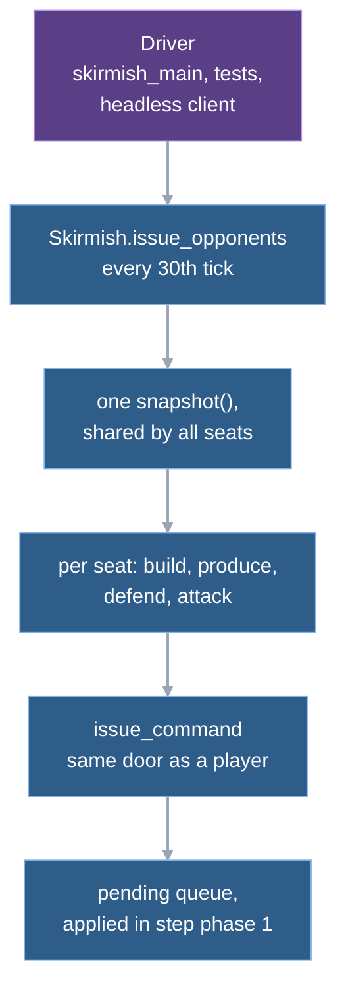
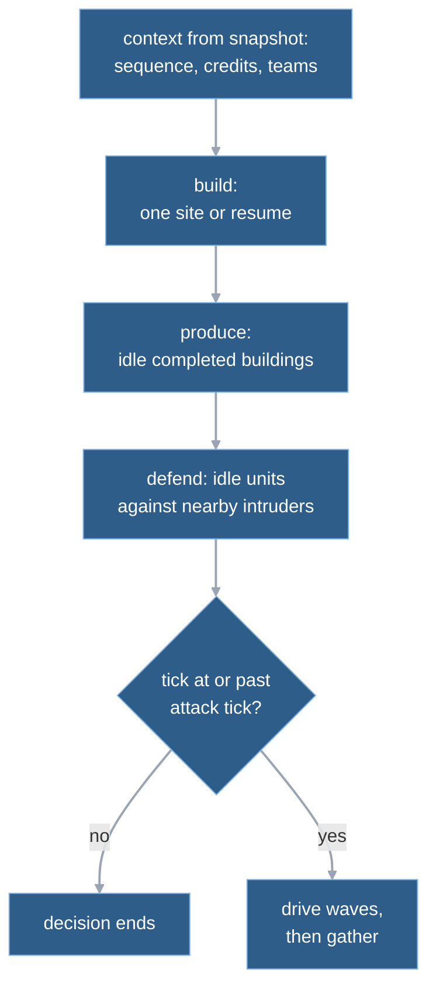

# 9. AI

The computer opponent is not part of the simulation's rules. It is a function that looks at a snapshot once a second and then issues ordinary commands, the same dictionaries a player's clicks produce, through the same `issue_command` call. So a bot cannot do anything a human cannot, and a match with bots is as deterministic and replayable as a match without them. The price is that the bot is small and simple (about 280 lines) and, today, omniscient: it reads the whole snapshot, enemy units included.

## The big picture: a function that reads state and writes commands

Three things take part, and only the first is the bot proper:

- **The bot** is `skirmish.gd`, a script of static functions with no state of its own except a small per-seat memory (below). `Skirmish` also hosts the standard 1v1 set-up and the per-faction lookups the bot and the HUD share, so the name covers both.
- **The scripted human** is `scripted_human.gd`: a stand-in for a player in tests. It is the same bot with a later attack tick, plus a few scripted orders.
- **The team match** is `debug/team_match.gd`: six bot seats, three against three, on Ashfall. It is the acceptance and benchmark scenario for bots.

A player's `controller` value is a separate thing. It does not start the bot; `"ai"` only switches some combat rules for that seat's units (scan radius, re-targeting; see the [terms appendix](README.md#appendix-terms), "Bot").

## One decision cycle, from its tick to its commands

Offline, seat 2 is the bot. Say the tick is 5400 (three minutes; `ATTACK_TICK`), the bot has a barracks and seven riflemen standing idle within 6 cells of its start cell, which is the bot's rally point (anyone further away would get a `move` to it first and join a later wave), and the human's base is across the map.

1. The physics callback asks the bot to play before it steps the simulation. Only every `DECISION_TICKS` (30th) tick does anything happen, which is once per second of game time; tick 5400 is one of them.  
   `skirmish_main._step_simulation → Skirmish.issue_opponent → issue_opponents`
2. The bot takes one full `snapshot()`, shared by every seat it plays this tick, inside a profile zone called `opponent.decide`.  
   `issue_opponents → Simulation.snapshot; Profiler.begin`
3. For seat 2 it reads from that snapshot the seat's last command sequence number, its credits, the team of every player, and its own buildings and faction. The sequence number is how it will number the commands it is about to send.  
   `_decide: state.last_sequences, state.players, state.buildings`
4. Build step: if the seat has a builder and a building is unfinished with nobody working on it, send `resume_build`. While a building is under construction the bot builds nothing else. Otherwise walk the faction's `build_order` and, for the first kind not yet owned (or being rebuilt), send `build` at the map's slot for that kind if the credits cover it. At most one build or resume command per decision.  
   `_decide → _build → _send`
5. Production step: for each completed building with an empty queue, send `produce`. The unit kind is the faction's least-owned kind for that producer; a supply center instead gets a collector until the seat has its quota (2 USA, 3 China, 5 FRC per center), and a lost builder is replaced first.  
   `_produce → unit_for, _collector_kind → _send`
6. Defence step: any enemy ground unit within 10 cells (`DEFENCE_RADIUS`) of any of the seat's buildings is an intruder. Every idle unit of the seat (guard mode, no target) is grouped under its nearest intruder, and each group gets one `attack` command. These units are remembered so the attack step leaves them alone this cycle.  
   `_defend → _nearest → _send`
7. The tick is not below 5400, so the attack step runs. Our seven riflemen are idle at the rally, not part of any wave, so they count as ready. Seven is at least `WAVE_MIN` (6), so the wave is released now instead of waiting for `WAVE_TIMEOUT` (1800 ticks, 60 s, counted from when the first ready unit was first seen).  
   `_attack → _gather`
8. The bot scores every enemy candidate from the centre of the ready group and picks the best: with no enemy unit within 10 cells, only buildings are candidates. It sends one `attack` command naming all seven units and that target, and records the wave (its ids and its target) in its memory.  
   `_gather → _pick → _send; bot.waves.append`
9. Each `_send` stamps the current tick, the seat and the next sequence number, and calls `issue_command`. That validates the command exactly as for a human and queues it. A rejection returns false and nothing else happens: the bot keeps no retry list, and the next decision, 30 ticks later, recomputes from the then-current state.  
   `_send → Simulation.issue_command → _pending`
10. The same physics callback now calls `step()`. Phase 1 finds commands stamped with the current tick and applies them like any other: the riflemen get the attack intent and combat planning takes over (chapter 4, "The same click on an enemy"; chapter 8).  
    `Simulation.step → _apply_orders`

Thirty ticks later, step 1 repeats. The wave's members that went idle are sent at the same target again, and if the target died or an enemy unit came within reach of the wave, the wave picks a new target (the mechanics below).

## Why this is deterministic and replayable

It is a claim worth checking, because lockstep and replays depend on it. Checked in the code at the commit named at the end of this chapter:

- **No hidden inputs.** The three bot scripts contain no random call, no clock and no reference to the simulation's generator (a search for the usual names finds nothing; the files are listed in "Where in the code"). The only time-related calls are the profiler's, which measure and decide nothing.
- **Reads go through the snapshot.** The bot reads the snapshot, the current tick and the map data, plus constant definitions. Entities and buildings come out of the snapshot sorted by id. Where the bot builds a dictionary or groups units, it iterates in that order, sorts the group keys before sending (the defence step), and breaks every score tie on the lowest id.
- **Writes go through `issue_command`.** Every effect of the bot is one of the commands listed in the [simulation interface](../reference/sim-interface.md): building, resuming a build, producing, attacking and moving. Chapter 4's rules apply: it is validated when issued and again when due.
- **Pinned by tests.** `test_team_match.gd` runs the six-seat match twice and compares digests every 200 ticks for 20,000 ticks (TB3), pins the final digest, and pins a rolling hash series (TB4). `test_skirmish_match.gd` runs bot against scripted human twice and compares full snapshots every tick (that test also pins a rolling hash, S1). A bot that read a clock or an unordered container would show up as a diverging second run.

A replay of a match with bots does not need the bot. The commands it issued are the record, and a replay feeds them back. What the bot gives the tests is a source of realistic command streams.

Two limits to know:

- **Its memory is not in the snapshot.** Wave lists and the rally timer live in a dictionary attached to the `Simulation` object as metadata, one entry per seat (`BOT_META`). The state digest never sees it. This is harmless while the bot runs from tick 0 in the same process as the simulation. A bot attached to a simulation that is already running would not know its waves (speculation: nothing in the code does this today).
- **Same commands, not same information.** A human sees what is on screen. The bot reads every enemy unit and building in the snapshot. Nothing in the simulation models fog or shroud yet (no fog or shroud code in `game/scripts/simulation/`), so there is nothing to hide from it. Fog is planned before the bots are rebuilt; that rebuild is milestone M8, which is proposed and not approved ([blueprint M8](../blueprint.md#m8--bots-worth-playing)).

## The bot behind a lockstep seat

Online, commands must travel through lockstep, not straight into the simulation. The headless net client does that with `SeatSim`, a wrapper with the same four calls the bot uses. Three pass through to the simulation; its `issue_command` hands the command to lockstep.  
`SeatSim.issue_command → Lockstep.submit`

Lockstep overwrites the tick and sequence fields and queues the command for the next packet (chapter 11), so the bot needs no changes: it believes it is talking to a simulation. Three consequences, all read from the code:

- The wrapper always answers "ok". A command that the simulation later rejects at its due tick is not seen by the bot; it recomputes at its next decision.
- Only the seat's own machine runs its bot. The other peers receive its commands from the relay, so the bot does not have to be deterministic across machines. Whether the *game* stays deterministic is lockstep's job.
- Online, both seats are created with controller `"human"`, so a bot-driven seat's units use the human combat rules (chapter 8), not the bot ones they use offline.

The real online scene (`online_main.gd`) never calls the bot. Bots in online play are driven only by the headless client, for the netplay scenarios in `tools/run_netplay.sh`: a scripted human on seat 1, the bot on seat 2.

## The mechanics: waves and target priority

The first 5400 ticks the bot builds, produces and defends but never attacks. After that, two pieces of logic run every decision: one drives existing waves, one forms new ones.

**Forming a wave (gather).** Idle, non-wave units that the defence step did not just use are either near the rally (within `RALLY_RADIUS`, 6 cells, of the seat's start cell) and *ready*, or far away and *walking*; walkers get one `move` command to the rally per decision. When anyone is ready, the bot notes the tick (`since`). The wave leaves when `WAVE_MIN` (6) units are ready or `WAVE_TIMEOUT` (1800 ticks) have passed since that note, whichever comes first. Units that arrive after the release form the next wave. If nobody is ready, the timer resets.

**Driving a wave.** Each decision, for each wave: drop dead ids; drop the wave if empty; find the wave's target and the wave's centre. The target is replaced when it no longer exists, or when it is a building and an enemy ground unit is within 10 cells of the centre (the wave heads for a building, but fights what it meets on the way). If the old target still exists and the new pick differs, every member that is not busy with defence is re-sent. If the old target is gone, only idle members are sent to the new one, which in practice is all of them: the removal reset them to guard. If the target is unchanged, only idle members are re-sent to it. If no enemy exists at all, the wave is dropped.

**Choosing a target.** One rule is used by waves, with a small twist for the candidate set:

- Candidates are the enemy buildings only, unless an enemy ground unit is within 10 cells of the position being scored or no enemy building is left, in which case units count too. Air units, units inside containers and buildings a rebuild worker is currently restoring are never candidates (the same filter as `Combat.valid_target`).
- Score = priority minus one point per 4 cells of distance (minimum 1). Highest wins, ties go to the lowest id.
- Priority comes from definition data, not from kind or faction names: a building with a weapon 29; a builder or a vehicle 28; a building that produces builders, 26 (every headquarters, and the FRC Supply Cache); infantry and any other building that receives supply, supplies power or produces something, 27; anything else 1.

**Defending.** Unlike waves, defence is immediate and local: any enemy ground unit within 10 cells of any building of the seat triggers it, even before the attack tick. All idle units go, grouped by nearest intruder. Units already in a wave and idle are included, so defence beats the wave.

### The scripted human

`ScriptedHuman.issue` stands in for a player. It calls the same bot for seat 1 with a later `HUMAN_ATTACK_TICK` (9000, 5 minutes). On top of that, on every 30th tick before then, it sends one `attack_move`: if an armed enemy unit is within 16 cells of any seat-1 builder or building, every seat-1 armed unit not already attacking goes to its position; if there is none, armed idle units more than 3 cells west of the staging point (`STAGE`) walk to it. The command carries the current tick and the next sequence number read from the snapshot, like the bot's.

Why have it: seat 1 has controller `"human"`, so its units use the human combat rules: an idle scan no wider than the weapon's reach, a wide re-scan when an attack-move target leaves range, and retaliation when attacked (`Combat.is_ai`), which makes the match a test of bot-versus-player rules. `test_skirmish_match.gd` uses it, and `headless_client.gd` runs it for netplay.

### The team match

The team match builds its simulation directly from the Ashfall map data: six seats, all `"ai"`, 10,000 credits each. Team 1 is seats 1 (USA), 2 (China), 8 (FRC); team 2 is seats 4, 5, 6 (USA, China, FRC). The seat numbers are the map's start numbers, so they are not contiguous. Its step function hands all six seats to the bot in the list's order and then steps the simulation. The match is capped at `TEAM_TICK_CAP` (45,000 ticks).

The seats do not coordinate. They share the snapshot and the team table, which is how a bot knows an ally from an enemy (test TB1 checks it never attacks the nearer ally), and nothing else. A seat with no buildings and no builder is silent (TB2).

It is used by the team-match test, by the shell script that runs the benchmark and pins its outcome line (no winner at the cap), and by the view-rows test. The accepted state of this scenario is a ledger row; see the [performance ledger](../reference/performance.md).

## Trade-offs and limits

**Why a function over a snapshot, not a phase of the tick.** The bot could have been one more call in `step`. Kept outside, it can do only what a client can: nothing it wants happens unless `issue_command` accepts it, and a match without bots runs no bot code at all. That is half of the boundary M8 asks for, observe through one entry point and act through commands ([fair bots research](../reference/fair-bots-research.md), section 2). The command half holds today. The observation half does not: the bot reads the full snapshot.

**Cost.** A decision runs once per 30 ticks, so its mean cost per tick is small, but it lands on one tick. In the 2026-11-08 team match `opponent.decide` averaged 0.059 ms per tick and peaked at 3.49 ms, all six seats on the same tick (measured, [team-match profile](../reference/perf-spike-verification.md#t1b-team-match-zones)). The 2026-11-11 profile found a larger spike: one `opponent.decide` tick of 7.37 ms made the team match's worst tick, 9.31 ms (measured, [performance next](../reference/performance-next.md#2-where-the-time-goes-measured); chapter 12). Staggering the seats is an open question there, not built. The defence step's intruder test compares every hostile unit against every own building each decision (read from the code, not profiled on its own).

**What the bot is not.** It has no scouting, no combat estimate, no retreat and no economy beyond the fixed build order and collector quota. A wave never retreats. The USA and China build orders contain no defence building; the FRC list ends with one. The 29/28/27/26 priorities come from a decoded Zero Hour priority set. The 4-cell divisor, wave timeout, rally radius and minimum wave size are untuned starting values ([M7 archive research](../reference/m7-verification-archive-research.md), "Bot wave update").

**Where it breaks, from the notes.** With 6-unit waves, the side that wins the first mid-map fight camps there, and the loser's new waves die near its own base, so a losing bot may never reach a building on Ashfall ([blueprint M8](../blueprint.md#m8--bots-worth-playing)). Once supply is gone the bots run out of money and grind (blueprint M8, "End-game income"). Both are listed as M8 questions, not fixed.

**Zero Hour comparison.** Zero Hour's skirmish AI is mostly data: attack waves, team templates and the priority sets are in compiled map scripts, and the C++ contains no wave logic (read-only source, [M7 archive research](../reference/m7-verification-archive-research.md)). Wargrid borrows the "priority minus distance" targeting and a ready-and-timeout release for waves, and replaces the scripted escalation with one fixed timer and wave size. The notes call the result a baseline, not parity: bots are meant to move far from Zero Hour ([design answers](../reference/design-answers-2026-11-08.md#bots-m8)).

**What the proposed bot changes (not built).** The M8 scope in the blueprint is labelled proposed and not approved. It names one observation entry point (own state, team-shared vision, its own last-seen memory), an attention budget for commands, a decision trace, and difficulty levels in M8.1. Of that, only the rule "commands only through `issue_command`" exists today.

## Where in the code

- `game/scripts/simulation/skirmish.gd` — the bot and the standard 1v1 set-up. `issue_opponent`, `issue_opponents` (entry; the 30-tick gate and the one snapshot), `_decide`, `_send` (stamps and issues), `_build`, `_produce`, `_defend`, `_attack`, `_drive_waves`, `_gather`, `_pick`, `_priority`, `_candidates`, `_engaged`; per-seat memory in `_bot` (`BOT_META`); constants `DECISION_TICKS`, `ATTACK_TICK`, `WAVE_MIN`, `WAVE_TIMEOUT`, `RALLY_RADIUS`, `DEFENCE_RADIUS`, `DISTANCE_STEP`; `create`, `build_order`, `unit_for`.
- `game/scripts/simulation/scripted_human.gd` — `issue` (bot for seat 1 plus `attack_move` staging), `HUMAN_ATTACK_TICK`, `STAGE`.
- `game/scripts/debug/team_match.gd` — `create`, `step`, `SEATS`, `TEAM_TICK_CAP`.
- `game/benchmarks/run_team_match.gd`, `tools/run_team_match.sh` — the timed, pinned run.
- `game/scripts/simulation/definitions/factions.gd` — per-faction `build_order`, `units_for`, `start_unit`, `bot_collectors_per_supply_center` that the bot reads.
- `game/scripts/net/seat_sim.gd` — the wrapper that routes bot commands into lockstep; `game/scripts/net/headless_client.gd` — `_run_script` picks bot or scripted human per seat.
- `game/scripts/skirmish_main.gd` — `_step_simulation`, the offline call site.
- `game/tests/test_skirmish_waves.gd`, `test_skirmish_match.gd`, `test_team_match.gd` — wave rules, bot against scripted human, six-seat determinism.

## Further reading

- [Fair bots research](../reference/fair-bots-research.md) — what "fair" means and what other open-source bots do.
- [M7 verification archive: research](../reference/m7-verification-archive-research.md) — Zero Hour skirmish scripts and priority sets, and the 2026-11-06 wave update that made the current bot. Its "Wargrid today" subsection predates the current bot.
- [Converted maps verification](../reference/converted-maps-verification.md) — wave targeting fix and bot sweeps on all maps.
- [Blueprint M8 and M8.1](../blueprint.md#m8--bots-worth-playing) — proposed scope for real bots.
- [Simulation interface](../reference/sim-interface.md) — the commands a bot may issue.
- Previous: [8. Combat](08-combat.md). Next: [10. Determinism and replays](10-determinism-and-replays.md) shows how the digests used above are made and compared.

---
Checked against `2b108ab`. Files: `game/scripts/simulation/skirmish.gd`, `game/scripts/simulation/scripted_human.gd`, `game/scripts/debug/team_match.gd`, `game/scripts/net/seat_sim.gd`, `game/scripts/net/headless_client.gd`, `game/scripts/skirmish_main.gd`, `game/scripts/online_main.gd`, `game/scripts/simulation/simulation.gd`, `game/scripts/simulation/combat.gd`, `game/scripts/simulation/definitions/factions.gd`, `game/benchmarks/run_team_match.gd`, `tools/run_team_match.sh`, `game/tests/test_team_match.gd`, `game/tests/test_skirmish_match.gd`
