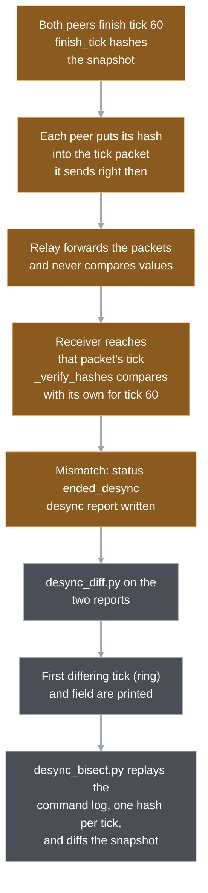

# 10. Determinism and replays

Online play sends commands and nothing else, so every machine has to compute exactly the same battle from them. One float that rounds differently, one dictionary walked in another order or one stray random number does not show up as a glitch: two players quietly play two different games. This chapter is about the three things that prevent that: a short set of coding rules, a fingerprint of the whole state that peers compare once a second, and traces that prove different operating systems produce the same state.

[Chapter 11](11-multiplayer.md) covers the network side (packets, relay, input delay). Here the question is what makes the simulation reproducible and how a failure is caught and located.

## One wrong bit ends the match

Lockstep assumes the same start, the same commands per tick and the same code. If any of those differ, nothing corrects it: the states drift apart and every later tick makes it worse. So Wargrid does not try to repair a desync. It detects one within about a second, stops the match and writes a report.



Three layers carry this, each with a different job.

- **Rules** keep the simulation reproducible in the first place (next section).
- **The digest** is a short hash of the snapshot. Lockstep computes it every `hash_interval` ticks (default 30, one second) and sends it inside the tick packet. The relay checks only the format of the field, never its value ([digest research](../reference/state-digest-research.md), section 1).
- **Traces** are files of per-tick hashes. Tests write them, CI and a local script compare them across operating systems, and the netplay scripts compare them across live clients.

## The rules, by theme

[Determinism rules](../reference/determinism-rules.md) owns the list; read it before adding simulation code. In short, it says four things.

- **Time and randomness belong to the simulation.** Ticks are the only clock, and in-tick randomness comes from the simulation's own generator.
- **Maths stays inside what every platform computes identically.** Plain arithmetic and `sqrt` are fine; trigonometry, `exp`, `log` and fractional powers are out because libm differs per platform. Turn rates use precomputed constants.
- **Order must not depend on timing.** Commands apply sorted by tick, player and sequence ([chapter 4](04-the-tick.md)), and snapshots sort their entities by id.
- **One thread.** A parallel step needs digest equality on native and web first.

The simulation also keeps its snapshot to plain values (numbers, strings, arrays, dictionaries with string keys). The reason is the digest, below.

Part of this is enforced rather than remembered. A Python test, `test_sim_math.py`, scans every file in the simulation folder for wall-clock calls, built-in random calls, banned maths and Godot's native hash. It runs inside `run_python_checks.sh`. Two files are exempt on purpose: `start_spots.gd` (setup-only randomness) and `state_hash.gd` (the digest itself uses Godot's hash). Sort order and the plain-values rule have no static check; tests and the digest are the safety net.

### Randomness

`Simulation.next_random()` is a 32-bit xorshift. Its single integer state `_rng` starts at the constant `RNG_SEED` and is part of the snapshot as `rng`, so the digest covers it: if two peers ever call it a different number of times, the next hash differs. The callers are combat scatter, the crate lifetimes and payouts in `salvage.gd`, and the horde timers' random first check.

Note the seed is a constant, not the match seed. The seed the relay announces in `start` feeds only `StartSpots.assign`, which uses Godot's own seeded `RandomNumberGenerator` to choose which map start each seat gets. Every client runs that function itself before the simulation exists, which is why the static check exempts it. A port has to reproduce Godot's generator there or re-pin ([couplings in the rules note](../reference/determinism-rules.md#couplings-a-port-must-reproduce)).

Presentation may use any randomness it likes. `sound_director.gd` randomises its pitch with a generator it seeds from the system by default, and `launcher.gd` draws the offline match seed with `randi()`, because neither writes into the simulation.

## What the digest hashes

`StateHash.digest` takes the snapshot (a full copy of the state, see the [README terms](README.md#appendix-terms)) and returns 16 hex characters made of two 32-bit halves.

- **First half:** Godot's built-in `Dictionary.hash()` over the whole snapshot, every field at full float precision.
- **Second half:** `core_check`, a 32-bit FNV-1a over a hand-picked core: entity id, owner, hit points, both position coordinates (floats quantised to 1/1024) and each player's credits.

The two halves cover different failure shapes. The built-in hash sees every field, but its value comes from Godot's implementation and from the insertion order of dictionaries. `core_check` sees little but is defined in Wargrid's own code and does not depend on Godot's hash implementation, so two tests pin its series (`S1_CORE_SERIES` and `TEAM_CORE_SERIES`). The tests also pin the digest itself, once on a small world and once at the end of the team match; the research note counts four re-pins in milestone 6 alone.

**The planned own digest is not built.** [Determinism rules](../reference/determinism-rules.md#state-digest-specified-not-implemented) specifies a Wargrid-owned digest (64-bit FNV-1a over a type-tagged word stream of every field, keys sorted) and labels it "specified, not implemented". Its [plan](../superpowers/plans/2026-11-09-state-digest-golden-scenarios.md) is approved, not started. What ships is the two-half digest above, which `net/lockstep.gd` uses today.

Why the proposal exists, from the [research note](../reference/state-digest-research.md): Godot's documentation promises no stability across versions, so an engine upgrade could change every pin silently; it treats `1` and `1.0` as different values; and a port to another language would have to reproduce Godot's dictionary ordering exactly.

## How a desync is caught and narrowed down

The netplay script has a scenario that does this on purpose (`tools/run_netplay.sh perturb`). Two headless clients play a match through a real relay, and seat 2 is started with `--perturb-at-tick 40`. A test hook then adds one credit to seat 2's player directly in the simulation, bypassing the command path. Nobody sent a different command; only the state differs.

1. At tick 30 both peers hash and agree. Nothing is wrong yet.  
   `Lockstep.finish_tick → StateHash.digest`
2. At tick 40 the hook runs on seat 2 only, so seat 2's copy of that player has one credit more than seat 1's copy.  
   `headless_client._test_hooks`
3. At tick 60 both peers hash again, this time to different values, and each puts its hash into the tick packet it sends at that moment.  
   `Lockstep.finish_tick`
4. When a peer reaches the tick of the packet carrying that hash, it compares the sender's hash for tick 60 with its own. The values differ, so it ends the match as `ended_desync` ("hash mismatch at tick 60"). Because both sides compare, both end.  
   `Lockstep.advance → _verify_hashes → _end`
5. Each client writes `desync-seat<N>.json`: seat, tick, the hash rows so far, the full command log, the snapshot taken at the hash tick, the hash ring (the last 64 per-tick hashes, see below), and the match's map, seed and start choices. The headless clients write it into the scenario's report folder; in the game it goes to a `desync` folder under `user://` or, in the browser, is offered as a download.  
   `Lockstep.desync_report(sim) → headless_client._write_logs` (game: `online_main._write_report`)
6. `tools/desync_diff.py` takes the two reports. It compares the command logs first, then the snapshots, walking dictionaries with sorted keys and arrays by index, and prints the path of the first difference. Before that path it prints the first tick at which the two hash rings differ (`ring diverges at tick 41`). It exits 1 on a difference and 0 with `IDENTICAL` otherwise.  
   `desync_diff.first_difference → _walk`, `ring_divergence`
7. `tools/desync_bisect.py` takes one or both reports and replays the command log through the headless oracle, which writes one ring hash per tick. It names, per seat, the first tick where the report's ring leaves the local replay, and the first differing snapshot field. With `--client-b CMD` it replays on a second client (another build or platform) and compares the two ring logs.  
   `desync_bisect._bisect → replay, seat_verdict`

The M5 notes record what the real run printed: `snapshot.players[1].credits: 9200 != 9201` with the report tick at 60 ([M5 online](../reference/m5-online.md#desync-findings)). The scenario asserts the tick and that the output names `players`; it also asserts the ring tick (41, the first tick after the hook ran) and the bisect lines.

Two things follow from that output.

- **The digest alone resolves to the hash interval; the ring does not.** The hashes at tick 30 matched and at tick 60 did not, so the break happened between ticks 31 and 60. The report's snapshot is from the hash tick, so the field diff points at the symptom (credits differ). The ring supplies the missing tick: it hashes the live state after every tick, so the first differing ring row is the first tick that differs, 41 here, and the bisect tool replays up to it.
- **The command logs were identical**, which is what `desync_diff.py` checks first. That points away from a network or ordering problem and toward non-deterministic code or state. A real bug usually looks like this.

The same idea works on trace files. `compare_replays.py` reads two or more `tick<TAB>hash` files and stops at the first row where they disagree. As an illustration (synthetic files, not a real run), two traces hashed every 30 ticks that part ways at tick 60 produce:

```
Replay diverged at tick 60: s1.tsv=bbbbbbbbbbbbbbbb, s2.tsv=bbbbbbbb00000000
```

The tool also rejects wrong row counts, malformed rows and mixed digest widths (16 hex characters from `StateHash`, 64 from SHA-256) before comparing, so a truncated or mislabelled trace fails loudly instead of matching by accident. On success it prints `REPLAYS MATCHED` and the row count.

**The hash ring.** Every `step` ends by hashing the live state into a 64-slot ring (`step.hash_ring`). The hash covers the tick, the RNG word, each unit's id, owner, hit points and position, each building's hit points, construction work and production-queue head work, each supply source's boxes and each player's credits. Floats go in by raw bits, so a change far below `core_check`'s 1/1024 still shows at its tick. It uses Godot's `hash()` over packed arrays: the same standing as `state.hash()`, so a ring mismatch is only reported, never acted on. The ring is not in the snapshot, so no digest, trace or pin changed, and it never goes on the wire. By arithmetic, 64 ticks cover the 30-tick hash interval plus the at most 33 ticks before a mismatch is noticed, so the first differing tick should be inside the ring (not measured beyond the `perturb` run).

## Replays and cross-platform traces

A **replay** here is a run reproduced from its recorded commands alone. There is no player-facing replay viewer; replays exist as test and tooling machinery in three forms.

**Same-process repeatability.** `game/tests/test_replay.gd` builds a scripted world twice, steps both for 1200 ticks and compares them every tick. Three scenarios exist: movement of twelve units under seven move commands, an economy run (build, produce, gather, cancel, remove) and a combat run to a decided match. The hash per tick is a SHA-256 of Godot's binary serialisation of the snapshot (`var_to_bytes`), which is not `StateHash.digest`. Cases check that the hash keeps full float precision (a `1e-12` change shows) and that one changed field moves it, so the comparison cannot go blind to small drift. `test_team_match.gd` adds a longer 3v3 prefix traced every 200 ticks with `StateHash.digest`.

**Cross-platform traces.** When `WARGRID_REPLAY_TRACE` and its siblings are set, the same tests write their rows to a file. CI does the following with them:

- Linux and Windows each run the suite and upload their traces; the export job runs the tests again from exported builds and uploads those. The job `godot-replays` then runs `compare_replays.py` across all of them. The export job also plays the netplay `match` and `perturb` scenarios with the exported binaries, and `godot-replays` compares the two platforms' match hash logs.
- Hosted macOS runners failed to start reliably, so macOS is checked locally: `sh tools/compare_local_traces.sh RUN_ID` downloads that CI run's Linux and Windows traces, runs the suite locally with trace paths set, compares all three, then exports a macOS build and runs a live netplay match whose hash log is compared as well.

Evidence so far: movement, economy and combat traces matched exactly on Linux x86, Windows x86 and macOS ARM ([blueprint §3](../blueprint.md#3-engine-language-tools), written at an earlier milestone), and native editor, native release and both web builds gave equal digests on eight workloads ([performance ledger](../reference/performance.md), "Technology findings").

**Live clients and the oracle.** The headless client, driven by the netplay script, can write every command it applied and every hash it computed. Given a command log (`--replay-log`), it can instead run a fresh simulation from those commands alone, the *oracle*, and write its digest rows. The `match` scenario requires both live clients and the oracle to produce identical rows, and the script pins the match's end tick. That shows a networked match equals a plain local replay of its own command stream, so the network layer changed nothing.

The oracle takes optional arguments. `--factions A,B` builds the offline skirmish instead (the player's seat with faction A, the AI with faction B), `--state-ticks` prints one summary line per listed tick, and `--snapshot-dir` also writes that tick's full snapshot as JSON. Unless the log fails to decode, it ends by printing `ORACLE FINAL <tick> <digest>`, which a caller can compare with a recorded digest. `--ring-log FILE` also writes one ring hash per tick, which `desync_bisect.py` compares.

Playtest sessions use this. `tools/replay_session.sh` unpacks each recorded match with `tools/playtest_session.py` and replays it through the oracle, printing `REPLAY MATCHED` or `REPLAY DIFFERS`. The command-log writer `Lockstep.log_lines` is shared by the game and the headless client.

## Engineering depth

**Floats, not fixed-point.** The simulation uses ordinary floats under the rules above, and the move to integers is tied to a port to another language ([decision](../reference/design-answers-2026-11-08.md#simulation-core-and-state-digest-user-2026-11-09-late-evening)). The bet is that the platforms Wargrid targets agree when the code sticks to basic arithmetic and `sqrt`, which the traces above support. The rules note lists the couplings that hold the bet together: `Vector2` rounds to 32-bit at construction (65 `Vector2(` sites under `game/scripts/simulation`, counted at this commit), Godot's A* breaks ties its own way, and fused multiply-add was checked absent on macOS arm64 under Godot 4.7.2. Each is a fact a native port must reproduce, and an engine upgrade must re-check.

**What the digest cannot see.** It samples once per interval, so a divergence is found at the next hash tick, not at its cause; and a desync that happens and cancels out between two samples would pass (reasoning from the design, no such case is recorded). Reducing the interval costs more digests: the research note measured one digest at about 0.14 ms p99 with 200 entities on Apple M6 and the lockstep overhead at 0.067 ms against a 0.6 ms budget on that machine ([research §1](../reference/state-digest-research.md)); the ledger owns current numbers.

**Insertion order is behaviour.** Godot dictionaries iterate in insertion order and Godot's hash includes it. The rules note lists the sites that iterate keys unsorted; two in `combat.gd` collect damage per target and rely on that order being the same on every peer. It is, as long as shots are produced in a deterministic order, which the sorted-id loops of chapter 4 provide.

**Zero Hour.** Zero Hour checksums its state too, but per class through a hand-written transfer routine, every 100 frames (`NET_CRC_INTERVAL`); Wargrid hashes the whole snapshot every 30 ticks, so a field added to the state is covered without remembering to list it. Evidence and the option comparison: [digest research](../reference/state-digest-research.md), questions 2 and 4.

**Open verification.** One mixed match has been played by hand: the WASM build in a browser against the native macOS build through the live relay, about ten minutes with fighting on both sides, and no desync ([development notes](../development.md)). That is one manual playtest, not a CI guarantee. A browser-to-browser match is still unverified, and no CI job compares runtime digests.

## Where in the code

- `game/scripts/simulation/state_hash.gd` — `digest` (the 16-character fingerprint), `core_check` (the narrow FNV series), `_mix` (float quantisation).
- `game/scripts/simulation/simulation.gd` — `next_random`, `RNG_SEED`, `_rng` (snapshot field `rng`), `snapshot`; `_tick_hash`, `hash_ring`, `HASH_RING_SIZE` (the per-tick ring).
- `game/scripts/simulation/start_spots.gd` — `assign`: the only seeded Godot RNG, setup only.
- `game/scripts/match_settings.gd` — `starts`: where the relay seed reaches `StartSpots`.
- `game/scripts/net/lockstep.gd` — `finish_tick` (hash on hash ticks), `wants_snapshot`, `_verify_hashes`, `desync_report` (carries `hash_ring`), `hash_rows`, `command_log`, `log_lines`.
- `game/scripts/online_main.gd` — `_write_report`: writes or downloads the desync JSON.
- `game/scripts/net/headless_client.gd` — `_test_hooks` (`perturb-at-tick`), `_replay_oracle`, `_oracle_sim`, `_state_row`, `--ring-log`, `--hash-log`, `--command-log`, `--replay-log`, `--factions`, `--state-ticks`, `--snapshot-dir`.
- `tools/replay_session.sh`, `tools/playtest_session.py` — `replay_rows`: replay a playtest session's matches through the oracle.
- `tools/test_sim_math.py` — the static determinism check (`CLOCK`, `RNG`, `NATIVE_HASH`, banned maths).
- `tools/compare_replays.py` — `compare_traces`, `read_trace`: first diverging tick across traces.
- `tools/compare_local_traces.sh` — the macOS-versus-CI comparison.
- `tools/desync_diff.py` — `first_difference`, `_walk`, `ring_divergence`: first differing ring tick and path between two reports.
- `tools/desync_bisect.py` — `_bisect`, `replay`, `seat_verdict`: replay a report's command log through the oracle and name the first divergent tick and field; `--client-b` compares two clients.
- `tools/run_netplay.sh` — scenarios `match` (oracle equality) and `perturb` (deliberate desync, ring tick and bisect lines asserted).
- `game/tests/test_replay.gd` — R1 to R5: repeatability, trace output, hash sensitivity.
- `game/tests/test_state_hash.gd`, `game/tests/test_team_match.gd`, `game/tests/test_lockstep.gd` — pinned digest, team trace, `test_desync_detected`.
- `.github/workflows/ci.yml` — jobs `godot-tests`, `godot-export`, `godot-replays`.

## Further reading

- [Determinism rules](../reference/determinism-rules.md) — the rule list, couplings, and the specification of the proposed own digest.
- [State digest research](../reference/state-digest-research.md) — what the built-in hash does, the options compared, the recommendation.
- [State digest and golden scenarios plan](../superpowers/plans/2026-11-09-state-digest-golden-scenarios.md) — approved, not started.
- [M5 online](../reference/m5-online.md) — desync findings from the first online matches.
- [Performance ledger](../reference/performance.md) — native and web digest equality.
- Previous: [4. The tick](04-the-tick.md) for the sorted order the rules rely on. Next: [11. Multiplayer](11-multiplayer.md) for packets, relay and input delay.

---
Checked against `389c9aa`. Files: `game/scripts/simulation/state_hash.gd`, `game/scripts/simulation/simulation.gd`, `game/scripts/simulation/start_spots.gd`, `game/scripts/match_settings.gd`, `game/scripts/net/lockstep.gd`, `game/scripts/net/headless_client.gd`, `game/scripts/online_main.gd`, `game/scripts/launcher.gd`, `game/scripts/presentation/sound_director.gd`, `tools/test_sim_math.py`, `tools/compare_replays.py`, `tools/compare_local_traces.sh`, `tools/desync_diff.py`, `tools/desync_bisect.py`, `tools/run_netplay.sh`, `tools/replay_session.sh`, `tools/playtest_session.py`, `tools/run_python_checks.sh`, `game/tests/test_replay.gd`, `game/tests/test_state_hash.gd`, `game/tests/test_team_match.gd`, `game/tests/test_lockstep.gd`, `.github/workflows/ci.yml`
