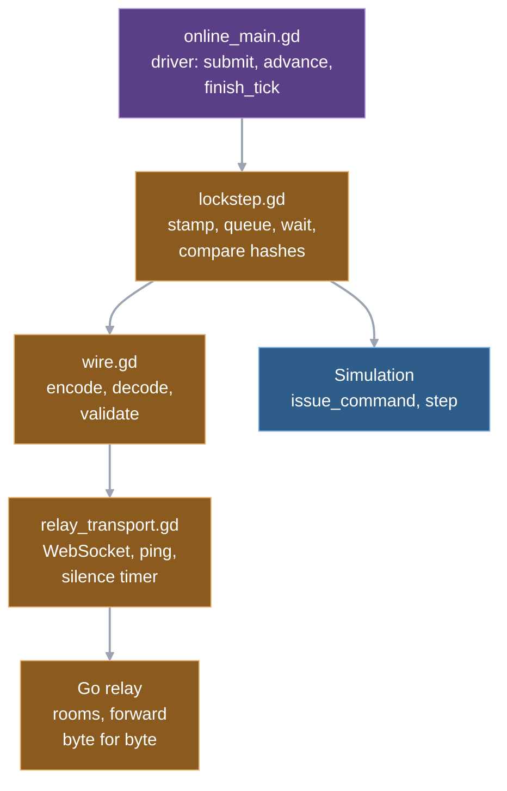
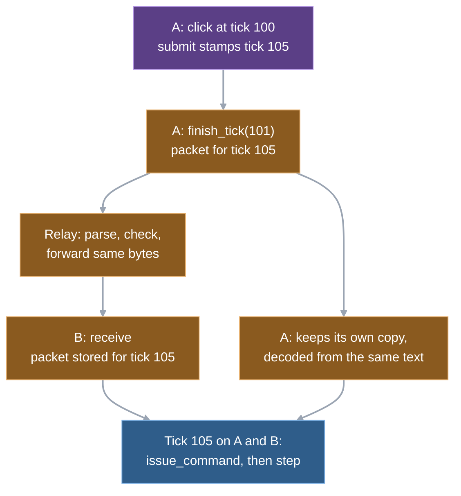

# 11. Multiplayer

An online match sends only orders over the network. Each player's machine runs the whole simulation and gets the other seats' orders for every tick from a small relay server; a tick runs only when all seats' packets for it are in. Nothing about units, damage or economy is ever transmitted, so the average frame measured in the M5 spike was about 52 bytes, and a desync check is one 16-digit hash.

This chapter follows one click across the wire, then opens the three pieces: lockstep (the client rules), the wire protocol and the relay. It ends with what a slow or dead peer does to the match.

## Three pieces, one packet per tick

On each machine the online scene script feeds `Lockstep`, the object that decides when a tick may run. Lockstep encodes through `wire.gd`, and `relay_transport.gd` moves the text over a WebSocket. The relay is a separate Go program that never sees the game.



The one rule: **every seat sends exactly one packet per tick, empty or not.** The packet carries that seat's commands for one future tick, and optionally a state hash. Every other part follows from it.

- The simulation can tell "nobody ordered anything" from "the packet has not arrived yet", so lockstep needs no clock and no timeout to know when a tick is complete.
- The relay can check that each seat's ticks come one after another with no gap and forward them blindly.
- A peer that goes quiet is visible at once, as a missing packet.

The price is that a packet crosses the network every tick (30 per second) per seat, even when idle. The M5 spike measured about 52 bytes per frame, about 1.55 KB/s uplink per client ([M5 findings](../reference/m5-online.md#latency-budget-command-p95--250-ms)).

## One click, from machine A to both simulations

Two seats, input delay 4 (the relay announces it in the start message; [chapter 4](04-the-tick.md) shows where the online driver steps). Player 1 on machine A orders a tank to move while A's simulation stands at tick 100, with its packets up to tick 104 already sent.

1. The click arrives as an ordinary move payload and the online scene hands it to lockstep instead of the simulation. Lockstep stamps it with tick 105 (the next packet not yet sent), the local seat as player and the next sequence number, and queues it.  
   `online_main._submit → Lockstep.submit`
2. Machine A finishes tick 100 and the scene calls `finish_tick(101)`. The packet for tick 105 is built from the queue (plus a hash on every 30th tick) and encoded as JSON text. A also stores it for itself, decoded back from that same text, then sends it.  
   `online_main._step_simulation → Lockstep.finish_tick → Wire.encode, Wire.decode`
3. The relay's WebSocket handler parses the frame, checks it is well formed, and posts it to the room's goroutine. The room checks that the seat number matches the connection and that this is exactly the next tick from that seat. It then writes the same bytes to every other seat.  
   `relay.OnMessage → parseEnvelope → room.post → room.forward`
4. Machine B polls its socket, decodes the frame and stores the packet under seat 1, tick 105, after checking seat, order, each command's player and tick stamp, and the queue limit.  
   `online_main._step_simulation → RelayTransport.poll → Lockstep.receive`
5. Once both machines have reached tick 105 and hold every seat's packet for it, lockstep runs the tick. For each seat in seat order, lockstep feeds the packet's commands to the simulation, which validates them as in [chapter 4](04-the-tick.md), then calls `step`, whose first phase applies the move. A and B run identical inputs in identical order.  
   `Lockstep.advance → Simulation.issue_command → Simulation.step`
6. On A only, lockstep records the click-to-execution time and any rejection for the status line.  
   `Lockstep.advance: _latency, _rejections`



**The order takes effect five ticks after the click, not four.** The stamp is the tick of the next packet to send, which is the delay plus one ahead of the current tick. At 30 ticks per second that is 5 × 33 ms ≈ 167 ms (arithmetic). The M5 command latency on the fixed build was p50 174 and 181 ms for the two seats, p95 191 and 205 ms, against a budget of 250 ms at p95 ([M5 findings](../reference/m5-online.md#latency-budget-command-p95--250-ms), measured).

**Why A runs its own command from the decoded copy.** Step 2 round-trips A's own packet through `Wire.encode` and `Wire.decode`. Godot parses every JSON number as a float, and the simulation's validation demands integers for tick, player, sequence and every id. `Wire.decode` converts integral floats in a fixed list of fields back to integers. A's own commands must pass through the same conversion as B's, or the two machines would apply slightly different dictionaries. The lockstep test `L3` pins this: the applied command equals the decoded sent form, and a target such as 0.1 + 0.2 keeps its full precision.

## Lockstep: when may a tick run?

`Lockstep` is a plain object with no scene or socket; the scene gives it frames and asks it questions. Its state is one table of packets per seat, keyed by tick.

**Starting.** The first packets cannot arrive before they are sent, so the constructor fills ticks 0 to delay-1 with empty packets for every seat. `start` then sends the first real packet, for tick `delay` (the relay refuses anything earlier). A command queued before `start` (every client queues `choose_faction`) is stamped with that same tick. The simulation runs its first four ticks without waiting.

**Advancing.** `Lockstep.advance(sim)` answers "may the tick run?" and runs it:

1. Return false if the match ended, or if a seat left and this tick is past its last packet (below).
2. If any seat's packet for this tick is missing, set the status to waiting and return false. The HUD says "Waiting for player N"; no tick runs and presentation keeps drawing the last state.
3. Compare any hashes riding on the packets (below).
4. Feed every seat's commands to `issue_command`, seats in ascending order, then drop those packets.
5. Call `step`, move on to the next tick, return true.

`finish_tick` runs after each successful advance: it builds and sends the packet for `tick + delay`. The scene calls the two in that order, and that pairing is why a seat stays at most `delay` ticks ahead of its slowest peer.

**Checks on every received packet.** A packet from an unknown seat or from the receiver's own seat, a tick that is not exactly the previous one plus one, a command whose player or tick differs from the packet's, or a seat with 300 packets already queued (`MAX_QUEUED_TICKS`) ends the match as a protocol error. TCP delivers in order, so "tick out of order" means a buggy or modified peer. The player field check means a seat cannot issue orders as another player; the simulation's own validation ([chapter 4](04-the-tick.md)) also refuses orders for units owned by someone else.

**Pacing.** Waiting for packets slows the game down, but the opposite problem exists: after a stall, packets arrive in a burst, and running them as fast as possible would speed the game up. `online_main._step_simulation` rations catch-up with a small credit counter, as [chapter 4](04-the-tick.md#trade-offs-and-limits) describes. The first online match ran at about 57 ticks per second before this existed ([M5 findings](../reference/m5-online.md#what-broke-and-why)).

**Ending.** Lockstep reports failure as a status, not an exception, and `advance` returns false from then on. The statuses are `ended_left` (a seat left), `ended_relay` (the relay sent an error or the connection was lost), `ended_desync` and `ended_protocol`. The scene turns them into the HUD line and, for a desync, writes the report. [Playing online](../playing-online.md#status-lines) lists the player-facing wording.

## The wire protocol

The protocol is JSON text, one message per WebSocket text frame, at most 64 KiB, with version `Wire.PROTOCOL` (2). Every message has a `type`. Who sends what:

| Message | From | Content |
|---|---|---|
| `hello` | client | protocol, build string, match code (empty creates a room), and from the creator the map settings |
| `welcome` | relay | the client's seat number and the match code |
| `start` | relay | seats, delay, a match seed, the creator's settings echoed unchanged; sent to every seat when the room is full |
| `tick` | client, relayed | seat, tick, commands, optionally a hash |
| `ping`, `pong` | client, relay | a timestamp the relay echoes byte for byte |
| `left` | relay | the seat that left and its last forwarded tick |
| `error` | relay | a reason; the relay closes the socket shortly after |

A tick message is one line (this is the committed vector `protocol/vectors/tick.json`):

```json
{"type":"tick","seat":1,"tick":10,"commands":[{"type":"move","tick":10,"player":1,"sequence":3,"entity_ids":[1,2],"target":[14.1,0.30000000000000004]}],"hash":{"tick":30,"value":"3a0ad3856b168044"}}
```

**Handshake.** The creator's hello carries map settings; the relay stores them without interpreting them and puts them in every seat's start. Each client compares the map and its hash with its own files and refuses to start on a mismatch (`MatchSettings.refusal`); the `map-mismatch` scenario shows the host then seeing the joiner leave at tick 4. The relay compares only the protocol number and the build string, which is the project's version setting: an old client cannot join a new relay's rooms, and the reverse. The match seed comes from the relay, not from a client, so neither player can pick favourable start spots; what the seed does (start spots, not the simulation's own generator) is explained in [chapter 10](10-determinism-and-replays.md#randomness).

**Decoding is strict.** `Wire.decode` rejects an unknown type, a missing required field, a non-integer where an integer belongs, a hash that is not 16 lowercase hex digits, and any frame over the cap. Go's `parseEnvelope` applies its own checks to what a client may send. Both implementations reject a bad frame instead of repairing it. The relay's checks are narrower: it never looks inside a command.

**Floats survive the wire.** `JSON.stringify` is called with sorted keys and full precision, so a coordinate like 0.30000000000000004 goes out and comes back as the same double. Without full precision two machines would compute positions from slightly different targets.

## The relay

The Go program in `relay/` is about 740 lines in four files ([development notes](../development.md#relay) for how to run it). It owns three things: matchmaking by code, forwarding, and noticing who left.

**Rooms are goroutines.** A room is created by the first hello and gets its own goroutine. All its state (seats, started flag, settings) is touched only there. Connection handlers talk to it by channel: joins on an unbuffered channel, ticks and leaves on an events channel. A mutex guards only the registry of rooms, which is touched on create, lookup and removal, never per frame. If one room's goroutine panics, `recoverCrash` closes that room's sockets and removes it; other rooms keep running (a recommendation of the relay stack spike).

**Seats and start.** Seats take the lowest free number. The room starts when it holds `WARGRID_SEATS` seats (default 2); at that moment every seat receives start with the delay (a constant, 4) and a random 31-bit seed. After start, nobody can join, even if a seat leaves.

**Forwarding.** For every tick frame the room checks the match has started, the seat in the message equals the connection's seat, and the tick is exactly the previous one plus one (the first is 4). Anything else marks the seat dead: the relay replies with an error, closes the socket after a 200 ms grace (Godot drops queued frames when it sees the close, so the error would otherwise be lost), and the others hear `left`. A valid frame is copied once and the same bytes are queued to every other seat. The sender gets no echo. The relay keeps no history: it counts frames and bytes per seat for its end-of-match log line, and nothing else.

**What the relay does not look at.** It checks that `commands` is an array and that a hash, if present, has the right shape. It does not read a command and never compares hash values ([state digest research](../reference/state-digest-research.md)). Comparing is left to the clients, so the relay cannot pause a match, rule on a desync or know a seat's state.

**Leaving.** When a seat's socket closes, for any reason, the room tells the others `left` with that seat's last forwarded tick, removes the seat, and when the last seat is gone removes the room and logs one `MATCH END` line. Section "What a slow peer does" below covers how a silent peer's socket gets closed.

**Writes.** Each socket writes through a small `sender`: with no test delay configured it is a plain asynchronous write. Two knobs exist for tests. A test delay holds every forwarded tick back while keeping frame order, and `left` waits behind the ticks. A batch interval joins ticks into one newline-separated message, which the current Godot client cannot read.

**Draining.** On a shutdown signal the relay stops accepting connections, closes lobbies that have not started, lets started matches run for `WARGRID_DRAIN_MS`, then closes everything. A match longer than that does not survive a deploy ([development notes](../development.md#relay)).

## One protocol, three checkers

The protocol is the one thing both a GDScript client and a Go server must agree on, so it is pinned outside both implementations.

- **Vectors (`protocol/vectors`).** 16 JSON files, each holding a message as text plus its parsed form, or marked invalid. The Godot wire test and the Go test `TestVectors` read the same files, and the Godot one also checks that there are exactly 16. Each side must accept the valid ones and reject the invalid ones (a fractional tick, an unknown type, a start without a seed, ...). Go must accept only the valid client messages (hello, tick, ping) and reject the server messages and invalid vectors, since a client may send nothing else.
- **Conformance suite (`protocol/conformance`).** A separate Go program that plays two or more clients against a live relay and checks exact bytes: that ticks are forwarded unchanged, that a bad frame gets an error, a close and a `left` with the right tick, that a full match refuses a third client, that settings are echoed byte for byte, that seeds are in range and vary. It has three profiles, because some behaviour needs a differently configured relay: default (38 cases), delay (2) and silence (1). `sh tools/run_conformance.sh` starts one relay per profile and ended `CONFORMANCE PASSED 41` when run for this chapter.
- **Relay unit tests (`relay/*_test.go`).** Run with the race detector. They cover parse rules, join rules (a protocol mismatch outranks bad settings), concurrent joins never overfilling a room, a panic ending only its room, drain keeping a started match, and a stalled reader still producing `left`.
- **Netplay scenarios (`tools/run_netplay.sh`).** Two real Godot clients, headless, through a real relay. Eleven scenarios: a full match (terminal tick pinned, hashes equal on both sides and against an offline replay of the command log), a peer killed, a 3 s stall, a 15 s silence, a relay that delays every forward by 200 ms, a deliberate desync, a version mismatch, two map scenarios, a relay killed and a relay sent SIGTERM.

Together these make the protocol an interface any relay can be checked against. That was the use made of it in the relay stack spike: five ports against the same suite, with Go chosen to replace the first (Kotlin) relay ([relay stack spike](../reference/relay-stack-spike.md)).

## Desync detection

Every 30th tick (`hash_interval`), `finish_tick` attaches the state hash to the outgoing packet, tagged with the tick it describes. The receiver compares it when it advances through that packet's tick, and on a mismatch ends as `ended_desync` before applying that tick's commands. A divergence is therefore caught at most 33 ticks (about 1.1 s, arithmetic) after it happens. What the hash covers, the report and how to find the first differing field are in [chapter 10](10-determinism-and-replays.md#how-a-desync-is-caught-and-narrowed-down). The lockstep overhead (encode, decode, digest on hash ticks) is p99 0.067 ms against a 0.6 ms budget (measured, [ledger budget table](../reference/performance.md#budgets)).

## What a slow peer does to everyone

**Lockstep window.** A seat reaches tick T only when every seat's packet for T is in. That packet was sent when its owner reached T minus delay. So one-way network delay plus jitter has to stay under about `delay` ticks (133 ms) for the game to run at full speed. Beyond that the faster machine waits on every tick and the game runs stop and go. This is derived from the code and not measured at that limit. Measured on one good link between two Macs: relay round trip p95 of 34 and 42 ms, command p95 of 191 and 205 ms, which the note attributes mostly to the delay itself ([M5 findings](../reference/m5-online.md#latency-budget-command-p95--250-ms)). The Go relay added 1.6 to 8.7 ms at p99 locally with 10 to 100 rooms, and the hosted relay answered in 11 to 12 ms at p50 from the development Mac (measured, a single home connection, indicative only: [relay stack spike](../reference/relay-stack-spike.md#latency-measured)).

**A slow machine counts like a slow link.** If a machine needs more than 33 ms per tick, its packets come late for everybody. Chapter 12 has the tick budgets; the slowest machine paces the match.

**What happens when a peer is not just slow.** Each case below is read from the code and the scenarios.

| Peer state | Who notices | Result |
|---|---|---|
| Slow but alive (still pinging) | nobody; the others show "Waiting for player N" | others wait with no time limit: nothing in `advance` times out while the relay connection is healthy |
| Frozen for a few seconds (the `stall` scenario, 3 s) | nobody | packets arrive late and in a burst; catch-up credit rations the replay; both finish with equal hashes |
| Silent for over 10 s (no packets, no pings: the `silent` scenario, 15 s) | relay read deadline (`WARGRID_SILENCE_MS`, default 10 s) | relay closes that socket, others get `left`; the scenario asserts that this happens within 12 s |
| Socket closed or process killed | relay at once | others get `left` with the last tick forwarded |
| Stops reading (full TCP buffer) | relay write deadline, same timeout | socket closed, `left`; `TestStalledPeerStillProducesLeft` |
| Relay unreachable | each client: a socket close, or the silence timer (5 s without any frame, pongs count) | `ended_relay`, "Connection to relay lost"; the `relay-down` scenario (relay killed) asserts both clients end within 2 s |
| Sends bad frames | relay, or the receiver if the relay passed the frame | relay-detected: `error` to the sender (`ended_relay`), `left` to the others (`ended_left`); receiver-detected: `ended_protocol` on that receiver |

Clients ping the relay once per second after their first send, so a healthy but idle connection keeps both timers fresh. The online scene never pauses the simulation (`_pauses_sim` is false), so a peer is running, waiting or gone; there is no pause rule.

**`left` ends the match.** When a seat leaves, the others can still run ticks up to the leaver's last forwarded tick, because those packets are in hand. When the simulation needs the next tick, or a packet is missing, lockstep ends the match as `ended_left`. There is no pause, no bot takeover and no reconnect. "Dropped player becomes a bot" and reconnect with command-log replay are on the M9 list (proposed, not built: [M5 findings](../reference/m5-online.md#m9-list)). A leaver before the start means a refused map or version, and the HUD says so.

## Trade-offs and limits

**Why a relay and lockstep rather than a server that simulates.** The relay never sees a unit, so its cost grows with frames and rooms, not with army size: 5.2 % of a shared vCPU for one 3v3 room in the Go build (measured, [relay stack spike](../reference/relay-stack-spike.md#cpu-per-3v3-room-measured)). Authoritative-server simulation was the blueprint's fallback in case lockstep failed the M5 gate; lockstep passed ([blueprint §11](../blueprint.md#11-performance-multiplayer-and-future-architecture)). The cost moved to the game: every machine must stay bit-identical ([determinism rules](../reference/determinism-rules.md)), and every client holds the full state, so a modified client could read hidden information (the blueprint notes this for bots). The relay is for private matches with friends ([relay scaling](../reference/relay-scaling.md)); a public game would need more.

**Input delay is a constant.** The relay hard-codes 4, and the client takes whatever start says. With the stamp at delay + 1, command latency is bounded below at about 167 ms before any network time. The M5 note records that a farther link would exceed the 250 ms budget, and lists dynamic delay for M9 (not built). Raising it is a change to one relay constant (the conformance suite pins 4 as well) but makes every game feel slower.

**Hash checks are sparse and final.** One hash per 30 ticks keeps lockstep overhead tiny, but a desync can hide for about a second (at most 33 ticks), and the match then simply stops. There is no repair, rollback or resync. The report exists so a developer can find the first differing field.

**The packet-per-tick rule limits what the relay can do.** It forces every seat to send 30 frames a second even while idle, and it ties the relay's checks to the exact tick sequence. A batching mode (one message per interval) halves relay CPU in measurement but adds half an interval of latency (+18 ms p50 at 33 ms; [relay stack spike](../reference/relay-stack-spike.md#batching-measured-go-idiomatic-wargrid_batch_ms33)) and needs a client that can read it.

**Packet size is bounded by the frame cap.** All commands queued since the last packet go in one frame, and the client does not split a packet. A frame over 64 KiB is refused by the relay as an invalid message and by the receiving client as a protocol error. No code path produces one in normal play (speculation about unusual cases, such as thousands of orders in one tick).

**Fixed integer field list.** `Wire.decode` converts integers only in named command fields, plus the lists `entity_ids` and `origin`. A new command with a new integer field must be added to that list, or it stays a float on both machines and fails validation consistently (speculation on the exact symptom; the code requires integers for ids, tick, player and sequence).

**Capacity and availability are host questions.** Rooms live in one process's memory; a relay crash ends every live match, and the high-availability options (rebuild rooms from clients, mirror state) are proposed in [relay scaling](../reference/relay-scaling.md#high-availability-options-proposed-2026-11-05) and not built. 3v3 online and a lobby are milestone M9, not built; the blueprint says a lobby needs relay protocol 3 because the seat count is global today ([blueprint M9](../blueprint.md#m9--3v3-online)). The spike note says outbound queues per connection are unbounded, so one peer that cannot keep up can only be cut by the write deadline (per that note; not re-checked in the `gws` library).

**Cross-platform identity is evidenced, not assumed.** macOS, Linux and Windows exports produced identical netplay traces in the M5 gate (364 rows matched); a mismatch would show first as a desync here. See [M5 findings](../reference/m5-online.md#answer).

## Where in the code

- `game/scripts/net/lockstep.gd` — `Lockstep`: `submit`, `receive`, `advance`, `finish_tick`, `waiting_for`, `can_step`, `desync_report`; statuses; constants `MAX_QUEUED_TICKS`; private `_receive_tick`, `_verify_hashes`.
- `game/scripts/net/wire.gd` — `encode`, `decode`, `tick_message`; `PROTOCOL`, `MAX_FRAME_BYTES`; required-field and integer-field tables.
- `game/scripts/net/relay_transport.gd` — `RelayTransport`: WebSocket peer, `poll`, `send_text`, once-a-second ping, 5 s silence (`silent`), round-trip samples.
- `game/scripts/net/seat_sim.gd` — wrapper so bot and script code drive a networked seat through `Lockstep.submit`.
- `game/scripts/net/headless_client.gd` — the netplay test client: seat scripts, stall, kill and perturb hooks, command-log replay.
- `game/scripts/online_main.gd` — online scene: `setup`, `_submit`, `_step_simulation` (poll, catch-up credit, `finish_tick`), `notice`, desync report writing, latency line.
- `game/scripts/launcher.gd` — hello, welcome and start handling; builds the `Lockstep` object and the online scene.
- `relay/main.go` — WebSocket handlers (`OnMessage`, `OnClose`), silence and write deadlines, `reject`, shutdown and drain.
- `relay/room.go` — `registry` (create, join, remove), `room.run`, `admit`, `forward`, `leave`, `recoverCrash`; constants `protocol`, `inputDelay`.
- `relay/envelope.go` — `parseEnvelope`: what a client may send; size caps.
- `relay/sender.go` — per-socket write queue; test delay and batch modes.
- `protocol/vectors/*.json` — the message vectors; `protocol/conformance/conform.go` — the case lists and profiles; `tools/run_conformance.sh`, `tools/run_netplay.sh`, `tools/desync_diff.py` — runners.
- `game/tests/test_lockstep.gd`, `test_wire.gd`, `test_relay_transport.gd`, `test_online_scene.gd` — the client-side tests.

## Further reading

- [M5 online findings](../reference/m5-online.md) — what broke, latency and lockstep overhead numbers, the M9 list. Its relay description predates the Go port.
- [Relay stack spike](../reference/relay-stack-spike.md) — why Go, relay CPU and latency measurements, the patterns adopted.
- [Relay scaling](../reference/relay-scaling.md) — routing and availability options (proposed).
- [Playing online](../playing-online.md) — the player's view and status lines.
- [Determinism rules](../reference/determinism-rules.md) and [state digest research](../reference/state-digest-research.md) — what the hash must cover.
- Previous: [10. Determinism and replays](10-determinism-and-replays.md). Next: [12. Performance and platforms](12-performance-and-platforms.md). The tick that lockstep gates is in [4. The tick](04-the-tick.md).

---
Checked against `2b108ab`. Files: `game/scripts/net/lockstep.gd`, `game/scripts/net/wire.gd`, `game/scripts/net/relay_transport.gd`, `game/scripts/net/seat_sim.gd`, `game/scripts/net/headless_client.gd`, `game/scripts/online_main.gd`, `game/scripts/launcher.gd`, `relay/main.go`, `relay/room.go`, `relay/envelope.go`, `relay/sender.go`, `relay/envelope_test.go`, `relay/stall_test.go`, `protocol/conformance/conform.go`, `protocol/vectors/tick.json`, `tools/run_conformance.sh`, `tools/run_netplay.sh`
