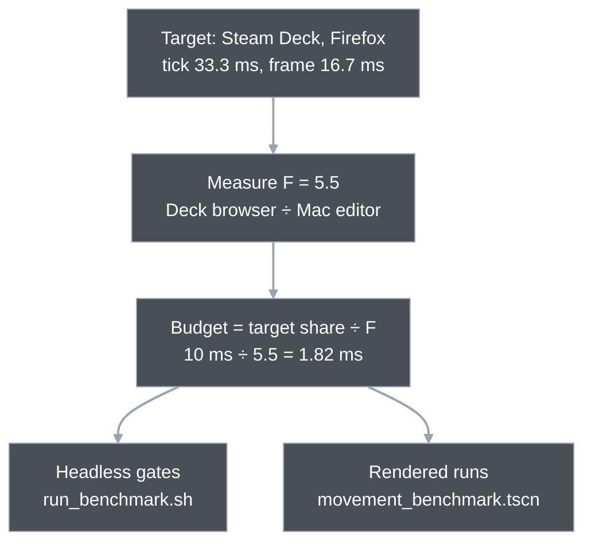
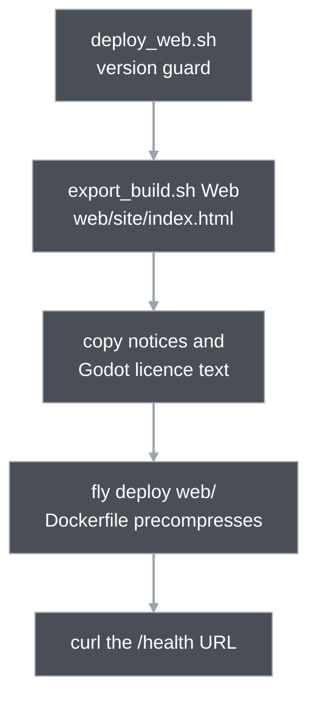

# 12. Performance and platforms

Wargrid is tuned for a machine it is not written on. Every speed limit is a share of the target's 33.3 ms tick or 16.7 ms frame (a Steam Deck running the game in Firefox as WebAssembly), divided by a measured slowdown F, and checked on the development Mac. A fast Mac says little; the ledger says whether a cost stays inside its derived budget.

This chapter covers the budget model, the tools that check it, what was found hot, what the native-code spike concluded, and the browser build behind it all. The last section lists three performance ideas that are proposals only.

## One slowdown factor turns a Deck budget into a Mac budget

A tick lasts 33.3 ms at 30 Hz and a rendered frame 16.7 ms at 60 fps. The target budget for each cost is a share of one of those. The development-machine budget is that share divided by **F = 5.5**, the measured ratio of Firefox on the Deck to the Mac's editor build, which is what the headless benchmarks run ([performance ledger](../reference/performance.md#target-device-measured-2026-11-06); the browser is a target next to desktop).

The ledger's budget table holds the derived rows. The key ones, each "target ÷ F":

| Cost | Target | On the Mac | Where checked |
|---|---:|---:|---|
| Simulation tick p95 (300 units moving) | 10 ms | 1.82 ms | `run_movement.gd`, `run_combat.gd` |
| Simulation tick p99 | 20 ms | 3.64 ms | the same |
| Presentation plumbing per tick | 5 ms | 0.91 ms | `run_profile.sh` zones, report only |
| Rendered frame p95 | 16.7 ms | 3.04 ms | rendered benchmark, report only except one guard |
| Lockstep overhead p99 | 3.3 ms | 0.6 ms | `run_lockstep.gd` |

Source: [ledger budget table](../reference/performance.md#budgets). Status at the guide's commit:

- **Plumbing** is measured as the hand-off sum (state fill plus draw-batch sort and build). Since the view rows change it fits 0.91 ms on skirmish3v3 only; the team match, hordes300 and the movement layouts exceed it. No budget changed.
- **Rendered frame:** the open and dense layouts passed in the 2026-11-08 rows; the later art lab rows (2026-11-10, at the game's start zoom) and the interpolation-on rows (2026-11-11) are **EXCEEDED** on every layout. These rows are report-only, and nothing was loosened ([History rows](../reference/performance.md#history)).
- **Combat stress rows:** open and hordes300 exceed the simulation budget and dense sits at it (median 1.811 ms over 13 runs). They are accepted as exceeded and held to regression ceilings instead ([gate proposals](../reference/performance.md#gate-proposals-t3-2026-11-08)).

The ledger's rule: a budget or the factor is never loosened to make a row pass. Either the code gets faster or the target is changed on purpose, with a recorded decision.

## Benchmarks are workloads plus a stopwatch

Each benchmark builds a fixed scenario with a workload script from `game/scripts/debug/`, steps it for 300 warm-up ticks and 1800 timed ticks, and sorts the per-tick times into p50, p95, p99 and max (`timing_stats.gd`, nearest-rank percentiles). The budgets are constants there: `BUDGET_P95_MS` 1.82 and `BUDGET_P99_MS` 3.64.

| Tool | What it runs | Gates? |
|---|---|---|
| `sh tools/run_benchmark.sh` | three headless scripts in a row: `run_movement.gd` (layouts open, dense; 300 units), `run_combat.gd` (ten layouts), `run_lockstep.gd` | yes: exit code, no engine errors, a completion line and the exact count of `BUDGET PASS` lines |
| `sh tools/run_profile.sh` | the same workloads with the zone profiler on (`profiler.gd`, zones such as `step.combat_plan`) | no, reports only |
| `sh tools/run_team_match.sh` | a 3v3 bot match on the Ashfall map to the 45,000-tick cap | pins the outcome line, not the time |
| `sh tools/run_game.sh res://scenes/movement_benchmark.tscn` | the rendered scene: open window, `vsync=off`, layouts open, dense, ashfall, horde | one guard, `ASHFALL_FRAME_P95_MS` 3.3; the rest is reported |
| `game/benchmarks/bench_runner.gd` | the same workloads in 30-tick chunks per frame, for the `Web Bench`, `macOS Bench` and `Linux Bench` presets (feature tag `wargrid_bench`) | no; used to measure F on the Deck |

The combat script has two kinds of verdict. Seven layouts must pass the budget. Layouts open and hordes300 exceed it and dense sits at it with one worst run over, so all three are held to a `STRESS_CEILING` of "worst of 13 quiet runs + 5 %" instead; the code comment says a ceiling is raised only by a recorded decision with a ledger line. The ceiling stops regressions; it does not make the row pass ([gate proposals](../reference/performance.md#gate-proposals-t3-2026-11-08)).

Two kinds of number stay outside wall-clock timing because they cannot flake. The snapshot-size ceiling and the combat target-check counters are asserted in the ordinary test suite ([machine-independent counters](../reference/performance.md#machine-independent-counters)). CI runs neither timing benchmark: "The wall-clock gates in `run_benchmark.sh` stay a local, quiet-host exit-gate step" ([ledger](../reference/performance.md#not-covered-yet)).

## One benchmark run, from command to ledger row

Take the headless movement gate. The command is `sh tools/run_benchmark.sh`.

1. The script imports the project, then starts Godot with `--script res://benchmarks/run_movement.gd` and reads its output.  
   `run_benchmark.sh → run_movement.gd`
2. For each layout the script builds a simulation of 300 units on a 64x64 map and loops 2100 ticks. Each tick the timer covers the settled check, issuing the next leg's orders when due, and `step`; the sample counts once the warm-up ends. The snapshot used for validation sits outside the timer; the ledger notes the harness has been sim-only since an earlier fix removed the snapshot from the timer.  
   `Workload.create → Workload.issue_leg → Simulation.step`
3. After the loop it checks that 1800 samples exist and every unit reached a unique destination, so a run that did no movement cannot pass. Then it sorts the samples and compares p95 and p99 with 1.82 and 3.64.  
   `Stats.summary → Stats.within → BUDGET PASS`
4. The shell wrapper accepts the run only if the exit code is 0, no `ERROR:` line appeared and the completion marker and the expected count of `PASS` lines are present.  
   `run_benchmark.sh: grep BENCHMARK PASSED 2`
5. A History row is then added to the ledger: tree, machine, load, command, values against the budget. A milestone's exit gate is not met without that row ([rule per milestone](../reference/performance.md#rule-per-milestone)).

A real row (measured): on 2026-11-10 after the art lab fixes, the movement layouts gave sim-only p95 0.691 (open) and 0.676 (dense), p99 0.855 and 0.874 ms, against 1.82 and 3.64. The run was at host load 2.3 against about 1.5 for quiet rows, so the ledger reads it as an upper bound ([History](../reference/performance.md#history), "art lab exit-review fixes").

**What an exceeded budget means.** The combat benchmark's `hordes300` layout (400 units fighting) took a median of 2.852 ms p95 across 13 quiet runs, about 57 % over 1.82 (measured). The script prints `COMBAT STRESS PASS` with the words "exceeds the 1.82/3.64 budget", because it is checking the ceiling of 3.07 and not the budget. The row stays labelled exceeded in the ledger. Nothing is silently relaxed: the options are to optimise, to change the target on purpose, or to report the row as exceeded.

Wall-clock numbers carry host noise. A window covered by another application made every rendered metric about 5 times slower, while focus and load did not (measured, [noise check row](../reference/performance.md#history), 2026-11-12). The ledger's iteration rule follows from it: keep the window fully visible, run only the layout a change touches, and never average a throttled run into a result.

## What was measured hot

Two sets of numbers explain where a tick goes. Both are Mac means on the 2026-11-11 profile ([performance next](../reference/performance-next.md#2-where-the-time-goes-measured), [data layout inputs](../reference/data-layout-decision.md#2-inputs-after-t4-measured-unless-labelled)).

| Row | `step` mean | Biggest zones in `step` | Presentation hand-off, after view rows |
|---|---:|---|---:|
| skirmish3v3, 210 units (goal row) | 0.70 ms | `combat_plan` 53 %, `combat_fire` 25 %, `advance` 17 % | 0.537 ms |
| team match, peak 261 units (goal row) | 1.07 ms | `combat_plan` 38 %, `advance` 30 % | 0.951 ms |
| hordes300, 400 units (stress row) | 1.98 ms | `advance` 48 %, `combat_plan` 40 % | 1.927 ms |

The goal row is a 210-unit 3v3 that must run smoothly in Firefox on the Deck; hordes300 is a reported stress row ([performance next section 8](../reference/performance-next.md#8-decisions-user-2026-11-11)). Four findings follow from the profile:

- **The hand-off used to cost more than the step.** Before the view rows change, copying state out for drawing was 1.1 to 1.4 times the simulation step on the combat and team rows (measured, performance next section 2). The view rows work cut the hand-off sum by 0.18 to 1.1 ms per tick, ten or more times the run-to-run spread (measured, [perf-next stop gate row](../reference/performance.md#history)). Chapter 5 describes the rows.
- **The tail matters more than the mean.** In the 2026-11-11 profile the worst tick is 5 to 9 times the mean: 9.31 ms on the team match (about 51 ms at F = 5.5), of which one bot decision took 7.37 ms. The three rows' worst ticks are 40 to 60 ms at F = 5.5, longer than the 33.3 ms tick, and the ledger lists it as a watch item without a gate ([performance next](../reference/performance-next.md#2-where-the-time-goes-measured), [ledger](../reference/performance.md#budgets)). Path-queue bursts, the other recorded source of tail ticks, are explained in chapter 4.
- **Rendering is the expensive part with smoothing on.** Interpolation costs 0.82 to 1.14 ms of CPU per frame against 0.04 to 0.05 ms with it off, because the draw batch is rebuilt every frame (measured, [perf-next rendered rows](../reference/performance.md#history)); the cause is read from code in [data layout section 7](../reference/data-layout-decision.md#7-interpolation-and-presentation-short-list), not profiled.
- **Typing and threads were small.** Static typing of hot loops gained 3 to 5 %. Parallel movement natively gained 2 to 3 % at four threads (measured, [technology findings](../reference/performance.md#technology-findings)). The kept simulation fixes were a per-owner target grid, cached radii and early exits, all trace-preserving; combat `open` fell from 2.763 to 1.865 ms p95 across them (measured, [kept fixes](../reference/performance.md#kept-fixes)).

## The native-code spike: conditional go, whole port only

The question: can a Rust core, loaded into Godot as an extension, buy the 2.2 times the browser row needed? The spike ran on branch `spike-native-sim` and ended **"CONDITIONAL GO, whole-port branch only"** ([native sim spike report](../reference/native-sim-spike.md#1-recommendation), 2026-11-10).

It built two slices (the horde bonus and the movement step) in Rust and measured them on the Deck in Firefox. The code is not merged: the `native/` directory does not exist on the guide's tree (the report and notes are on `main`).

What it found:

- **Hot loops alone are a dead end.** The kernel itself was tiny; 60 to 73 % of each slice's time was packing the per-unit Dictionaries into buffers (measured). The effective gain per slice was 1.35 to 1.54, and the whole-tick gain G_inc was 1.09 against a need of 2.20 to 2.26 (inferred from measured rows). On the Deck, `hordes300` p95 went from 15.04 ms to 14.42 ms with both slices native, still **EXCEEDED** against 10 ms (measured).
- **The extension template has a tax.** The `dlink` web template slows everything else by 6 to 7 %, which alone pushes `combat_open` on the Deck from 9.76 to 10.34 ms, over the budget (measured). A Rust panic also aborts the whole page, so the core must never panic.
- **A whole port might pay, on paper.** The projection G_port is 3.3 to 4.6 (estimate), but only if drawing reads packed columns cheaply; if the read side costs as much per entity as today's `snapshot()`, it is 1.34 and fails (estimate, read side unmeasured at the time).
- **Determinism held.** Native and WebAssembly digests were equal on every platform measured; Windows is unverified (measured).

A later experiment moved the verdict's cause. With state already in packed arrays, a Rust kernel ran 34 to 58 times faster than GDScript on the same arrays and the hand-off dropped to 0.1 to 0.4 % of the tick, digests equal natively and in Firefox ([performance next 5.4](../reference/performance-next.md#54-a-rust-kernel-on-packed-arrays), measured, one friendly kernel shape). The report carries a banner that its whole-port verdict "holds for today's storage only". So the layout question below, not Rust, is the live decision.

## The browser build, and why it sets the budget

The Web export ships with every release and has been live since 2026-11-06 (blueprint platform-target row); the browser is the main target ([blueprint §11](../blueprint.md#11-performance-multiplayer-and-future-architecture)).

It sets the budget because WebAssembly is slow on the budget device: Firefox on the Deck ran the simulation 4.9 to 5.45 times slower than the Mac editor build, against 3.4 to 4.2 for the Deck's native build (measured, [target factor table](../reference/performance.md#target-factor-measurement-2026-11-06)). The 2026-11-08 re-check gave 5.0 to 5.2 on the simulation rows, and F stayed 5.5 ([F re-check](../reference/performance.md#f-re-check-2026-11-08)).

How a browser build gets to players:

- **Export.** `tools/export_build.sh PRESET OUT` runs Godot headless in release-export mode and resolves the output path itself, because Godot resolves a relative path against `game/`. The Web preset in `export_presets.cfg` turns off both `thread_support` and `extensions_support`. CI installs only the no-threads web template (`install_export_templates.py`).
- **Deploy.** `tools/deploy_web.sh` picks the production or test app by its argument and refuses a mismatch: production needs a release version, the test app needs a prerelease such as `0.7.0-dev`. The script's comment gives the reason: the relay only pairs equal build strings, so a `-dev` build keeps test players out of production rooms. Every fly deploy needs explicit approval ([worker thread design section 5](../superpowers/specs/2026-11-12-worker-thread-design.md#5-builds-tax-and-cross-origin-isolation)).
- **Hosting.** The Dockerfile precompresses the wasm, pack, script and page files once with brotli and gzip, because the wasm (about 40 MB, per the Dockerfile comment) would otherwise be compressed on every request. `web/sws.toml` revalidates every file (`no-cache`) so a redeploy cannot pair a new wasm with an old pack. `web/fly.toml` sets one shared VM that suspends when idle. No cross-origin isolation headers are sent in production: the server config has none.
- **Why no threads.** A threaded build needs those headers and measured 4.7 to 8.3 % slower on the simulation rows in Firefox (measured, [technology findings](../reference/performance.md#technology-findings)). Godot's "Separate" render thread doubled desktop tick time and does not work on the web ([performance next 5.2](../reference/performance-next.md#52-threads-separate-render-thread-and-the-simulation-on-a-worker-measured)).
- **Same simulation, different CPU.** Native and WebAssembly digests matched on eight workloads including the 45,000-tick team match, and a real mixed match through the live relay (WASM on one machine, native macOS on another, about ten minutes with fighting) showed no desync (measured: the eight digests in [technology findings](../reference/performance.md#technology-findings); the mixed match in [remaining work](../reference/performance.md#remaining-work) and the [development notes](../development.md)). Chapter 10 explains why the rules make that possible.

## Engineering depth: what the model assumes

**F comes from one device and one browser.** It is a Steam Deck and Firefox. The ledger lists Safari and Chrome as open, and the Deck row for today's sim-only movement benchmark does not exist: "The F of the post-P1 sim-only movement row is unmeasured: no Deck run of HEAD exists" ([F re-check](../reference/performance.md#f-re-check-2026-11-08)). The Deck is also parked for now; the Mac mini is the measuring host. Every "on the target" number written since is a Mac number times 5.5 (inferred).

**The budget is a ratio, so it moves with every ratio's error.** The browser factor was 4.98 to 5.28 in one run and 5.02 to 6.55 in another, depending on the row. A lower F would loosen every budget by the same share. The ledger therefore treats F as a recorded decision and has never lowered it to make a row pass.

**Budgets assume one thread.** The simulation step, the hand-off and the drawing share one frame. Any structure that moves work to another thread changes what each row means, which is why the worker-thread proposal below suggests new rows rather than quietly reusing the old ones.

**Gates that run only locally.** Local wall-clock gates catch regressions only when someone runs them on a quiet host. CI cannot, because runners differ from the Mac and from each other, and load moved rows by about 60 % in M7 ([ledger](../reference/performance.md#not-covered-yet)). The counters that can gate everywhere do, in the suite.

**No player has reported a performance problem yet.** Current playtesters use gaming PCs, so nobody has played on low-end hardware. The work is preventive: the budgets model the target device, a horde mode would need the headroom, and core costs are cheaper to fix before more systems depend on them. That argues for measuring first and keeping changes small.

## Proposed, not built

Three ideas below are on paper or on a branch. None is in the game on `main`. A search of `game/scripts` for thread, mutex and semaphore classes finds nothing, and there is no pump script or packed simulation storage.

### Simulation on a worker thread

Status in its design: "proposed, design only. Nothing built, no thread, no benchmark, no header change." ([design](../superpowers/specs/2026-11-12-worker-thread-design.md))

The idea: a `SimPump` object owns the simulation and runs one job per tick (commands in, `step`, then a finished view state out). Scenes post jobs and draw the newest result; no main-thread code reads the live simulation. The design recommends two stages: "go now" for the first, a later measurement for the second.

Stage one runs the pump on the main thread in every build, which changes the scenes and lockstep code but adds no thread. Stage two switches it to a `Thread` in threaded builds, decided by a measurement in the browser.

What backs it:

- **Measured:** a worker ran the simulation at main-thread speed, within 1 to 2 % on three rows, and kept a main thread with no game work at 16.6 ms frames. A threaded build costs 4 to 7 % on the simulation rows. Digests were identical across main thread, worker, native and browser. The hand-off of a result back to the main thread was never measured ([design section 2](../superpowers/specs/2026-11-12-worker-thread-design.md#2-what-is-measured)).
- **Estimate:** main-thread work per tick drops 62 to 69 % across the three rows, and the worst bot tick leaves the frame ([design section 6](../superpowers/specs/2026-11-12-worker-thread-design.md#6-expected-gain)).
- **Budget proposal, not applied:** worker tick p95 3.40 ms, p99 5.66 ms and main presentation 0.85 ms, replacing the single-thread rows only in builds that run the worker. The ledger carries them under "Proposals (not applied)"; while production is a no-threads build today's rows bind ([ledger](../reference/performance.md)).
- **Gates before production:** a measured main-thread win in the browser, a Safari check, and explicit approval of the cross-origin isolation headers and the deploy. A threaded build served without the headers does not start, which is why the design adds a deploy test pairing preset and headers.

### Packed-array data layout

Status in its note: "proposed, not approved." ([data layout decision](../reference/data-layout-decision.md))

The idea: store per-unit simulation state in packed arrays in GDScript, system by system, only inside the milestone that rewrites that system (movement and pathing first, avoidance on the same columns, combat with split rates). No Rust kernel and no whole port now; a kernel is justified only by a named system that already sits in packed arrays and misses its budget. The note puts presentation per-frame cost ahead of storage as the next target.

Why packed arrays: on the horde workload they gave 1.4 to 1.6 times in GDScript, and the copy for drawing becomes nearly free (measured, [performance next 5.3](../reference/performance-next.md#53-horde-spike-stage-1-simple-agents-in-three-data-layouts-measured)). The note's expected gain on the 210-unit goal row is small: about 1.3 times on the per-tick total with combat on columns (estimate), because the kernel-shaped share of the step is only 0.32 there (inferred).

The rules it sets are strict: dense columns in id order, never swap-remove, `snapshot()` keeps its exact output shape so no pin moves, and the golden-scenarios plan comes first as the oracle.

What is already built is on the drawing side only: view rows, the unit table that `view_state` hands to presentation (chapter 5). The simulation's own `_entities` is still one Dictionary per unit.

### Unit avoidance

Status: on branch `spike-avoidance` only. Evidence-only spike: "MEASURED, EVIDENCE ONLY. No design decision, nothing merged, nothing on main." (spike note on branch `spike-avoidance`, `docs/reference/unit-avoidance-spike.md`; read with `git show`). It is a requirement (units go around each other instead of through), and the blueprint calls the milestone "not designed", scheduled after the movement and pathing milestone ([blueprint §7](../blueprint.md), "Unit avoidance milestone").

The cost cap is about +0.5 ms p95 on the 300-unit rows.

Round 1 built two prototypes, Zero Hour-style yielding (A) and OpenRA-style reservation (B), in `avoidance.gd` and two helper files in the simulation folder, plus a benchmark and scenarios. Its verdict: "Neither approach meets the user's cost cap (about +0.5 ms p95 on the 300-unit benchmark) cleanly". B's movement rows pass only because units give up (one leg in the timed window against main's two), and `hordes300` fails at +0.639 ms (measured, spike note).

No variant met the cap in round 2 either. Later rounds are on the branch; none is merged ([development notes](../development.md)). Chapter 6 explains the movement it would change.

A horde mode (about 1,000 simple agents) is also undecided; throwaway spike branches `spike-horde` and `spike-horde-native` hold its measurements ([performance next 5.3 and 5.5](../reference/performance-next.md#53-horde-spike-stage-1-simple-agents-in-three-data-layouts-measured)).

## Where in the code

- `tools/run_benchmark.sh` — headless gate: movement, combat and lockstep scripts, exit code plus marker and PASS-line counts.
- `game/benchmarks/run_movement.gd`, `run_combat.gd`, `run_lockstep.gd` — the three gates; `STRESS_CEILING` in `run_combat.gd`, `BUDGET_P99_MS` in `run_lockstep.gd`.
- `game/benchmarks/run_profile.gd`, `tools/run_profile.sh` — zone profile, never gates.
- `game/benchmarks/bench_runner.gd`, `tools/serve_web_bench.py` — workloads in per-frame chunks for desktop and Web bench exports; used for F.
- `game/benchmarks/run_team_match.gd`, `tools/run_team_match.sh` — the 45,000-tick bot match.
- `game/scripts/debug/timing_stats.gd` — `summary`, `within`, `BUDGET_P95_MS`, `BUDGET_P99_MS`.
- `game/scripts/debug/profiler.gd` — static zone timers (`begin`, `end`, `report`); off unless `enabled`.
- `game/scripts/debug/movement_workload.gd`, `combat_workload.gd`, `team_match.gd` — the scenarios; `movement_benchmark.gd` is the rendered scene script with `ASHFALL_FRAME_P95_MS`.
- `tools/export_build.sh`, `tools/deploy_web.sh`, `tools/install_export_templates.py`, `tools/test_deploy_web.py` — export, deploy and its version guard tests.
- `web/Dockerfile`, `web/sws.toml`, `web/fly.toml` — static hosting; `web/site/` is untracked export output.
- `game/export_presets.cfg` — presets `Web`, `Web Bench`, `Web Render Bench`; `variant/thread_support=false`.

## Further reading

- [Performance ledger](../reference/performance.md) — budgets, History rows, F measurements, gate table, the rule per milestone.
- [Performance next](../reference/performance-next.md) — hot spots, experiments and the recommended path.
- [Native sim spike](../reference/native-sim-spike.md) — the decision-rule table, platform coverage and the migration recommendation; [sim core options](../reference/sim-core-options.md) and [engine portability](../reference/engine-portability-and-horde-mode.md) for the earlier reasoning.
- [Worker thread design](../superpowers/specs/2026-11-12-worker-thread-design.md) and [data layout decision](../reference/data-layout-decision.md) — the two proposals.
- Previous: [11. Multiplayer](11-multiplayer.md). Next: [13. Testing and tooling](13-testing-and-tooling.md).

---
Checked against `2b108ab`. Files: `tools/run_benchmark.sh`, `tools/run_profile.sh`, `tools/run_team_match.sh`, `tools/export_build.sh`, `tools/deploy_web.sh`, `game/benchmarks/run_movement.gd`, `game/benchmarks/run_combat.gd`, `game/benchmarks/run_lockstep.gd`, `game/benchmarks/bench_runner.gd`, `game/scripts/debug/timing_stats.gd`, `game/scripts/debug/profiler.gd`, `game/scripts/debug/movement_workload.gd`, `game/scripts/debug/combat_workload.gd`, `game/scripts/debug/movement_benchmark.gd`, `game/export_presets.cfg`, `web/Dockerfile`, `web/sws.toml`, `web/fly.toml`
