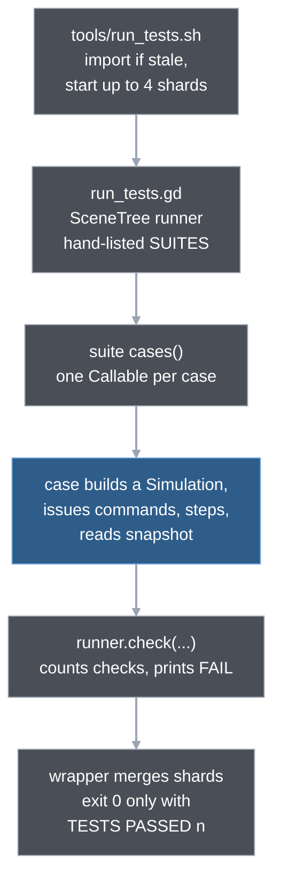
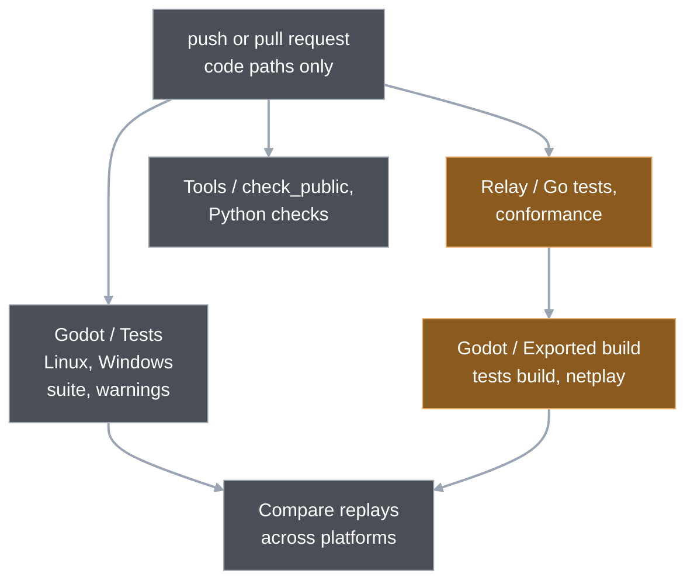

# 13. Testing and tooling

A deterministic simulation with no scenes can be tested the way a library is: build one, issue commands, step it, read the state back. Wargrid's test suite is that, run headless from a single hand-written runner, and it is the executable specification of the rules ([blueprint section 5](../blueprint.md#5-behavior-first-testing-strategy)). Around it sit small guards that scan the source text for things a test cannot see (private access, wall clocks, faction ids), a harness that measures the original game for comparison, and the CI and release workflows that run all of it on every push.

## What runs, in one picture

Everything below is started by a POSIX `sh` wrapper in `tools/`, resolves the repository root from its own path and takes the engine from `GODOT_BIN`.

The suite files are `game/tests/test_*.gd`; two more files, `combat_fixture.gd` and `economy_fixture.gd`, hold shared set-up. Beside the Godot suite there are three other kinds of check:

- **Static guards in Python** (`test_sim_boundary.py`, `test_sim_math.py`, `test_faction_guard.py`): read GDScript as text and fail on patterns. The other `tools/test_*.py` files test the tools themselves.
- **Local research tools** (`zh_ini.py`, `check_reference.py`, `zh_parity/`): need the retail data or, for `zh_parity/`, a Zero Hour source build, and never run in CI, except their synthetic self-tests.
- **Repository hygiene** (`check_public.sh`, lint, warnings, ruff, mypy, ShellCheck, actionlint).

## One test case, read end to end

The smallest useful example is in `game/tests/test_simulation.gd`: a command with a future tick must wait. The suite starts with a list of its cases; the runner calls each as `test_future_tick(runner)`.

1. The case builds a world: one simulation, one unit at a known position.  
   `world → Simulation.new; spawn`
2. It builds a move command for tick 2, sequence 0, player 1, and offers it to the simulation. The helper `accepted` asserts that the answer is exactly `{"ok": true, "error": ""}`.  
   `command(2) → accepted → Simulation.issue_command`
3. It steps twice and reads the whole state back as a snapshot. It asserts that the tick is 2, that one command is still pending, that the unit has no order and has not moved.  
   `step ×2 → snapshot → equal(...)`
4. It steps a third time, which is the tick the command names. Now the pending list is empty, the unit has the move order, and `check_first_motion` asserts that the unit is still at its start position with status moving. That is the start delay from [chapter 4](04-the-tick.md): the route is assigned, but the first tick of motion comes later.  
   `step → snapshot → check_first_motion`
5. Every assertion is `runner.check(condition, message)`. The helper `equal` builds a message of the form `C3 tick expected 2, actual 3` for every call but only the runner prints it, and only on failure.

Two details come from the runner, not the test. A case must return `true` and make at least one check, otherwise the runner records `FAIL: incomplete/empty case <name>`. That is why the file has `if state.entities.is_empty(): return false` before it indexes `entities[0]`: a missing unit becomes a reported failure instead of a script error. And the test never touches `sim._pending` or any other private member: it talks to `Simulation` only through the interface in [the simulation interface note](../reference/sim-interface.md). Many older files do not (see the boundary check below).

The label prefix (`C3`) is a convention: a short id for the rule a check pins, so a failure points at a rule, not a line.

## The runner

`game/tests/run_tests.gd` extends `SceneTree`, so Godot runs it as the main loop with `--script`. It holds one big constant `SUITES`, a list of `preload`ed suite files. That list is hand-written: a new suite file must be added to it, or it never runs. (The runner does not discover files; the blueprint's "no discovery plugins" rule, section 5.8, is deliberate.) For each suite it calls `cases()`, which returns the case functions. Rules the runner enforces:

- **Zero tests is a failure.** A suite with no cases, a run with no cases, and a run with zero checks each add a failure. A suite that fails to load quits with exit 1.
- **A case must prove it ran.** Returns anything but `true`, or makes no check: failure.
- **A watchdog.** One 180 second timer per runner process (one per shard) prints `FAIL: watchdog timeout in <case>`, naming the case running at that moment, and quits, so a hung case cannot hang CI. Its comment gives the reason: a slow case on a shared host must not look hung.
- **A final line.** `CASES n CHECKS n FAILURES n`, then `TESTS PASSED n` only when there are no failures. Exit code is 0 only then.

Two user arguments select cases. `--only=<text>` runs the cases whose suite path or function name contains the text. `--shard=i/n` takes every n-th case of the (filtered) list. The `run_tests.sh` wrapper maps `WARGRID_TEST_ONLY=<text>` to `--only` and runs one process. A full run starts up to four shards, one Godot process each (`WARGRID_TEST_SHARDS` overrides; the script caps it at 4 with a comment saying 8 shards measured no faster). `test_runner.gd` tests the shard and filter functions themselves.

The wrapper is where "success" is decided, because a Godot process can exit 0 after a script error:

- It runs the project import first, but only when something under `game/` is newer than a stamp file, and fails on any `ERROR:` or `SCRIPT ERROR:` line.
- It fails if any shard log holds an `ERROR:` line, if a shard never printed its `CASES` line, or if the merged check count is zero.
- It prints the merged summary and exits non-zero unless the last line matches `TESTS PASSED <positive number>`.

`WARGRID_TEST_EXE` points the same wrapper at an exported tests build instead of the editor binary. The export preset "Linux Tests" carries a `wargrid_tests` feature tag, and `project.godot` maps that tag to `WargridTestRunner` as the main loop, so the exported binary runs the suite when started. CI uses this to test the shipped export format on Linux and Windows.

`test_replay.gd` and `test_team_match.gd` write four replay traces when an environment variable is set (`WARGRID_REPLAY_TRACE` and three siblings); CI uploads them and compares platforms. That is [chapter 10](10-determinism-and-replays.md).

## Which tests exist, and what the blueprint asked for

The blueprint's test pyramid (section 5.2) lists unit, scenario, parity, replay, property, performance and visual tests. The suite matches it loosely:

- **Scenario tests** are most of it: economy, production, combat, construction, containers, defences, horde, rebuild holes, salvage and so on, one file per system, commands in and state out.
- **Replay and hash tests**: `test_replay.gd`, `test_state_hash.gd` (a pinned digest, plus one check per field that changing it changes the digest), `test_team_match.gd`.
- **Network tests**: `test_wire.gd`, `test_lockstep.gd`, `test_relay_transport.gd`, `test_online_scene.gd`.
- **Presentation tests, still headless**: scene scripts and HUD layout without a window (`test_scene.gd`, `test_base_scene.gd`, `test_pause_menu.gd`, `test_view_rows.gd`, ...). The project rule is that a HUD change gets a headless layout test.
- **Parity-style tests**: `test_supply_parity.gd` runs the collectors and checks credits per minute against Zero Hour values measured by the harness below (a 5 % tolerance constant, targets in a table that cites [the measured note](../reference/m7-supply-parity-measured.md)). One row is deliberately "reported, not gated".
- **Performance** is not in the suite: benchmarks are separate scripts in `game/benchmarks/` run by `tools/run_benchmark.sh` and `run_team_match.sh`, which have their own pass markers and pinned outcomes ([chapter 12](12-performance-and-platforms.md)).

Where the code differs from the blueprint, the code wins:

- The blueprint proposes JSON scenario fixtures in a `fixtures/` directory under `game/tests/`, with a parser and assertion names, and marks the schema as proposed. That directory does not exist. Scenarios are GDScript: commands and expected values sit in the test, helpers in the two fixture files.
- The blueprint's `PASS` / `UNVERIFIED_REFERENCE` / `INTENTIONAL_DEVIATION` statuses are not output by the runner, which knows only pass and fail. They appear in the verification notes (for example the movement and group-movement notes), where the "correctness is separate from parity" distinction is recorded by hand.

The suite size is a number that changes weekly; the [development notes](../development.md) and the per-milestone verification notes hold the counts.

## The simulation boundary check

A test that reads `sim._entities` ties itself to how the simulation stores things. Each such test would break if the data layout changes, which the performance work wants to do (chapter 12: packed arrays, a native core). `tools/test_sim_boundary.py` enforces the rule that new tests use only the interface:

- It collects every name that starts with an underscore and is declared as `var`, `const` or `func` in `game/scripts/simulation/`.
- It scans each test file, with comments removed, for `.<private name>` accesses.
- A file with hits fails unless it is on `ALLOWLIST`, a frozen list of 30 files that predate the rule. A second test fails when a listed file no longer has hits, so the list can only shrink.

Fixtures are in the same position: `economy_fixture.gd` pokes `_buildings` to place a finished building, and is allowlisted. The note's reason is portability: a native or repacked core can then run the same tests ([sim-interface](../reference/sim-interface.md)). The check is a text pattern, not a parser. It cannot see an access through a local alias, and its unit tests pin three access cases (flags a read, ignores a helper, ignores a comment) and that the private-name scan finds `_entities` and `_buildings`.

Two sibling guards work the same way (regular expressions over `game/scripts/`, with an exemption list):

- `test_sim_math.py` bans in simulation code what [determinism rules](../reference/determinism-rules.md) forbid: trig and exp/log calls, clocks (`Time`, `OS`, `Engine`), the random-number API and Godot's native `hash()`. Two files are exempt: the start-spot picker uses seeded random numbers for setup, and the state hash uses Godot's hash until a replacement digest lands.
- `test_faction_guard.py` bans faction ids in `simulation/` and `net/` outside `definitions/`, so factions stay data (the project rule in `AGENTS.md`).

## Reading Zero Hour: three separate tools

Wargrid is "inspired by" Zero Hour, and some numbers are tuned against it. Three tools support that. None runs in CI against real data, and none puts EA data in the repository.

**`tools/zh_ini.py`: a queryable dump of the shipped configuration.** `python3 tools/zh_ini.py dump` parses every block of the retail `INIZH.big` in place into `build/zh_ini/inizh.jsonl`, one JSON object per block with archive entry and line numbers. Findings are cited by archive entry and line, and the file is queried with `rg` or `jq` rather than with ad-hoc decoders, one of which once misread the format (blueprint section 7).

- The archive must match the SHA-256 pinned in `check_reference.py`, unless `--skip-hash`.
- The dump is written through a `.tmp` file and a rename into gitignored `build/`, and is never committed (`AGENTS.md`). Extracted values go into reference notes with their source.
- Its test builds a fixture archive in memory; the one real-archive test is skipped when the archive is absent.

**`tools/check_reference.py`: the value comparison.** It compares Wargrid's unit, building, weapon and armour numbers with the pinned INI data and prints the differences. Local only.

**`tools/zh_parity/`: measuring behaviour, not configuration.** Config says what a weapon's range is; it does not say what happens when a unit chases, turns, queues behind another or collects supplies. `parity.py` launches a fresh Zero Hour **source build** (a native macOS fork plus a small local patch) and drives it over the fork's localhost HTTP control API. Per scenario it spawns units on a flat strip, issues one order, and writes every logic frame to a tab-separated trace outside the repository. Properties that matter:

- **Always silent and headless.** The game starts with `-headless -noaudio`, and the harness asserts the game reports itself headless before it proceeds. The code comment gives the reason: a windowed run plays the game's audio at full volume.
- **Frames, not wall time.** The game runs uncapped and paused-stepped, so a scenario costs seconds, and traces are comparable frame by frame.
- **Sweeps.** `--repeats` and `--lanes` run several games in parallel on separate ports and pool the results; finished traces are skipped on rerun.
- **Metrics live in `analyze.py`.** It reads the traces and computes start delay, speeds, turn rates, shot intervals, time to kill, credits per minute. Each metric has an `EXPECT` row with Wargrid's value and a tolerance, and a verdict, including `ACCEPTED` for a decided offset.

The rule that matters for the code is the last one: **results are evidence for a decision list, never an automatic number change** ([parity harness](../reference/zero-hour-parity-harness.md), [Zero Hour verification](../reference/zero-hour-verification.md)). A result is labelled "measured (source build)": it is not the retail binary, and rendering, sound and UI feel are out of scope. The harness holds no EA code or data; the fork stays outside the repository. What CI runs is only the synthetic part: `analyze.py --self-test` and `tools/test_zh_parity.py`, which use made-up traces and no engine.

The bridge into the suite is a test like `test_supply_parity.gd`: a harness result, pooled over repeats, becomes a fixed target with a tolerance and a pointer to the note that holds the measurement. The test then protects the tuned behaviour from regressions without needing the original game.

## Static checks

- **`sh tools/run_lint.sh`** runs `gdlint game` (gdtoolkit 4.5.0, pinned in `tools/requirements-dev.txt`). `.gdlintrc` turns off five rules, mainly line length, which the code base ignores. `gdformat` was tried and not adopted.
- **`sh tools/run_warnings.sh`** runs each tracked `.gd` file through Godot `--check-only`, four at a time. `project.godot` sets six warnings to error level: untyped declaration, unused parameter, three kinds of shadowing and integer division. The script takes its file list from `git ls-files`, so a new file cannot escape the check; it fails on any `ERROR:`. Tests are exempt only from `untyped_declaration`, through `@warning_ignore_start` at the top of each test file. The plan's third step (the `unsafe_*` warnings) was skipped because the count was over its stop rule ([static checks plan](../superpowers/plans/2026-11-05-gdscript-static-checks.md)).
- **`sh tools/run_python_checks.sh`** runs `ruff format --check`, `ruff check`, `mypy`, then `run_python_tests.sh`, which runs every tracked `tools/**/test_*.py` except `test_install_godot.py` (it downloads Godot) as its own process, plus the harness self-test. Configuration is `tools/pyproject.toml`.
- **`sh tools/run_shell_checks.sh`** runs ShellCheck (shellcheck-py, pinned in `tools/requirements-dev.txt`) on every tracked `*.sh`. `.shellcheckrc` turns off SC1007, which misreads the `CDPATH= cd --` idiom; deliberate word splitting carries a `disable` comment at the spot.
- **`sh tools/check_public.sh`** exists because the repository is public and tracked files are engineering records. It fails when private working notes are tracked, and when tracked text matches patterns for a home path, a local hostname or LAN address, a tool session id or a personal mail address. A further word list lives outside the repository because the words would themselves be a leak; CI runs without it, and the script uses the list when present. `tools/test_check_public.py` tests the script against throwaway repositories. The fix for a hit is rewording, never loosening the pattern (`AGENTS.md`).

These checks are all text-level: lint and warnings find style and typing problems, the guards find forbidden patterns, and `check_public.sh` finds leaks. None proves a behaviour. The suite does.

## CI: what a push triggers

`.github/workflows/ci.yml` runs on push (except docs-only changes and Dependabot branches), pull request, manual start and as a reusable workflow. Godot is pinned to one version, downloaded with a checksum check. The jobs:

- **Godot / Tests** runs `run_tests.sh` on Linux and Windows with the four trace variables set, then, on Linux only, `run_warnings.sh`. It uploads the traces, and the log on failure. A separate **Godot / Lint** job runs `run_lint.sh`.
- **Relay / Test and conformance** runs `go vet` and `go test -race`, builds the relay for both platforms, and runs `run_conformance.sh`, the black-box protocol suite (chapter 11). **Relay / Lint** runs golangci-lint. **Docker** builds both images.
- **Godot / Exported build** (needs the relay job) exports the tests build and the game for each platform, runs the suite from the exported tests binary, and runs five netplay scenarios (`run_netplay.sh`: a real match, perturbation, relay down, maps, map mismatch) with the real game binary and the freshly built relay.
- **Compare replays** needs the test and export jobs and runs `tools/compare_replays.py` over the traces: Linux against Windows, then all four traces of one scenario together (editor and exported builds, both platforms), then the netplay trace pair. A platform difference in float behaviour shows up here as a first differing tick ([chapter 10](10-determinism-and-replays.md)). macOS is compared locally with `tools/compare_local_traces.sh RUN_ID`, because the hosted macOS runners were dropped from CI on 2026-11-03 ([development notes](../development.md#setup-and-commands)).
- **Tools / Python and shell lint, tests** runs `check_public.sh`, `run_python_checks.sh`, `run_shell_checks.sh`, and then an explicit list of tool tests. That list overlaps with `run_python_tests.sh` (which already runs every tracked tool test except `test_install_godot.py`); the explicit list is what also covers that one.
- **Workflows / Lint** runs a pinned actionlint, with shellcheck on the `run:` blocks.

Every job has a timeout, since the blueprint's CI contract relies on timeouts instead of GNU `timeout`.

## Release and the Godot pin

Two more workflows round it out.

**`release.yml`** starts on a pushed tag `v*`:

1. The `version` job fails the run unless the tag equals `v` plus `application/config/version` in `game/project.godot` (`tools/release_version.py`). The reason is in the plan: the relay rejects rooms whose clients send different build strings, so a stale version would put different simulations in one room.
2. The `tests` job calls `ci.yml` as a reusable workflow: the release runs the same gates, and nothing is built if they fail.
3. `build` exports Linux, Windows, macOS and Web, writes Godot's licence text, and packages the desktop zips with `LICENSE` and the map and audio notices.
4. `publish` runs in the GitHub Environment `production`, which needs a manual approval. For a normal release it deploys the relay, then the web build, each followed by a health check, then creates or updates the GitHub release. A prerelease tag (a version with a `-` suffix) builds and publishes a prerelease but skips both deploys. A rerun after a partial failure completes the release instead of failing on "already exists".

Pushing a release tag and approving the `production` environment are manual steps.

**`godot-release.yml`** runs weekly and opens an issue when a newer Godot stable exists than the pin in `ci.yml`. Pins are bumped by hand, in `ci.yml` and `release.yml` together, and a bump needs a green replay comparison.

## Trade-offs and limits

**The runner is deliberately small.** One `SceneTree` script, hand-listed suites, no discovery, no fixture language. The blueprint says to evaluate GdUnit4 when suite size or scene testing justifies it; no such migration is recorded. Cost: a suite file missing from `SUITES` is silently never run, and the runner reports only totals, not a per-suite count. Nothing compares `SUITES` with the directory, so a missing entry shows only as a check count that did not grow.

**The wrapper, not the runner, is the trust boundary.** Godot's exit code is not trusted. Success needs an exit code, the absence of `ERROR:` lines, every shard's final line and a positive check count. That design answers the real failure of "all green, zero tests ran".

**Text guards are cheap and shallow.** They catch a class of mistake the tests cannot (a banned call that happens to work on this machine), but a regular expression can be evaded and each has an exemption list, with the limits written next to the entries.

**Behaviour tests do not establish feel or speed.** The project rule is explicit: automated tests do not establish game feel or measured performance, Rendered checks open a window and are run by hand, benchmarks included.

**Parity evidence has a ceiling.** The harness measures a source build of the original, not the shipped binary; the parity tests assert tolerances on pooled measurements, not equality. Where the original contradicts itself, the test says so in a comment and reports instead of gating.

## Where in the code

- `game/tests/run_tests.gd` — the runner: `SUITES`, `check`, `shard`, `only_filter`, the watchdog, the summary lines.
- `game/tests/test_runner.gd` — tests of `shard` and `only_filter`.
- `game/tests/test_simulation.gd` — the worked example: `test_future_tick`, `test_tick_zero`, helpers `world`, `command`, `accepted`, `rejected`, `equal`, `check_first_motion`.
- `game/tests/economy_fixture.gd`, `combat_fixture.gd` — shared worlds and command senders (`make_world`, `send`, `build`, `steps`).
- `game/tests/test_supply_parity.gd` — a parity-derived test with the table of targets.
- `tools/run_tests.sh` — the wrapper: import stamp, shards, `WARGRID_TEST_ONLY`, `WARGRID_TEST_EXE`, summary.
- `tools/test_sim_boundary.py`, `test_sim_math.py`, `test_faction_guard.py` — source-text guards.
- `tools/zh_ini.py`, `check_reference.py` — INI dump and value comparison; `tools/test_zh_ini.py`, `test_check_reference.py`.
- `tools/zh_parity/parity.py`, `analyze.py`, `tools/test_zh_parity.py` — the Zero Hour harness and its synthetic tests.
- `tools/run_lint.sh`, `run_warnings.sh`, `run_python_checks.sh`, `run_python_tests.sh`, `run_shell_checks.sh`, `check_public.sh`, `.gdlintrc`, `.shellcheckrc`, `tools/pyproject.toml`, `tools/requirements-dev.txt`.
- `tools/run_benchmark.sh`, `run_profile.sh`, `run_team_match.sh`, `run_netplay.sh`, `run_conformance.sh`, `compare_local_traces.sh`, `export_build.sh` — other gates, covered in chapters 10 to 12.
- `.github/workflows/ci.yml`, `release.yml`, `godot-release.yml`, `.github/dependabot.yml`.
- `game/project.godot` — warning levels, tick rate, and the `wargrid_tests` main loop type; `game/export_presets.cfg` — "Linux Tests" and the other test presets.

## Further reading

- [Blueprint section 5](../blueprint.md#5-behavior-first-testing-strategy) — definition of done, evidence ladder, the CI contract.
- [Development notes](../development.md#setup-and-commands) — the commands, the CI paragraph, current suite counts.
- [Parity harness](../reference/zero-hour-parity-harness.md) and [Zero Hour verification](../reference/zero-hour-verification.md) — setup, scenarios, how results are recorded.
- [GDScript static checks plan](../superpowers/plans/2026-11-05-gdscript-static-checks.md) and [release workflow plan](../superpowers/plans/2026-11-06-release-workflow.md) — the decisions behind the gates.
- [Simulation interface](../reference/sim-interface.md) and [determinism rules](../reference/determinism-rules.md) — what a test may touch, what the guards enforce.
- Previous: [12. Performance and platforms](12-performance-and-platforms.md).

---
Checked against `2b108ab`. Files: `game/tests/run_tests.gd`, `game/tests/test_simulation.gd`, `game/tests/test_runner.gd`, `game/tests/economy_fixture.gd`, `game/tests/test_supply_parity.gd`, `game/tests/test_state_hash.gd`, `tools/run_tests.sh`, `tools/test_sim_boundary.py`, `tools/test_sim_math.py`, `tools/test_faction_guard.py`, `tools/zh_ini.py`, `tools/check_reference.py`, `tools/zh_parity/parity.py`, `tools/zh_parity/analyze.py`, `tools/run_lint.sh`, `tools/run_warnings.sh`, `tools/run_python_checks.sh`, `tools/run_python_tests.sh`, `tools/check_public.sh`, `.github/workflows/ci.yml`, `.github/workflows/release.yml`, `.github/workflows/godot-release.yml`, `game/project.godot`, `game/export_presets.cfg`
