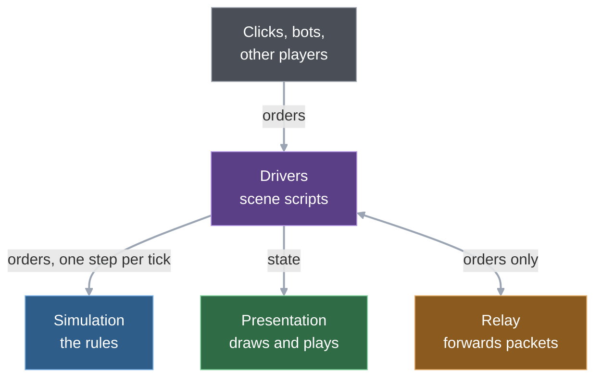

# Wargrid codebase guide

In an online Wargrid match, nothing about the battle crosses the network except the players' orders. Every machine runs the whole game itself: each one starts from the same map and start spots, receives the same player commands for each tick, and steps the same simulation. A small hash of the state, sent once a second (every 30th tick), tells the peers if one of them ever drifts. The price is discipline and waiting: every new rule must keep the simulation identical across platforms ([determinism rules](../reference/determinism-rules.md)), and an online tick cannot run until every seat's packet for it has arrived.

## The whole thing in one page

Diagram colours mark the layer, the same in every chapter: blue simulation, green presentation, purple drivers (scene scripts), orange network and relay, grey Godot, tools and tests.

1. **Rules and drawing are two programs in one.** The simulation holds the whole game and advances it in fixed steps; it knows nothing of screens, clocks or networks. The presentation only draws what it is handed, and thin scene scripts sit between them. [Chapter 1](01-big-picture.md).
2. **The world is a grid.** Every map is a rectangle of square cells, open or blocked, and drawing turns the cells into diamonds with two lines of arithmetic. Three of the four maps are converted from Zero Hour map files by a Python tool. [Chapter 2](02-world.md).
3. **Units are dictionaries; what they can do is data.** Every unit and building is a plain dictionary, and a read-only table of definitions says what a tank is. There is no "if faction is X" in the rules, so a new unit with existing abilities is a data row. [Chapter 3](03-entities.md).
4. **One function runs a tick, and commands are the only input.** `Simulation.step()` does everything in a fixed order, and the only way to ask for a change is a command. That single entry point makes lockstep, replays and desync checks possible. [Chapter 4](04-the-tick.md).
5. **Drawing is one big batch.** Each refresh turns the state into one packed list of coloured triangles plus a few sound requests. Shapes are baked once and copied, so the GPU draws them in a single call. [Chapter 5](05-presentation.md).
6. **Movement is deliberately simple.** Units are points on a four-way grid and nothing collides: a pathfinder, a step that models heading and speed, and an allocator that gives each unit in a group its own end cell. A planned milestone rewrites it; units going around each other exists only on a branch. [Chapter 6](06-movement.md).
7. **Money mostly comes from supply runs.** Credits enter when a collector unloads boxes at a depot (and from salvage crates), and leave when a building is placed or a unit queued. The shape follows Zero Hour, and the supply loop was measured against Zero Hour (a source build, through the parity harness). [Chapter 7](07-economy.md).
8. **Combat is cheap and identical on every machine.** Units look for targets on a staggered timer, every shot of a tick is computed before any damage is applied, and a unit that moved this tick does not fire. [Chapter 8](08-combat.md).
9. **The bot is just another player.** It looks at a snapshot once a second and issues ordinary commands, so it cannot do anything a human cannot. Today it is small and sees everything. [Chapter 9](09-ai.md).
10. **A desync is caught, not repaired.** Coding rules keep the rules reproducible, peers compare a fingerprint of the state once a second, and traces show that different operating systems reach the same state. [Chapter 10](10-determinism-and-replays.md).
11. **Online sends orders and nothing else.** A small relay server forwards each seat's packets, and a tick runs only when every seat's packet for it is in. A slow peer slows everyone. [Chapter 11](11-multiplayer.md).
12. **Speed is judged on a weaker machine.** Each cost gets a share of the target device's tick or frame time, divided by a measured slowdown factor, and the ledger records whether it fits. [Chapter 12](12-performance-and-platforms.md).
13. **Tests are the specification.** The simulation is tested like a library: build one, issue commands, step it, read the state back, all headless. Guards, a harness that measures the original game, and CI sit around it. [Chapter 13](13-testing-and-tooling.md).

## How to read it

Every chapter moves from overview to detail: why the system exists, a diagram, one real case traced through the functions, the mechanics, then what it costs and where it breaks. Stop after any layer. Start with chapters 1 and 4. The term list at the end is for lookup, not for reading.

1. [Big picture and time](01-big-picture.md): how is the game split, and who keeps the time?
2. [The world](02-world.md): what is a map, and how does a cell become a diamond on screen?
3. [Entities and definitions](03-entities.md): what is stored per unit, and what is looked up from data?
4. [The tick](04-the-tick.md): what happens inside one step, and how does an order get in?
5. [Presentation](05-presentation.md): how does state turn into pixels and sound?
6. [Movement](06-movement.md): how does a click become a unit that moves?
7. [Economy and building](07-economy.md): where does money come from, and where does it go?
8. [Combat](08-combat.md): who shoots whom, when, and how is that kept identical everywhere?
9. [AI](09-ai.md): how does the computer opponent play?
10. [Determinism and replays](10-determinism-and-replays.md): what keeps every machine identical, and how is a failure found?
11. [Multiplayer](11-multiplayer.md): what crosses the network, and what happens when a peer is slow?
12. [Performance and platforms](12-performance-and-platforms.md): how are speed limits set, and what runs where?
13. [Testing and tooling](13-testing-and-tooling.md): how is the game checked, built and released?

## Major decisions

Where each big choice lives: the decision log row, then the chapter that shows its consequences. Rows are in [blueprint section 14](../blueprint.md#14-decision-log).

| Decision | Chapter | Evidence |
|---|---|---|
| Simulation separate from presentation (no §14 row) | [1](01-big-picture.md) | [Blueprint §3](../blueprint.md#3-engine-language-tools), [simulation interface](../reference/sim-interface.md) |
| Fixed tick ("Simulation cadence") | [1](01-big-picture.md), [4](04-the-tick.md) | [Decision log](../blueprint.md#14-decision-log) |
| Map source: converted from a Zero Hour map | [2](02-world.md) | [Decision log](../blueprint.md#14-decision-log), [more maps](../reference/more-maps.md) |
| Faction model: capability data, no faction branches | [3](03-entities.md) | [Decision log](../blueprint.md#14-decision-log) |
| Artistic direction: isometric geometric 2.5D | [5](05-presentation.md) | [Decision log](../blueprint.md#14-decision-log), [art direction](../art-direction/ART_DIRECTION.md) |
| Game design: Zero Hour strengths, deliberate defect fixes | [7](07-economy.md), [8](08-combat.md) | [Decision log](../blueprint.md#14-decision-log), [Zero Hour verification](../reference/zero-hour-verification.md) |
| Bots: fair, same rules as a human | [9](09-ai.md) | [Decision log](../blueprint.md#14-decision-log), [fair bots research](../reference/fair-bots-research.md) |
| Multiplayer: deterministic lockstep through a relay | [10](10-determinism-and-replays.md), [11](11-multiplayer.md) | [Decision log](../blueprint.md#14-decision-log), [M5 verification](../reference/m5-verification.md) |
| Online connection: small relay with no game logic | [11](11-multiplayer.md) | [Decision log](../blueprint.md#14-decision-log), [relay stack spike](../reference/relay-stack-spike.md) |
| Performance target: browser next to desktop | [12](12-performance-and-platforms.md) | [Decision log](../blueprint.md#14-decision-log), [performance ledger](../reference/performance.md) |
| Language: GDScript first | [12](12-performance-and-platforms.md) | [Decision log](../blueprint.md#14-decision-log), [native simulation spike](../reference/native-sim-spike.md) |
| Testing: mandatory, concurrent with implementation | [13](13-testing-and-tooling.md) | [Decision log](../blueprint.md#14-decision-log), [Blueprint §5](../blueprint.md#5-behavior-first-testing-strategy) |

## Appendix: terms

Reference only: Wargrid's own meanings for words that appear across the chapters, checked against the code. Chapters introduce each term where it first matters. Paths are repo-relative.

- **Bot**: the computer opponent. The driver calls `Skirmish.issue_opponent` (or `issue_opponents`) before `step()` for the seats it wants played; the bot reads a snapshot and issues ordinary commands, so it cannot order anything a human cannot. A player's `controller` value (`"ai"`) does not start the bot; it switches a few combat rules for that player's units (`Combat.is_ai`: scan radius, re-targeting, retaliation). `game/scripts/simulation/skirmish.gd`, `game/scripts/simulation/combat.gd`.
- **Cell**: one square of the map grid. A position is a float pair `[x, y]`; its cell is the floor of both. Maps store cells as rows of characters, where `.` is walkable and any other character blocks. `game/scripts/simulation/map_data.gd` (`blocked_cells`), `game/scripts/simulation/grid_navigation.gd`.
- **Command**: a player request as a dictionary with `tick`, `player`, `sequence`, `type` and a payload per type. `Simulation.issue_command` validates and queues it; `_apply_orders` applies it at the start of the tick it names, in (tick, player, sequence) order. Once a match runs, every change of game state from outside goes through a command; the set-up and test-only calls are listed in [the simulation interface](../reference/sim-interface.md). `game/scripts/simulation/simulation.gd`.
- **Container**: a unit or building that other units can enter and leave (including shared tunnel networks). Entered units are "contained": they take no commands and travel with the container. Whether they shoot from inside is a per-container rule (`passengers_fire` in the definition's `contains`). `game/scripts/simulation/containers.gd`.
- **Crate**: a pickup left where a hostile salvager destroyed a vehicle. A salvager unit that reaches it gets credits or a weapon upgrade. It expires after a random time. `game/scripts/simulation/salvage.gd`.
- **Definition**: static game data for one kind: cost, build time, speed, hit points, weapon, footprint, what it produces. Definitions are plain dictionaries in one file per faction, read through the registry, never changed at run time. `game/scripts/simulation/definitions/definitions.gd` (registry), `game/scripts/simulation/definitions/usa.gd`, `game/scripts/simulation/definitions/china.gd`, `game/scripts/simulation/definitions/frc.gd`.
- **Determinism**: the same start and the same commands give the same state on every machine and run. Lockstep multiplayer and replays depend on it. The rules live in [determinism rules](../reference/determinism-rules.md); the check is a state hash (see Digest).
- **Digest (state hash)**: a short hex string that fingerprints the whole simulation state at one tick. Peers compare digests to detect desyncs. `game/scripts/simulation/state_hash.gd` (`digest`). Two hashes exist today: `StateHash.digest`, used by lockstep and the headless client, and the test traces' own SHA-256 of the snapshot (`game/tests/test_replay.gd` `_hash`). A Wargrid-specified digest is specified, not implemented ([determinism rules](../reference/determinism-rules.md#state-digest-specified-not-implemented)).
- **Driver**: the object the match screen holds that owns the `Simulation` and decides what one tick does and where a command goes; the screen calls its `step()` from `_physics_process`. Offline and online have one each. `game/scripts/match/offline_driver.gd`, `game/scripts/match/online_driver.gd`; the screen is the scene script `game/scripts/match/match_screen.gd`.
- **Faction**: a named set of definitions plus start data: start building and unit, build order, which buildings produce which units. Factions differ in data, not in simulation code paths. `usa`, `china` and `frc`. `game/scripts/simulation/definitions/factions.gd`.
- **Frame**: two unrelated things share this word. A rendered frame is one pass of Godot's `_process` (the presentation clock counts them). A wire frame is one text message between a client and the relay (`MAX_FRAME_BYTES`, `Lockstep.send`). Chapters say "rendered frame" or "wire frame" when it could be mixed up. `game/scripts/presentation/presentation_clock.gd`, `game/scripts/net/wire.gd`.
- **Hole**: for kinds that define `rebuild_hole`, the rubble left where a destroyed building stood, owned by the same player. A worker spawns there after a delay and rebuilds the building. `game/scripts/simulation/rebuild_holes.gd`.
- **Horde**: a bonus level a unit gets while enough allied units of the same kind or class (the rule's `match`) stand close together, recomputed on a timer per unit. Its definition carries the rule; the level lives in the unit's combat state. `game/scripts/simulation/horde.gd`.
- **Input delay**: lockstep stamps a command with the tick of the next packet to send, `delay` + 1 ticks ahead of the simulation's tick, so every peer has time to receive it before that tick runs; `delay` is the value the relay announces in `start`. `game/scripts/net/lockstep.gd`.
- **Interpolation**: drawing a moving unit between its previous and its current tick pose so motion looks smooth at a higher frame rate than the tick rate. Presentation only, on the highest graphics quality with the smooth option on; the simulation never sees it. `game/scripts/presentation/world_view.gd` (`_track_poses`).
- **Kind**: the string id of a definition, such as `usa_tank` or `china_barracks`. Units and buildings carry a `kind`; code looks the definition up with `Registry.kind(kind)`. `game/scripts/simulation/definitions/definitions.gd`.
- **Lockstep**: every peer runs the full simulation and only commands travel. A peer may step tick N only once it holds every seat's packet for N, so all peers stay on the same tick. `game/scripts/net/lockstep.gd` (`submit`, `receive`, `advance`).
- **Match**: one game from start to a winner. The simulation holds its state (`setup`, `ongoing`, ended) and ends it as won or drawn when at most one team still owns a building that counts for victory. `game/scripts/simulation/simulation.gd` (`start_match`, `_evaluate_match`).
- **Milestone (M0 to M9)**: a numbered stage of the plan in [blueprint §7](../blueprint.md#7-milestones-and-exit-criteria). Done: M0 project skeleton, M1 one vehicle, M2 groups and obstacles, M3 base and supplies, M4 combat, M5 online lockstep, M6 teams and a full-size map, M7 three factions. Proposed: M8 bots, M9 3v3 online. A decimal (M4.1, M5.1) is a follow-up from a playtest. "Ground batch A" is a planned, not yet designed milestone of ground-combat features (turret aiming, line of sight).
- **Path request**: a unit that needs a route waits in a queue with status `path_pending`. Only a limited number of requests are answered per tick, so a large move order spreads over several ticks. `game/scripts/simulation/simulation.gd` (`_service_paths`, `_assign_route`).
- **Presentation**: everything that draws, plays sound or shows UI. It draws the state the drivers hand it (from `view_state`) and never changes simulation state. `game/scripts/presentation/`.
- **Relay**: the Go server in `relay/`. It forwards each seat's per-tick packets to the other seats of a room, announces `start` with the delay and the match seed, and never runs the simulation. `relay/main.go`, `relay/room.go`.
- **Replay**: a run reproduced from its recorded commands alone, tick by tick. Tests compare per-tick hashes of two runs; the headless client replays a relay log and writes `StateHash.digest` rows. `game/tests/test_replay.gd`, `game/scripts/net/headless_client.gd` (`_replay_oracle`).
- **Seat**: a numbered slot in a match, from 1 up. A seat is also the player id inside the simulation (`command.player`, `owner`) and the number in a map's `starts`. Lockstep and the wire protocol identify peers by seat. `game/scripts/net/seat_sim.gd` (wraps the simulation so bot and scripted code, which call `issue_command`, go through lockstep; the online UI calls `Lockstep.submit` directly), `game/scripts/net/lockstep.gd`, `game/scripts/simulation/start_spots.gd`.
- **`shortcut:` comment**: the project's marker for a known, accepted limit in the code, written as `shortcut: <the limit>, <when to upgrade>`. Chapters list the ones that touch their system.
- **Simulation**: the authoritative game state and the rules that advance it, in `game/scripts/simulation/`. It knows nothing of scenes, rendering, wall-clock time or the network, and advances only through `step()`. `game/scripts/simulation/simulation.gd`.
- **Skirmish**: a match against bots: the offline game mode, and the standard setup (`Skirmish.create`) that also hosts the bot logic. `game/scripts/simulation/skirmish.gd`, `game/scripts/match/offline_driver.gd`.
- **Snapshot**: a full copy of the simulation state as plain data (route arrays are shared read-only, everything else is copied), with entities sorted by id. Used for digests, tests and the full state a UI needs. `view_state` is its lighter sibling for drawing. `game/scripts/simulation/simulation.gd` (`snapshot`, `view_state`).
- **Supply**: the economy resource. Supply sources are piles of boxes on the map; collector units carry boxes to a supply center building and the owner is paid credits per box. `game/scripts/simulation/supply_collection.gd`.
- **Tick**: one fixed step of simulation time and the only clock the simulation has. `step()` advances it by one; commands, build times, cooldowns and timers are counted in ticks. The tick rate is 30 per second, set in `game/project.godot` (`physics/common/physics_ticks_per_second`) and decided in the [blueprint decision log](../blueprint.md#14-decision-log) ("Simulation cadence"). `game/scripts/simulation/simulation.gd`.
- **Trace**: a file with one row per tick (or per fixed interval) holding the tick and a hash of the snapshot (SHA-256 in `test_replay.gd`; the headless client's hash log holds `StateHash.digest` every hash interval), written by a test run. Traces from different operating systems are compared to prove the simulation is identical everywhere. `game/tests/test_replay.gd`, `tools/compare_replays.py`, `tools/compare_local_traces.sh`.
- **View rows**: the unit part of `view_state`, stored column by column in packed arrays (`id`, `owner`, `kind`, `hp`, `x`, `y`, `status`, `flags`, ...) instead of one dictionary per unit. Presentation reads them by row index; `index_of` finds a unit's row by id. `game/scripts/simulation/view_rows.gd`.

---
Checked against `60b6674`. Files: the chapters listed above.
